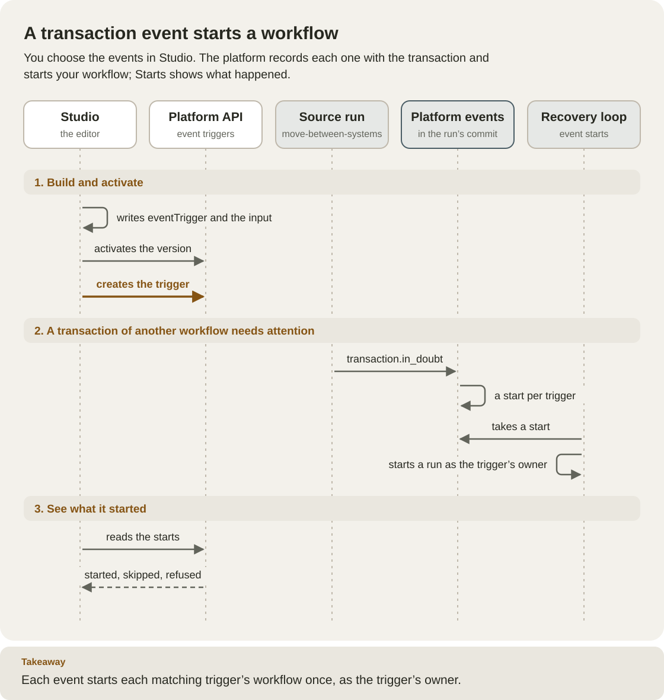

<!--
Copyright 2026 Firefly Software Foundation.

Licensed under the Apache License, Version 2.0 (the "License");
you may not use this file except in compliance with the License.
You may obtain a copy of the License at

    http://www.apache.org/licenses/LICENSE-2.0

Unless required by applicable law or agreed to in writing, software
distributed under the License is distributed on an "AS IS" BASIS,
WITHOUT WARRANTIES OR CONDITIONS OF ANY KIND, either express or implied.
See the License for the specific language governing permissions and
limitations under the License.
Author: Firefly Software Foundation
SPDX-License-Identifier: Apache-2.0
-->

# Undo steps together with a transaction

A **Transaction** step (`transaction`) groups steps that change other systems,
so that either all of them go through or what they did is undone. Each step
inside it that changes data says how it is undone, and Weave runs those undos
for you, in reverse order, when something fails, when the run is canceled, or
when it times out. This guide runs the example under
`examples/language/move-between-systems.workflow.yaml` and shows what to do
when a transaction is **in doubt**: when Weave can't tell, on its own, what
happened in another system.

## Before you start

You need a platform that lists `flow.transaction` in its language manifest
(`weave remote capabilities` shows `language_features`), the `developer`,
`deployer`, and `operator` roles in an environment, and a signed-in CLI
([Connect the CLI to a platform](connect-to-api.md)). Resolving a transaction
in doubt by saying how it ended, or ending it by force, also needs the
`transaction_reconciler` role.

## 1. Say how each step is undone

The example moves a quantity from one system to another. It reserves the
quantity in the source, adds it to the target, and then submits the order,
which can't be undone:

```yaml
- id: move
  kind: transaction
  businessKey: {ref: /input/moveId}
  steps:
    - id: hold            # reserves: confirmed later, or released
      confirm: {kind: action, uses: source-system.confirm-hold@1.0.0, ...}
      cancel: {kind: action, uses: source-system.release-hold@1.0.0, ...}
      holdSeconds: 600
    - id: add             # reversed by a called workflow
      compensate: {kind: callWorkflow, uses: reverse-target-addition@1.0.0, ...}
    - id: submit          # can't be undone, so it comes last
      irreversible: true
```

The compiler checks every path before you publish: every step that changes
data says how it is undone, the step that can't be undone comes after every
step that can, and reservations last longer than that step takes. The full
rules are in [Workflow language: Transactions](../contracts.md#transactions).

## 2. Publish, activate, and run it

Publish `reverse-target-addition` and activate it, then publish and activate
`move-between-systems`, pinning the reversal like any call
(`--pin-current-calls`). Start a run as usual. When every step succeeds, Weave
confirms the reservation and the transaction is `completed`:

```bash
weave runs transactions "$RUN_ID" --output json
```

Each item names the transaction, its state, its business key, each step's key,
how it is undone and where it stands, and never a business value.

## 3. What Weave does when something fails

| What happened | What Weave does |
| --- | --- |
| A step before the order fails | Undoes the steps that went through, newest first: it reverses `add`, then releases `hold`. The transaction is `compensated` and the run fails with `WV-TXN-ROLLED-BACK` |
| A step failed and its worker says nothing was applied | Skips undoing that step; only what went through is undone |
| A reservation is about to expire | Undoes the transaction before it does (`WV-TXN-HOLD-EXPIRED`) |
| You cancel the run, or it times out | Undoes the open transaction first, then ends the run canceled or timed out |
| The order is in flight when you cancel | Waits for its result: if it went through, the transaction finishes; if it definitely failed, it is undone |

An undo is retried on its own (by default up to 10 times over up to a day). The
run's log says what is being undone and why: `move: undoing 2 steps after add
failed (UNAVAILABLE)`.

## 4. Resolve a transaction in doubt

When an undo or a confirm can't finish, or nobody knows whether the order went
through, the transaction is **in doubt**. The run stops behind a high-priority
incident (`WV-TXN-UNDO-STUCK`, `WV-TXN-CONFIRM-STUCK`,
`WV-TXN-AFTER-PIVOT-STUCK`, `WV-TXN-PIVOT-UNKNOWN` or `WV-TXN-SETTLE-TIMEOUT`)
whose `transaction` field lists each step and the ones still pending. Nothing
but a person's decision moves it. Check the other systems first, then choose:

| Decision | Kind | When |
| --- | --- | --- |
| **Retry the undo** (or the confirm) | `retry_safe` | The cause is fixed. An action runs again with the same operation key and a fresh time limit, and undoing resumes where it stopped. An undo or confirm that calls a workflow starts a new child run instead, whose steps get new operation keys, so that workflow must receive `/participant/operationKey` in its `with` and refuse a duplicate by it |
| **Mark as reconciled** | `accept_reconciled_result` with a reconciliation record | You fixed things by hand. Say how the transaction ended (`compensated` or `completed`) and what happened to each stuck step; with `completed`, give the block's output, which later steps read. While the run would go on after the block, `completed` is refused (HTTP 422) when the block can never complete, because every way through it reaches a Fail step: use Force end, or `compensated` if everything was undone |
| **It happened** | `accept_reconciled_result` with the step's output | The order went through. Weave confirms the reservations and runs the steps after it |
| **It didn't happen** | `accept_reconciled_failure` | The order never went through. Weave undoes the steps before it, even when the step has an On error setting |
| **Force end** | `terminate` | Stop here: nothing more is done or undone. The run ends canceled and what was applied stays applied |

Mark as reconciled is refused (HTTP 409 `WV-RUNTIME-STATE`) while an attempt of
one of the transaction's steps has just failed and Weave still handles that
failure: wait a moment and send it again. Only a failure that Weave still
handles is refused. When the rollback stops a failed step first (for example,
the hold time passes or the run is canceled), that step is never tried again, so
it doesn't delay your decision, but its `WV-TASK-FAILED` incident stays open
until the run ends. After a `completed` record, a run that isn't already ending
stays suspended behind that incident, and you can only end it: cancel the run,
or resolve the incident with `terminate`.

Once a person ends a transaction, a late result of its work changes nothing: a
worker's report is refused with HTTP 409 `WV-LEASE` (or, when the run ended
failed or canceled and the lease had not expired, kept as an `ignored` receipt),
and a called workflow's result stays with its call. Weave doesn't count these,
so if a worker logs one, check the record against the systems involved.

Retry needs `incident.resolve`. The others also need `transaction.reconcile`,
an audited reason, and (except Force end) an evidence reference. See
[Incident operations](../reference/incident-operations.md#transactions-in-doubt)
for the request bodies.

## 5. Stop a run without undoing it

A reconciler can cancel a run without undoing its open transactions: they end
`force_ended` and `external_effects_may_continue` is `true`.

```bash
weave runs cancel "$RUN_ID" --request cancel.json   # {"reason": "...", "skip_undo": true}
```

While one of the run's transactions is in doubt, this cancel is refused with
HTTP 409 `WV-TXN-IN-DOUBT` and changes nothing. Resolve that transaction's
incident instead: its **Force end** is the one way to end a transaction in doubt
without deciding how it ended.

## 6. React to a transaction

A workflow can start when a transaction ends or goes in doubt, for example to
tell a team that a move is in doubt or to open a ticket. The events are
`transaction.completed`, `transaction.compensated`, `transaction.cancelled`,
`transaction.in_doubt`, `transaction.reconciled`, and
`transaction.force_ended`.



**How to read this diagram:** Read down. Someone creates the trigger once; each
event of a matching transaction then starts one run as the trigger's owner.

[Open diagram at full size](../diagrams/react-to-a-transaction.svg).

**From Studio,** add the **Platform event** trigger: Studio writes the
declaration and the input below, tests the workflow with a sample event, creates
or moves the trigger when you activate, and lists what it started under
**Starts**. [React to a transaction in Studio](studio.md#react-to-a-transaction)
has the steps. The rest of this section does the same with a definition file and
the command line.

### Declare the events the workflow accepts

The workflow lists the events in `eventTrigger` and takes the platform event as
its input:

```yaml
apiVersion: weave/v1alpha1
kind: Workflow
metadata: {name: notify-team, version: 1.0.0}
spec:
  inputSchema: {$ref: weave.platform-event-v1}
  outputSchema: {}
  eventTrigger:
    events: [transaction.in_doubt, transaction.compensated]
    from: [move-between-systems]   # optional: only these source workflows
  steps: [...]
  output: {ref: /input/transaction/business_key}
```

`weave.platform-event-v1` is a schema name the platform reserves and supplies
to every compile. An input schema the event can't fill fails to compile
(`WV-COMP-TYPE_MISMATCH` at `/spec/inputSchema`), and one the compiler can't
prove gets a warning (`WV-COMP-UNKNOWN_COMPATIBILITY`); the run's input is
checked when it starts either way. A workflow reacts to its own events only
when its `from` names it.

Steps read the event under `/input`, such as `/input/type` or
`/input/transaction/business_key`. A field every event carries compiles without
warnings. `cause`, `incident_id`, and the lists under `steps` are only in some
events, so a plain read of one warns `WV-COMP-REFERENCE_PRESENCE`; read it with
`coalesce`, or check it with `exists` first:

```yaml
incident:
  op: {name: coalesce, args: [{ref: /input/transaction/incident_id}, {literal: ""}]}
```

### Bind it to the events

Activate the workflow, then bind the activation to some or all of the events it
declares:

```bash
weave triggers events create --request trigger.json
```

```json
{"name": "notify-on-doubt", "activation_id": "<activation id>",
 "events": ["transaction.in_doubt"], "source_workflows": ["move-between-systems"]}
```

| Rule | What happens |
| --- | --- |
| The binding asks for an event or a source workflow the version doesn't declare, or names the workflow itself when its `from` is omitted | Refused with `422 WV-TRIGGER-EVENTS` |
| `source_workflows` is omitted | The workflow's `from` applies, or any workflow when it has none |
| An environment already has 64 enabled triggers | Refused with `409 WV-TRIGGER-LIMIT` |
| Another enabled trigger has the name | Refused with `409 WV-TRIGGER-CONFLICT` |

Creating a trigger needs `trigger.manage`, `run.start`, and `run.read`, and
`transaction.reconcile` when the request sets `may_reconcile`, which lets the
trigger's runs resolve their transaction once workflows can resolve
transactions; until then it has no effect. Each run starts
as the trigger's owner, who must still hold `run.start` and `run.read` when it
starts: the run receives what the event says about a transaction. A trigger's
events and sources can't be edited. When you activate a new version of the
workflow, move the trigger to it with `POST …/event-triggers/{id}/retarget`,
sending the trigger's revision in `If-Match`; the new version must still declare
the trigger's events and sources. The trigger keeps the starts it recorded, and
its later runs, including starts already requested, run the new version as the
person who moved it, who needs what creating it needs. See
[Move a trigger to another version](../reference/api.md#move-a-trigger-to-another-version).
To ask for other events, disable the trigger with
`weave triggers events disable "$TRIGGER_ID"` and create another; disabling
works even when the project's quota is spent, and no run starts after it
returns. Over HTTP, send the revision you read in `If-Match` to stop the trigger
only if nobody moved it since: otherwise the stop answers `409 WV-REVISION` and
the trigger keeps running.

### What a reaction receives

The run's input is the platform event: its `event_id`, `type` and `emitted_at`,
and under `transaction` the source workflow and run, the transaction's instance
key, business key and state, the cause when it left its normal path, its steps
by key (`done`, `undone`, `pending`) and how each is undone, the incident when
it is in doubt, and whether the source run was a test. It never carries step
inputs or outputs. The run's business key is the transaction's, and its origin
shows as **Platform event** (`event`).

### How often reactions start

Each event starts each matching trigger's workflow once, shortly after the
event. Events of test runs start nothing. A reaction whose own transaction
emits events can start further reactions, so the platform bounds each chain:

- **Depth.** A run that a platform event started is one reaction deep; a run it
  calls, or a retry of it, stays at that depth. Events of a run three
  reactions deep start nothing (`WV-TRIGGER-EVENT-DEPTH`).
- **Budget.** A chain makes at most 64 starts in all, counted by the event that
  began it, so a run that emits E transaction events can cause up to 64 × E
  reactions. When an event would pass the budget, the triggers with the
  lowest IDs get the starts left and the rest are skipped
  (`WV-TRIGGER-CHAIN-BUDGET`).
- **Outside systems.** A reaction whose effect comes back through another
  system, as a webhook or a broker message, starts a new chain at depth 0 with
  a new budget.
- **Held starts.** A start the platform can't accept yet (a spent quota, a busy
  lock, capacity) keeps its place in the budget and is tried again for up to
  24 hours, so later events of the chain may be skipped while it waits, once
  all 64 places are taken. A chain whose held starts expire can end with fewer
  than 64 runs.

### Read what a trigger started

`weave triggers events starts "$TRIGGER_ID"` lists each event offered to the
trigger, newest first, with its status (`requested`, `started`, `rejected` or
`skipped`), the run it started, and the event that began its chain
(`root_event_id`). Reading it needs `trigger.manage` and `run.read`. A refused
start never suspends a run or opens an incident:

| Code | Meaning |
| --- | --- |
| `WV-TRIGGER-START` | The run couldn't start. `cause` says why, for example `WV-FORBIDDEN` (the owner lost `run.start` or `run.read`, or was deactivated), `WV-READINESS` (the activation was retired), or `WV-RUNTIME-INPUT` (the event doesn't fit the input schema) |
| `WV-TRIGGER-DISABLED` | The trigger was disabled before the run started |
| `WV-TRIGGER-EVENT-DEPTH` | The source run was three reactions deep |
| `WV-TRIGGER-CHAIN-BUDGET` | The chain already had 64 runs started or waiting to start |
| `WV-TRIGGER-START-EXPIRED` | The platform couldn't start the run within a day of the event |

The `weave.event_starts` metric counts starts by status (`ok`, `rejected`,
`blocked`).

## See and resolve transactions in Operations

Studio's **Operate** pages show every transaction of the environment and offer
the decisions of steps 4 and 5. Each needs its own permission:

| To | You need | Roles that hold it |
| --- | --- | --- |
| See transactions in **Runs** and in a run's detail | `run.read` | `viewer`, `execution_manager` |
| See their counts in **Overview** | `status.read`, as the whole page, and `run.read` | `viewer` |
| See the transactions in doubt in **Incidents** | `incident.read` | `operator` |
| Retry, or wait again | `incident.resolve` | `operator` |
| Make any other decision on a transaction in doubt | `incident.resolve` and `transaction.reconcile` | `operator` with `transaction_reconciler` |
| **Cancel run** | `run.cancel`, and `run.read` for the run's detail | `operator` with `viewer` |
| **Cancel without undoing** | `run.cancel` and `transaction.reconcile`, and `run.read` for the run's detail | `operator` with `viewer` and `transaction_reconciler` |

An incident's decision that you may not make stays in view, disabled, with the
role it needs.

A business key shows as text on these pages. It never enters an address, a page
title, a notice, the name of an exported file, or a request to Weave AI.

### Find the runs that need attention

In **Operate › Runs**, the **Transaction** column shows the state of the run's
worst transaction: **Open**, **Deciding**, **Finishing**, **Completed**,
**Undoing**, **Undone**, **Canceled**, **In doubt**, **Reconciled**, or **Force
ended**. A run without transactions has none.

Check **Needs attention** to list only the runs with a transaction in doubt, or
choose any states under **More filters › Transaction**. Both look in the time
range you chose, and the list says which when it finds none.

### Read what a transaction did

A run's detail has a **Transactions** section after its graph. Each transaction
shows its state, its business key, and why it left its normal path, and then a
row per step: how it is undone, what happened forward and in its undo or
confirm, how many tries that took, the run it called, and its operation key to
copy into the other system. Below them are the moments of the transaction and,
once someone resolved it, how, why, and with what evidence. A transaction that
completed with nothing to resolve folds to one line.

In a transaction in doubt or force ended, look for these two words first. They
mark what other systems still hold:

- **Still reserved**: the reservation was made, and nobody confirmed or released
  it.
- **Not undone**: the step went through, and nothing reversed it.

### Resolve a transaction in doubt

**Operate › Incidents** lists the transactions in doubt first, under **High
priority**, each with its business key. When a run waits for a called run that
is in doubt, both incidents are one **case** that names the one to resolve
first: the called run's. Its drawer names the waiting run under **Held by**, and
the waiting run's names the called one under **Waits on**.

The notice of a run that stopped for a transaction leads there too. **Open
incident** opens the incident of the transaction in doubt, and **Go to the
transaction** shows its record in the run; of several in doubt, both lead to the
first. When Studio can't tell which incident that is (the run is held, its
transactions couldn't be read, or the one in doubt isn't listed yet), **Show in
Incidents** lists the active incidents with its code, those of test runs too.

Open an incident to read its record and choose among the decisions that fit it:

| Decision | Offered when | Asks for |
| --- | --- | --- |
| **Retry the undo**, **the release**, **the confirm**, or **the step** | That is what couldn't finish | A reason |
| **Wait again** | Steps were still running when the time to undo ran out | A reason |
| **Mark as reconciled** | Any of those | How it ended, the steps you checked, the transaction's result when it finished, a reason, and an evidence reference |
| **It happened** or **It didn't happen** | Nobody knows whether the step that can't be undone went through | The step's result (only when it happened), a reason, and an evidence reference |
| **Force end** | Always; it is the only one for a run too large to undo | A reason, and the run's short ID typed |

**Mark as reconciled** lists every step whose end Weave doesn't know for the
ending you choose, with its operation key. Check each one in its own system
before you tick it. With **Undone**, you confirm that each step was reversed, was
released, or has nothing left to undo, and that a step still running is stopped;
with **Finished**, that each one was confirmed or went through. Weave then stops
whatever is left and takes your word, so a step you didn't check stays as that
system has it.

**Force end** first lists what **stays done in other systems**.

If someone changed the incident meanwhile, Studio asks you to refresh it. When a
step changed too, you tick the steps again; what you typed stays. If the answer
to your decision was lost, send it again unchanged: the same receipt makes that
safe.

### Stop a run from its detail

**Cancel run** on a run with a transaction that isn't finished undoes it before
the run ends. **Cancel without undoing** lists what stays done in other systems
and asks for a reason and the run's short ID. While a transaction is in doubt,
neither is sent: **Open incident** takes you to the decision it waits for. A run
held because it grew too large to undo its transactions can't be canceled either
way: force end it from its incident.

### Know when a transaction is in doubt

**Operate › Overview** counts the transactions in doubt and those being undone,
with the age of the oldest, and lists in-doubt incidents first among the
incidents that need attention. **Show runs that need attention** opens the runs
of the last 400 days with a transaction in doubt. The counts leave out the
records that an earlier release left unsettled in ended runs; **Needs attention**
in Runs, and so that list, still includes those runs.

Every environment has the alert rule **Transactions in doubt** (critical, at
once). See [Alerts](../operations/observability.md#alerts) for the rule and the
two signals about transactions.

## Test a step that takes part in a transaction

A debug session simulates a transaction with mocks for each step and for its
confirm, cancel, and undo; see
[Simulate transactions](../reference/simulation.md#simulate-transactions).
A simulation can't show how the systems you call behave. Check a step against
your own worker or PostgreSQL database with `weave transactions conformance`:
it sends the step's requests in every order Weave can deliver them (a repeat, a
cancel of a step that never ran, the step after its cancel) and reports each
check. [Make a system safe to undo](transaction-participants.md) explains the
command, the SDK's fence, and what the PostgreSQL connector records.

The check doesn't wait for a reservation to expire, so also try this by hand on
a test activation: confirm a reservation after it expired; the confirm must fail
with a code the action lists in `definiteFailures` or report `effect: none`.

## Next steps

- [Make a system safe to undo](transaction-participants.md)
- [Workflow language: Transactions](../contracts.md#transactions)
- [Worker protocol: tasks of a transaction](../reference/worker-protocol.md)
- [Integration events: transaction events](../reference/integration-events.md)
- [API reference: platform-event triggers](../reference/api.md)
- [History and replay](../reference/history-and-replay.md)
