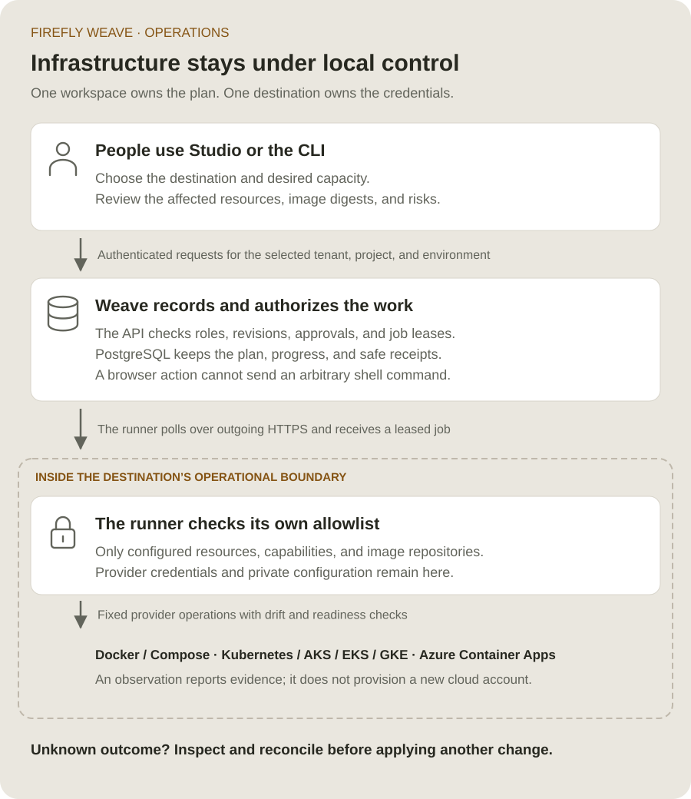
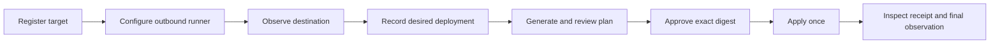
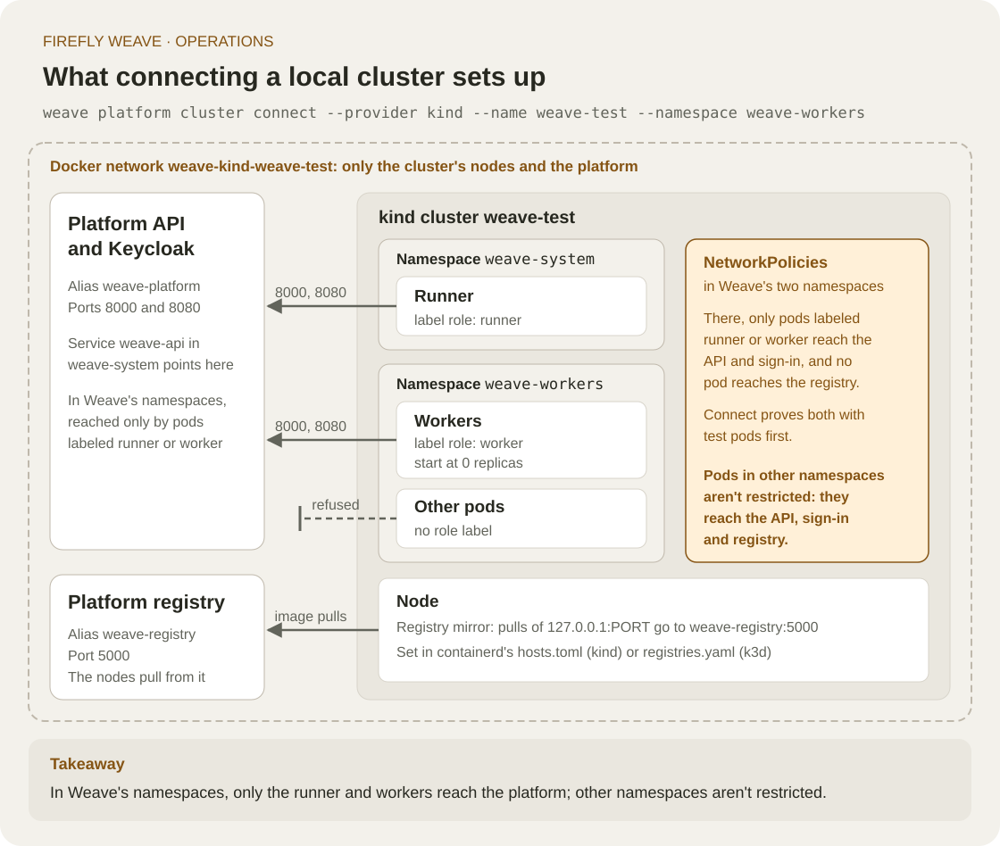
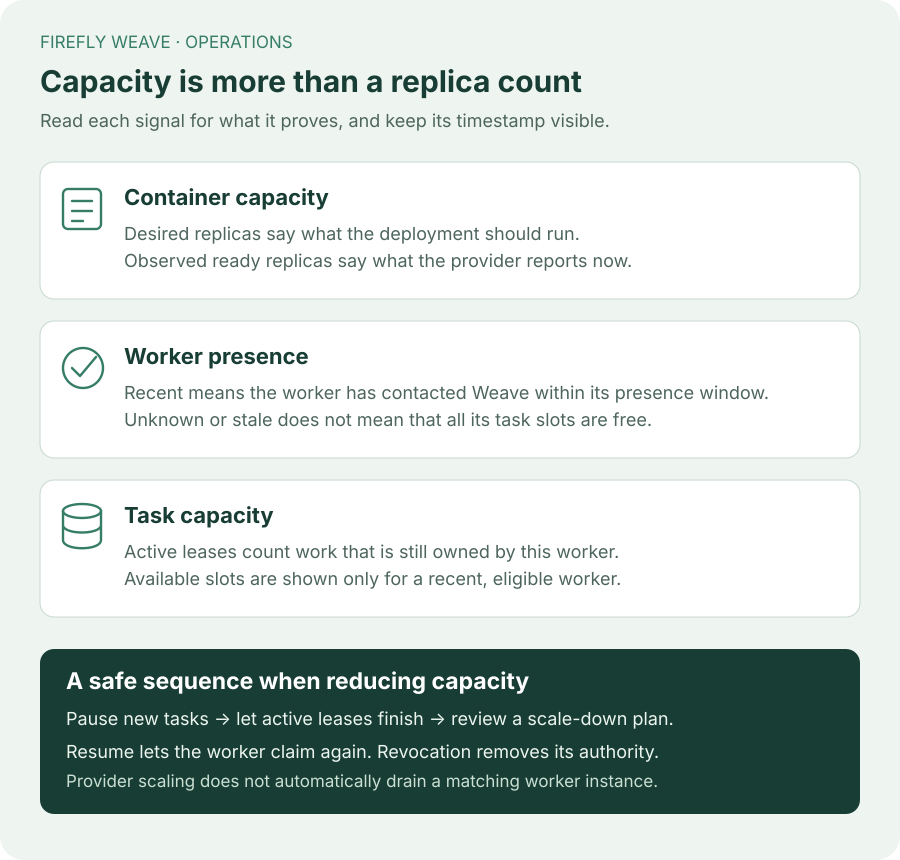
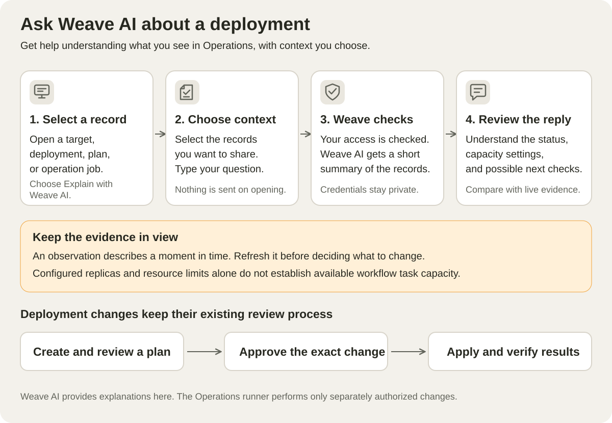

<!--
Copyright 2026 Firefly Software Foundation.

Licensed under the Apache License, Version 2.0 (the "License");
you may not use this file except in compliance with the License.
You may obtain a copy of the License at

    http://www.apache.org/licenses/LICENSE-2.0

Unless required by applicable law or agreed to in writing, software
distributed under the License is distributed on an "AS IS" BASIS,
WITHOUT WARRANTIES OR CONDITIONS OF ANY KIND, either express or implied.
See the License for the specific language governing permissions and
limitations under the License.
Author: Firefly Software Foundation
SPDX-License-Identifier: Apache-2.0
-->

# Manage container deployments

Operations connects an existing container destination to Weave, records what
is there, and sends reviewed changes to a runner beside that destination.
It does not create a cloud subscription, Kubernetes cluster, network, or
identity provider. Provision those foundations with your existing infrastructure
tools before registering a target. To try a Kubernetes target on your own
computer instead, a local platform creates and connects a test cluster for you;
see [Connect a kind or k3d cluster on this computer](#connect-a-kind-or-k3d-cluster-on-this-computer).



This guide follows the same sequence in Studio and the CLI:



## 1. Prepare the destination and identities

Use a running Weave API, a saved CLI or Studio platform connection, and an
existing Docker Compose project, Kubernetes namespace, or supported cloud
container destination. The runner host needs the corresponding provider CLI,
network access to the destination and Weave API, and locally provisioned
provider credentials. The browser and Weave database do not receive those
credentials.

An administrator creates a dedicated **application** principal and links its
verified machine identity using the existing
[identity and membership commands](../guides/people-and-access.md).
Do not use a worker principal or copy a person's Studio token. Record this
application's ID when registering the target. After the target has an ID,
grant `deployment_runner` in its exact environment, with `resources` containing
only that target ID. The runner must authenticate as the same application.

Give people only the roles they need:

| Person or application | Role |
| --- | --- |
| Inventory reader | `deployment_reader` |
| Target registrar and desired-deployment editor | `deployment_planner` |
| Plan reviewer | `deployment_approver` |
| Operator applying or cancelling a reviewed change | `deployment_operator` |
| Dedicated runner application | `deployment_runner`, restricted to its target |

Target creation requires an environment-level planner grant because its target
ID does not exist yet. Subsequent work can use target-resource grants. The
approver and operator may be separate people; reconciliation requires both
roles. Signing in, being a workflow developer, or seeing a registered worker
does not grant deployment authority.

## 2. Register an existing target

In Studio, open **Operate › Clusters → Register target**. Choose the adapter, the
existing destination's pinned identity and boundary, the dedicated runner
application, and capabilities that its local policy will support. Administrators
can select active application accounts by their available display label. Other
planners can expand the administrator-provided application ID option. Use
**Settings → People and access** to create/link the application and assign roles;
provider credentials stay outside Studio. Kubernetes supports observation,
updates, worker scaling and worker restarts; only Compose offers deployment of
its trusted local template. For Azure Container Apps, start with observation only. After the
specific environment passes acceptance, limit its target and runner policy to
`observe` and `update`; keep `scale_workers` disabled. The
[Azure capacity boundary](operations-runner.md#azure-container-apps) explains why.
Registration records metadata; it does not verify provider access or deploy
anything.

The CLI equivalent uses a `TargetRequest` JSON file:

```sh
weave operations targets create --request target.json \
  --idempotency-key register-target-01
```

Example `target.json` for Docker Compose; replace the illustrative daemon
identity and principal ID with your actual non-secret identifiers:

```json
{
  "name": "team-runtime",
  "adapter": "docker-compose",
  "external_identity": "pinned-docker-daemon-id",
  "boundary": "team-weave",
  "runner_principal_id": "00000000-0000-0000-0000-000000000001",
  "capabilities": ["observe", "deploy", "update", "scale_workers"]
}
```

Save the returned target ID. Grant the runner role now, with that ID in the
binding's resource list. Configure only capabilities actually supported by the
chosen adapter; a backend enum is not proof a destination supports an action.

## 3. Configure and start the outbound runner

The target page shows setup steps and **Download setup template**, containing
its known API origin, workspace, pinned destination and target ID. Save it privately
on the runner host, then complete the local context, component allowlist, image
repositories and credential-file references there. It is an incomplete,
observation-only template, not a credential or installation bundle. Studio never
executes these commands or treats registration as provider readiness.

On the runner host, use the same package version as the platform:

```sh
weave operations runner setup --output /absolute/private/runner.json
weave operations runner check --config /absolute/private/runner.json
weave operations runner run --config /absolute/private/runner.json
```

Setup writes a new private local file. Supply the exact workspace and target
IDs, pinned provider identity, explicit provider context, allowed component
names and image repositories, and the path to the dedicated machine's OAuth
configuration. The OAuth file and cloud credentials remain local.

**Check** validates local policy and reads the destination; it does not register
the runner or apply a job. **Run** registers and polls for authorized work.
Operate it under your existing service supervisor. A runner's recent contact
shows presence, not container health or worker task capacity.

## 4. Observe, then record desired components

Open the target in Studio and select **Observe target**. Wait for its durable
operation to succeed. Inspect the dated observation, its completeness, and
resource ownership before choosing **Record desired deployment**. Select observed
components to copy their names, immutable images and replica counts into the draft.
Enter local configuration aliases, CPU and memory limits explicitly: observations
do not report them. Worker components offer admitted releases when you have
`catalog.read`; select the release paired with the image in your build receipt.
A release configuration digest and a registry manifest digest are different
identities; Studio does not verify that pairing. Without catalog access, ask an
administrator for that access or use the CLI. Selecting an observed component does not grant ownership or
apply any change.

The CLI starts the same read-only job using an `ObserveRequest`:

```json
{"target_id": "00000000-0000-0000-0000-000000000002"}
```

```sh
weave operations observations create --request observe.json \
  --idempotency-key observe-target-01
weave operations jobs read "$JOB_ID"
weave operations observations read "$OBSERVATION_ID"
weave operations deployments create --request deployment.json \
  --idempotency-key record-deployment-01
```

Use the actual returned IDs. `deployment.json` follows the canonical
`DeploymentRequest` schema: target ID, name, declared `imported` or `managed`
ownership, and bounded API, worker, or Weave AI components (API, permission and
role names use `lumi`). Each component has its role, an immutable
`repository@sha256:…` image, local configuration alias, replica count, CPU and
memory limits. Worker components additionally require an admitted worker
release ID. Configuration aliases must match the runner's local allowlist;
they are not environment-variable or secret payloads.

Database migrations are not executable deployment components. Run the release's
migration job separately using the destination's upgrade runbook, then verify
schema compatibility before resuming the API and workers. A deployment plan
does not perform or replace that migration step.

An API/scheduler component must have exactly one replica. Scaling workers to
zero stops containers; it does not perform graceful worker draining. Use the
separate worker-instance **Drain** control first when active work must settle.
Imported ownership is declared intent requiring explicit review before changes,
not an automatic ownership transition after applying a plan.

## 5. Generate and review the immutable plan

In the desired deployment, select **Create plan**, choose an intent and a fresh
complete observation, then **Generate reviewable plan**. Read every component,
image digest, replica count, expected external version, risk, and expiry.
Cost and duration estimates are not provided.

CLI `plan.json` uses the returned desired-deployment revision and observation:

```json
{
  "deployment_id": "00000000-0000-0000-0000-000000000003",
  "deployment_revision": 1,
  "observation_id": "00000000-0000-0000-0000-000000000004",
  "intent": "update",
  "ttl_seconds": 300
}
```

```sh
weave operations plans create --request plan.json --idempotency-key plan-01
weave operations plans read "$PLAN_ID"
```

Choose `deploy` only when the adapter supports deployment of its trusted local
template. `update` changes supported existing components; `scale_workers`
requires the same observed worker image. It cannot silently become an image
update. Desired-deployment edits use `deployments update` with the current
`--revision`; conflicts require reloading and reviewing the current intent.

Container Apps update plans may contain only worker and Weave AI components. If a
desired deployment includes an API component, record worker/Weave AI changes in a
separate desired deployment and upgrade the API with the
[Azure maintenance boundary](azure.md#container-apps-operations-and-maintenance).
Studio excludes unsupported update choices; the API rejects them before saving
a plan. Worker scaling can select worker components of a mixed desired deployment
only where the adapter, target and runner policy all permit it. Keep this
capability disabled for Azure Container Apps.

## 6. Approve and apply that exact plan

The reviewer chooses **Approve reviewed plan**. The operator chooses **Apply
approved plan**. Approval stores the exact digest. Applying rechecks revisions,
freshness, capabilities, and the approver's current role. A saved approval can
therefore become unusable after a revocation or change.

### Who counts as a second approver

Unless an environment manager turned it off for a target, a plan needs a second
approver: the account that made the plan, and the account that requested its
change request, cannot approve it, through Studio, the change request or the
low-level `weave operations plans approve`. Applying checks the stored approval
against the same rule again.

The rule compares **accounts, not people**. A person who can grant roles can
give an application account the `deployment_approver` role and approve their own
plans through it, which needs no more authority than turning the rule off.
Every grant of approval rights to an application account is therefore audited
as `deployment_target.approval_policy`, the same action as a change of a target's
policy, so reviewing that one action covers both. Keep approval rights on
people's own accounts, and on application accounts only for automation you
review.

For the CLI, create `reviewed-digest.json` containing only `digest` with the
exact digest you reviewed:

```sh
weave operations plans approve "$PLAN_ID" --request reviewed-digest.json
weave operations plans approval "$PLAN_ID"
weave operations plans apply "$PLAN_ID" --request reviewed-digest.json \
  --idempotency-key apply-reviewed-plan-01
weave operations jobs read "$JOB_ID"
```

Retain each idempotency key for retries of that same request. A different key
does not permit applying one plan twice. Only one job is active per target.
The runner renews a fenced lease and checks authority before external writes.

## 7. Verify the receipt or reconcile uncertainty

A successful apply has a final complete, settled observation matching the
reviewed images, replicas, readiness, and managed resources. Read the job's
receipt and observation, rather than treating registration or an accepted job
as proof of deployment success.

If a lease expires or execution is interrupted after changes may have begun,
the job becomes **reconciliation required**. Cancelling is not rollback.
New mutations stay blocked, while a read-only observation can inspect the
destination. First establish that the external operation has stopped; then
request a new complete, settled observation. An operator holding both apply
and approve authority can close the ambiguous job with its exact original
plan digest and the new observation ID:

```sh
weave operations jobs reconcile "$JOB_ID" --request reconciliation.json
```

`reconciliation.json` contains `plan_digest`, `observation_id`, and
`external_operation_stopped: true`. This acknowledgement does not reverse
changes or trigger another apply. Review the new state and create a new plan
if further work is needed.

The [API inventory](../reference/api.md#deployment-operations-authority) lists
the same authority checks. Python applications use the canonical models with
[WeaveClient.invoke](../reference/sdk.md#deployment-operations-through-the-sdk).

## Request a change

A **change request** runs the steps above for you. You say what to change; the
platform checks the target, makes the plan, waits for an approval, lets the
affected workers finish their tasks, applies the plan and follows the runner to
the end. Plans still expire and approvals still sign the exact plan. In Studio,
choose **New change request** on a target card or on **Clusters › Change
requests**; the progress view shows each step as it happens.

What a change request can do:

| Intent | What changes | Workers finish first |
|---|---|---|
| `scale_workers` | The number of workers of the selected components | When it lowers the number |
| `update` | Image, release, CPU or memory | When it also lowers the number |
| `deploy` | The trusted local template (Compose only) | When it also lowers the number |
| `restart_workers` | Nothing: every worker is replaced at the same count | When you keep **Let workers finish their tasks first** on (the default) |

### States

| State | Meaning |
|---|---|
| `observing` | The runner is reading the target |
| `ready_to_plan` | The target was read; the plan is made next |
| `awaiting_approval` | The plan waits for an approval |
| `approved` | Approved; ready to let workers finish, then apply |
| `draining` | The workers the plan removes or restarts finish their tasks and take no new ones |
| `applying` | The runner applies the plan and verifies it |
| `succeeded` | Applied and verified |
| `failed` | The plan no longer fit the target, the runner refused it, or nobody claimed the job before its deadline |
| `reconciliation_required` | The runner may have changed something; see [step 7](#7-verify-the-receipt-or-reconcile-uncertainty). The workers it let finish their tasks go back to work, except those a scale-down was removing, which stay draining |
| `expired` | The plan expired before it was applied |
| `declined`, `cancelled` | Someone ended it, with a reason |
| `superseded` | The target or deployment changed while the change was being planned |

An `expired`, `superseded`, or `failed` change whose failure means nothing was
applied (`WV-PLAN-STALE`, `WV-PRECONDITION-FAILED`, `WV-DRAIN-WINDOW` or
`WV-JOB-CANCELLED`) can be **re-observed and re-planned** in one step. A change
that ends without applying anything puts the workers it drained back to work,
and so do a change that needs reconciliation and a change that succeeds,
except for the workers its plan removes: those stay draining, since their
containers are gone or the runner may still be stopping them.
Each such resume is audited.

### The drain window

A change that lets workers finish needs time to do it before the plan expires:

- The plan must live at least the drain timeout plus 3 minutes. Left out, the
  plan lives 10 minutes, or 15 when the change lets workers finish.
- Draining starts only while the plan has the drain timeout plus 2 minutes
  left, so an apply forced after the timeout still lands in time. Studio counts
  down to that moment ("Approve within m:ss").

For example, with the default 5-minute drain timeout, the plan must live at
least 8 minutes, and draining must start with at least 7 minutes of the plan
left. A change whose window closed answers `WV-DRAIN-WINDOW`; re-plan it.

Apply waits until every drained worker holds no task (`WV-DRAIN-PENDING`).
After the drain timeout, a person with `worker.drain` may force the apply with a
reason, which is audited.

A worker is matched to its container by the host it reports. When a container
the plan removes or restarts matches no registered worker, or several, the
change carries the warning `WV-DRAIN-UNKNOWN`: that worker can't be asked to
finish first. Applying such a change needs a reason from a person with
`worker.drain`, without waiting for the drain timeout; the apply is audited as
forced, and the container's stop grace period is the only time its tasks get.
Without a reason, apply answers `WV-DRAIN-UNKNOWN`.

### Which workers a scale-down removes

Any plan that lowers a worker component's replicas is a scale-down, whatever
its intent. The plan names the members it removes, by one rule: stopped
containers first, then the highest container numbers (Compose) or unready pods,
then the most recently started (Kubernetes). Those workers are the ones that
finish their tasks first. The Compose runner stops and removes exactly those
containers before it scales, so Compose never chooses. The Kubernetes runner
gives those pods the lowest `controller.kubernetes.io/pod-deletion-cost` before
it lowers the replicas, so the ReplicaSet removes them first; the receipt warns
if one of them is still there afterwards. A scale-down whose observation does
not list every member answers `WV-PLAN-STALE`; observe again. Only runners that
register adapter version 2 take scale-downs: Compose and Kubernetes runners.

### A second approver

Targets need a second approver by default: the person who requested the change
and the person who made its plan cannot approve it (`WV-APPROVAL-SELF`, 403).
See [Who counts as a second approver](#who-counts-as-a-second-approver). The
target `local-docker` that `weave platform up` creates turns it off, so one
person can try changes on their own computer. To change it, use the target's
**A second person must approve changes** switch in Studio, or send
`approval_policy` with `weave operations targets update`; either needs
`environment.manage` and is audited as `deployment_target.approval_policy`.
Turn it on for shared environments.

### From the CLI

```sh
# Request one fixture worker on local-docker; the platform reads the target first.
weave operations change-requests create --request change.json --idempotency-key change-01
weave operations change-requests read "$CHANGE_ID"
# Once it reads ready_to_plan, make the plan with the revision you read.
weave operations change-requests advance "$CHANGE_ID" --revision "$REVISION"
weave operations change-requests approve "$CHANGE_ID" --request reviewed-digest.json
weave operations change-requests drain "$CHANGE_ID" --idempotency-key drain-01
weave operations change-requests apply "$CHANGE_ID" --request reviewed-digest.json --idempotency-key apply-01
```

`change.json` names `target_id`, `deployment_id`,
`expected_deployment_revision`, `intent`, `components`, optional `desired`
values, `drain` (`mode` and `timeout_seconds`, 60–600), `title` and `reason`.
`decline` and `cancel` take a `reason`.

## Connect a kind or k3d cluster on this computer

To try a Kubernetes target without a cluster in the cloud, create a single-node
kind or k3d cluster on this computer and connect one of its namespaces. The
namespace becomes a `kubernetes` deployment target with its own runner inside
the cluster. From then on, you observe, scale, drain, and restart its workers
through reviewed change requests, as on `local-docker`, and nothing in the
cluster is changed by hand. These commands are for development only.

You need a local platform started with `weave platform up`, with operations on
(the default), and Docker on this computer. You don't install kind, k3d, or
kubectl: the commands download the pinned versions into the installation
directory on first use and check each file's SHA-256. Run the commands in the
folder where you ran `weave platform up`, or name its installation directory
with `weave platform --directory`.



**How to read this diagram:** The platform's API and registry, on the left, join
the cluster's own Docker network. Follow the arrows from the right: the runner
and the workers reach the API and sign-in, other pods are refused, and the node
pulls images from the platform registry.

[Open diagram at full size](../diagrams/local-cluster-connect.svg)

### Create a cluster

```sh
# Create a kind cluster on the platform's Docker context without connecting it.
weave platform cluster create --provider kind --name weave-test --no-connect
```

Expected: `Created kind cluster weave-test: kubeconfig context kind-weave-test,
Docker network weave-kind-weave-test.` With `--output json`, the command prints
one line: `{"cluster":"weave-test","context":"kind-weave-test","network":"weave-kind-weave-test"}`.
Use `--provider k3d` for a k3s cluster; its network is `k3d-weave-test`.

Without `--no-connect`, `create` also connects the `weave-workers` namespace, as
the next section describes, and adds `Target: kind-weave-test` (in JSON,
`target_id` and `target_name`).

The command:

- uses only a Docker context on this computer's Unix socket, never a remote or
  shared engine, and `delete` follows the same rule;
- downloads only the chosen provider's pinned tool (kind or k3d) and kubectl
  into the installation directory, and checks each one's SHA-256, before it
  creates anything;
- creates the cluster on a Docker network of its own (`weave-kind-NAME` or
  `k3d-NAME`) and refuses when a network of that name already exists, so the
  platform never shares a network with another cluster;
- refuses when Docker has less than 6 GiB free, and refuses a cluster name that
  already exists on the Docker context;
- without `--no-connect`, refuses before it creates anything when operations
  are off or when `--context` names another Docker context than the
  platform's, since connect accepts only nodes on the platform's context;
- waits up to 180 s for the nodes to be Ready, and deletes the cluster again if
  they aren't;
- deletes nothing when kind or k3d fails, times out, or is interrupted, and
  says to run `weave platform cluster delete` with the same provider and name
  to remove any nodes the tool left behind;
- keeps a cluster that fails to connect and gives the `weave platform cluster
  connect` command that retries.

kind and k3d add the cluster's context to your kubeconfig and make it current,
as they always do.

### Connect a namespace

```sh
# Connect the weave-workers namespace of the weave-test kind cluster as a deployment target.
weave platform cluster connect --provider kind --name weave-test --namespace weave-workers
```

Expected: one progress line per stage on standard error, then
`Target: kind-weave-test`, `Runner: online`, and `Observed:` with the time of
the runner's first observation. The namespace defaults to `weave-workers`,
whose target is named `kind-weave-test`; another namespace adds `.NAMESPACE`,
such as `kind-weave-test.team-b`. A namespace has 1 to 63 lowercase letters,
digits, and hyphens, and can't be `weave-system`, `default`, or a `kube-` name.

Connect reads your kubeconfig as kubectl does: `--kubeconfig`, else each file
in `KUBECONFIG`, else `~/.kube/config`. It accepts only the context
`kind-weave-test` (or `k3d-weave-test`) whose API server is this computer,
whose nodes run on the platform's Docker context, and whose Docker network
holds nothing but its nodes and the platform. It passes `--kubeconfig` and
`--context` on every kubectl call, never changes your kubeconfig, and saves
only the context's name.

Like `local-docker`, the target needs no second approver, so one person can try
changes on their own computer; see [A second approver](#a-second-approver) to
turn the rule on. A rerun repairs what it finds and rotates the runner's
secret once the probes pass. One installation connects up to eight cluster
targets.

### What connect changes

Connect runs these stages in order and names each one in its progress line.
Every object in the cluster comes from the platform's code, carries the label
`app.kubernetes.io/managed-by: weave-platform`, and is applied with
server-side apply, so a rerun puts back what someone changed by hand.

| Progress line | What it changes |
| --- | --- |
| `preflight: checking the cluster and your kubeconfig` | Nothing: it checks the names, the context and its server, the nodes' Docker context and network, and who owns `weave-system` and the namespace |
| `network: joining the platform to weave-kind-weave-test` | The platform's API and Keycloak join the cluster's network as `weave-platform`, and its registry as `weave-registry`. If another container is on that network, every platform container leaves it and connect stops |
| `mirror: pointing the nodes at the platform registry` | Each node pulls the platform registry's images from `weave-registry:5000`. A k3d server restarts once when its registry settings change |
| `images: pushing the runner image to the platform registry` | The runner image the platform built, which the runner's Deployment names by digest |
| `shared: applying the objects in weave-system` | The `weave-system` namespace, its `default` service account without a token, the Service `weave-api` and its EndpointSlice at the platform's address, three NetworkPolicies, and the ConfigMap `weave-private-origins`. Every target of the cluster shares them |
| `namespace: applying weave-workers` | The namespace, its `default` service account without a token, the same three NetworkPolicies, and its own `weave-private-origins` ConfigMap |
| `identities: the runner's and the workers' sign-in` | A free pair of Keycloak clients, the runner's and the workers' principals on the platform, the Secrets `weave-runner-identity-weave-workers` in `weave-system` and `weave-worker-identity` in the namespace, and the ConfigMap `weave-worker-config`. Client secrets reach kubectl only on standard input |
| `probe: checking what pods in the namespace can reach` | Three test pods, deleted afterward. A labeled pod signs in at the platform, an unlabeled pod reaches none of the API, sign-in, or the registry, and a labeled pod doesn't reach the registry. Nothing is registered before they pass |
| `target: registering kind-weave-test` | The target with `observe`, `update`, `scale_workers`, and `restart_workers`, its deployment `weave-workers`, the runner's grant on the target, and the workers' grant on the fixture worker's release |
| `runner: starting weave-runner-weave-workers` | The runner's service account, its Role and RoleBinding in the namespace, its ClusterRole and ClusterRoleBinding, the ConfigMaps `weave-runner-kubeconfig-weave-workers` and `weave-runner-config-weave-workers`, and the Deployment `weave-runner-weave-workers` in `weave-system`. The Deployment `weave-worker` is created at 0 replicas, once |
| `ready: waiting for the runner's first observation` | One observation of the target, which the runner must finish within 120 s |
| `receipt: recording the connected target` | The private `clusters.json` in the installation directory, which keeps the context's name and never the kubeconfig |

The runner may do only what its commands need. Its Role allows `get` and
`patch` on Deployments and `get`, `list`, and `patch` on pods in the workers
namespace, and its ClusterRole allows `get` on that namespace alone: no
Secrets, no ConfigMaps, and nothing in `weave-system`. Only the runner's pod
mounts a service account token. Both namespaces enforce the Pod Security
`restricted` profile, every container runs as user 65532 with a read-only root
filesystem, and the runner and the workers read their client secret from a
file only they can read (mode `400`).

Connect creates the worker Deployment once. Its replicas, image, resources, and
restarts then belong to reviewed change requests, so running connect again
never changes them; see [Request a change](#request-a-change). Each target's
worker component may run up to 5 replicas, each limited to 1 CPU and 512 MiB.

### Connect more namespaces

Connect another namespace of the same cluster to get a second target with its
own runner, identities, and workers:

```sh
# Connect the team-b namespace of the weave-test kind cluster as a second target.
weave platform cluster connect --provider kind --name weave-test --namespace team-b
```

Expected: `Target: kind-weave-test.team-b` and `Runner: online`. The objects in
`weave-system` are shared, and a second connect applies them unchanged: the
first target's runner keeps running. Its runner is `weave-runner-team-b`, and
disconnecting either target leaves the other one's runner online.

### List and check connected clusters

```sh
# List the connected clusters, their targets and each target's runner.
weave platform cluster list
```

Expected: `Cluster: kind-weave-test (connected)`, then one line per target, such
as `Target: kind-weave-test, runner online`. A cluster reads `connected`, or
`missing` when its nodes are gone. Each target's runner reads `online`,
`offline`, or `unknown` when the platform can't be asked. `list` reads only the
platform and Docker, never the cluster.

Add `--check` to compare each target's objects with what connect applies:

```sh
# Name each target's objects that differ from what connect applies.
weave platform cluster list --check
```

It names each drifted object as `Kind/name` and never prints a value: kubectl
hands both versions to `diff -q`, which reports file names only. For example,
after someone edits the ports of the `weave-platform-access` NetworkPolicy, the
target's line ends with `drift: NetworkPolicy/weave-platform-access`, and
`connect` puts the policy back. Connect creates the worker Deployment once, and
its replicas, image, resources, and restart time then belong to reviewed change
requests, so `--check` names `Deployment/weave-worker` only when it's gone or
its security settings changed: what its containers run, mount, or read, how its
pods resolve host names, or its security context, such as a writable root
filesystem or a mounted service account token. A deleted workers namespace
reads as `Namespace/NAMESPACE`, since everything in it went with it. `--check`
changes nothing; run `connect` again to repair what it names, and for
`Deployment/weave-worker`, see the repair below. It needs the runner image the
platform built, which `connect` pushes to the platform registry; when Docker no
longer holds that image, `--check` says so, and `list` without `--check` still
works.

### Repair a drifted worker

Connect creates the worker Deployment and its sign-in secret only when they're
missing, so a changed worker stays drifted after `connect`. To repair it,
delete both, connect again, and check. If kubectl isn't installed, use the one
Weave fetched, `.local/platform/tools/kubectl-v1.37.2` (with `.exe` on Windows):

```sh
# Delete the drifted worker and its sign-in secret in weave-workers, connect again, then check.
kubectl --context kind-weave-test --namespace weave-workers delete deployment/weave-worker secret/weave-worker-identity
weave platform cluster connect --provider kind --name weave-test
weave platform cluster list --check
```

This also replaces the workers' sign-in secret, since a drifted worker may have
sent it elsewhere. Tokens already issued with the old secret stay valid until
they expire. Deleting the Deployment stops the namespace's workers. Connect
recreates it as it first did, at 0 replicas, so they stay stopped until a
reviewed change request scales them again; see
[Request a change](#request-a-change). Connect skips the Deployment when someone
recreated it in the meantime, so only `list --check` confirms the repair.

### After weave platform up

Each `weave platform up` with operations on points every connected cluster at
the platform's current addresses. It joins the platform to each cluster's
network again and, when an address moved, applies the new addresses to the
cluster's objects through your default kubeconfig. `up` reports each cluster as
`connected`, `missing`, or `unreachable` with the reason, and a cluster never
makes `up` fail. A cluster you connected with `--kubeconfig` elsewhere reads
`unreachable` here; run `connect` again with that file.

### Disconnect a target

```sh
# Disconnect the team-b target of the weave-test cluster.
weave platform cluster disconnect --provider kind --name weave-test --namespace team-b
```

Expected: `Disconnected team-b from kind-weave-test; removed N objects.`
Disconnect revokes the target's runner, disables the target, deactivates its
sign-in principals, deletes its objects in the cluster and its Keycloak
clients, and frees its identity pair for the next connect. It also frees a
target that a stopped connect left pending. When it's the cluster's last
target, disconnect also removes the shared objects in `weave-system`, the
cluster's private origins, and the platform's connections to the cluster's
network. It deletes the `weave-system` namespace itself only when the namespace
carries this installation's `firefly.weave/installation` label; one without
that label may hold objects that aren't Weave's, so it stays.

Disconnect deletes the namespace's `weave-worker` Deployment, so running
workers stop: each pod gets up to 240 s to finish its task before it's
stopped. Plan a disconnect when no task needs those workers.

Disconnect never deletes the workers namespace, and it deletes nothing in a
namespace that another Weave installation now owns. The namespace it keeps
still carries this installation's `firefly.weave/installation` label, so this
installation can connect it again, and another installation's connect refuses
it. Remove the label, or delete the namespace, to hand it to another
installation:

```sh
# Remove this installation's label from the team-b namespace of the weave-test cluster.
kubectl --context kind-weave-test label namespace team-b firefly.weave/installation-
```

Each step is safe to repeat, so running disconnect again finishes one that
stopped.

A disconnect only disables a target, and the platform never registers one
namespace twice, so connecting the namespace again enables its disabled target
for the new runner, with its deployment and approval policy. It enables any
disabled target of the namespace, also one that someone disabled on purpose,
so it names that target in a progress line: `target: enabled the disabled
target NAME (ID) again`. With `--output json`, which prints no progress lines,
the result names it in `enabled_again`, with `target_id` and `target_name`.

### Delete the cluster

```sh
# Disconnect the cluster's targets, then delete the cluster and the Docker network it got.
weave platform cluster delete --provider kind --name weave-test
```

Expected: `Disconnected kind-weave-test.` for each connected target, then
`Deleted cluster weave-test.` `delete` first disconnects each of the cluster's
targets, as `weave platform cluster disconnect` does, but only on the
platform's side: the cluster's objects go with the cluster, so `delete` never
reaches it, and a stopped cluster or one whose API doesn't answer is still
deleted. It keeps the cluster when a target can't be disconnected, for example
when the platform's API isn't running. For a connected cluster, `delete
--context` must name the Docker context the cluster is connected on; a cluster
of the same name on another context isn't the connected one, so `delete`
refuses and changes nothing. `delete --name` deletes any kind or k3d cluster
with that name on the Docker context, even one that Weave didn't create, so
check the name before you run it. It also removes the cluster's own network
when no other container uses it, including one an interrupted create left
behind.

### Troubleshoot a refused command

A refused command exits 2 and prints `error WV-CLI-PLATFORM:` and one sentence
that says what to change; with `--output json`, the sentence is the
diagnostic's `message`. Unless the sentence says otherwise, nothing was
changed. Connect, disconnect, and list resend a request for up to 60 s when the
platform answers that it's busy, so a busy platform alone doesn't stop them.
The sentences below use the cluster `weave-test` and the namespace
`weave-workers`; yours name your own.

| The command says | What to do |
| --- | --- |
| `Use --provider kind or k3d and a cluster name of 1 to 32 lowercase letters, digits and hyphens that starts and ends with a letter or digit.` | Correct `--provider` or `--name` |
| `Use a namespace of 1 to 63 lowercase letters, digits and hyphens.`, `weave-system is used by Weave's runners. Choose another namespace.`, or `NAME is used by Kubernetes. Choose another namespace.` | Choose another `--namespace`; `default` and every `kube-` name belong to Kubernetes |
| `Operations are off in this installation. Run weave platform up without --no-operations, then connect again.` | Run `weave platform up` without `--no-operations`. `create` ends the sentence with `or create with --no-connect.` |
| `No kind-weave-test context in your kubeconfig. Create the cluster with weave platform cluster create --provider kind --name weave-test, or pass --kubeconfig.` | Create the cluster, or pass `--kubeconfig` with the file kind or k3d wrote |
| `kind-weave-test points at a server that isn't this computer. Weave connects only local kind and k3d clusters.` | Connect a cluster on this computer. For any other cluster, follow [Install an Operations runner](operations-runner.md) |
| `The cluster's nodes don't run on Docker context CONTEXT, which this platform uses. Create the cluster on that context.` | Create the cluster again without `--context`, so it uses the platform's context |
| `The cluster's Docker network also holds another cluster's nodes. Create the cluster with weave platform cluster create, which gives each cluster its own network.` | Create the cluster with `weave platform cluster create`. The same advice follows `The cluster's nodes are on more than one Docker network.` and `The cluster's Docker network holds containers that are neither its nodes nor the platform's.` |
| `This installation already connects 8 cluster targets. Disconnect one with weave platform cluster disconnect, then connect again.` | [Disconnect a target](#disconnect-a-target) you no longer use |
| `Namespace weave-workers belongs to another Weave installation. Choose another namespace.` | Choose another namespace, or disconnect it in the other installation and remove its label |
| `Namespace weave-workers, which this installation connected, now belongs to another Weave installation. Disconnect it with weave platform cluster disconnect --provider kind --name weave-test --namespace weave-workers, then connect again.` | Run that disconnect, then connect again |
| `Namespace weave-system belongs to another Weave installation, which connects this cluster. Create another cluster with weave platform cluster create.` | Create another cluster for this installation |
| `A test pod couldn't pull the worker image through the platform registry. Create the cluster with weave platform cluster create, which sets up the registry mirror. Nothing was registered.` | Create the cluster with `weave platform cluster create` |
| `This cluster doesn't enforce NetworkPolicy, so any pod could reach the platform. Create the cluster with weave platform cluster create. Nothing was registered.` | Create the cluster with `weave platform cluster create`, whose kind and k3s versions enforce NetworkPolicy |
| `A test pod signed in, but the token came from another issuer. Run weave platform up again, then connect. Nothing was registered.` | Run `weave platform up`, then connect again |
| `A test pod stopped before it could check what it reaches. Run connect again; if it stops again, check the cluster's events with kubectl get events. Nothing was registered.` | Connect again; if it stops again, read the events of the workers namespace with `kubectl get events` |
| `The runner didn't make contact within 120 s. Read its log with kubectl --context kind-weave-test --namespace weave-system logs deployment/weave-runner-weave-workers. The target is registered; run connect again to retry.` | Read the runner's log with that command, fix what it reports, then connect again. `The runner's first observation job ended in state STATE.` takes the same steps |
| `Docker has N GiB free; a cluster needs 6 GiB. Free space without pruning other projects' images, or use another context.` | Free space on the Docker context, or create the cluster on another one with `--no-connect` |
| `A cluster named weave-test already exists on context CONTEXT; nothing was changed.` | Choose another `--name`, or delete the existing cluster first |
| `The platform's keycloak container isn't running. Run weave platform up, then connect again.` | Run `weave platform up`, then connect again; the same holds for the `registry` container |
| `Another cluster command is active; retry after it ends.` | Wait for the other `weave platform cluster` command to end, then run yours again |

## Current bounds

Each environment permits up to 100 targets, desired deployments, and runner
registrations; 1,000 observations, plans, approvals, and jobs per collection;
and 10,000 runner report records. Requests exceeding a collection limit return
an explicit capacity error. This first interface has no deletion or retention
command for those records. Restarting a runner with the same application,
target, adapter version, and capabilities reuses its non-revoked logical
registration. Revoked registrations are never revived. Keep the collection
limits in view when operating a long-lived environment.

Change requests: one active change request per target, up to 10,000 per
environment, and ended change requests are removed 90 days after they end.

Observations expire after 15 minutes. Plans last 30–900 seconds, bounded by
their observation's expiry. Jobs have a 15-minute deadline and renewable
60-second leases. A running operation may outlive its original observation's
freshness once external changes begin, but never its job deadline or current
lease authority.

## Read worker capacity correctly



For Azure Container Apps, the observation counts replicas reported for active
revisions. It does not inventory physical replicas of inactive or historical
revisions. A settled observation with zero active replicas therefore does not
prove that every old process has stopped. Confirm all revisions and their
replicas through the provider before a maintenance window or runner replacement.
Worker presence and available task slots are separate signals in
**Operate › Workers**. **Operate › Clusters › Runners** shows every runner's
last contact; a runner is online if it made contact in the last 90 seconds.

## Explain a saved record with Weave AI



When Weave AI is configured, **Explain with Weave AI** opens the assistant from a
selected Clusters record. Choose which saved records to include and send a
question; nothing is sent automatically. A target, desired deployment,
observation, plan, or operation can provide context. Both `lumi.use` and the
record's normal `deployment.read` permission are required.

The explanation uses bounded summaries with image digests, replica and resource
counts, freshness, ownership, risks, and safe receipt codes. It excludes provider
configuration, external identities, credentials, paths, and raw logs. It cannot
create or apply a deployment plan. Treat it as an explanation of saved evidence,
not proof of live cloud health or available worker task capacity. See the
[Weave AI guide](../guides/weave-ai.md#explain-operations-records) for the
opt-in flow.

See [Install an Operations runner](operations-runner.md) for local configuration,
provider setup, capability limits, and recovery after an uncertain operation.
