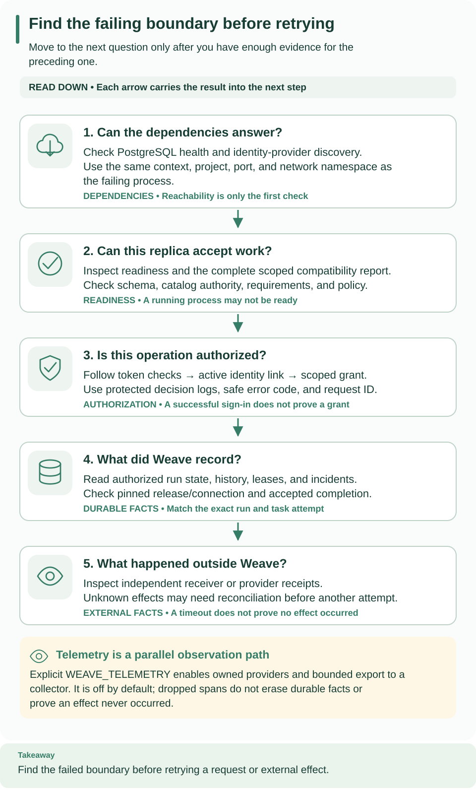

<!--
Copyright 2026 Firefly Software Foundation.

Licensed under the Apache License, Version 2.0 (the "License");
you may not use this file except in compliance with the License.
You may obtain a copy of the License at

    http://www.apache.org/licenses/LICENSE-2.0

Unless required by applicable law or agreed to in writing, software
distributed under the License is distributed on an "AS IS" BASIS,
WITHOUT WARRANTIES OR CONDITIONS OF ANY KIND, either express or implied.
See the License for the specific language governing permissions and
limitations under the License.
Author: Firefly Software Foundation
SPDX-License-Identifier: Apache-2.0
-->

# Export metrics and traces

Use this page to send Weave's metrics and traces to an OpenTelemetry collector
and to read what arrives. It is written for operators. You need a running Weave
API that you start yourself (from the [standalone walkthrough](../guides/standalone.md)
or a [deployment](deployment.md)) and a collector that accepts OTLP over
HTTP/protobuf. Setting it up takes about 15 minutes.

**Export is off by default, and only `WEAVE_TELEMETRY` turns it on.** Weave owns
its OpenTelemetry providers inside each API process. Starting the compiler,
using the SDK, or setting the usual `OTEL_EXPORTER_*` variables does not enable
Weave exports, and no provider is registered as a process global.

**The local platform does not export telemetry.** `weave platform start`
ignores `WEAVE_*` variables from your shell, so it never receives
`WEAVE_TELEMETRY`; see [configuration](configuration.md#the-local-platform-manages-its-own-settings).
Use the standalone walkthrough or a deployment to try export.



Read the five cards from top to bottom: dependencies, readiness, authorization,
what Weave recorded, and what happened outside Weave. The cream box below them
is telemetry: a parallel channel of observations. Use the stored run and
independent receipts to establish an outcome, even when export is incomplete.

[Open diagram at full size](../diagrams/operations-evidence.svg)

## Choose the evidence you need

| Question | Start here | What it can establish |
| --- | --- | --- |
| Is this replica's compatibility monitor still progressing? | `/health/live` | The monitor is running and has completed a scan within its allowed time |
| Can this replica accept work? | `/health/ready` and the scoped compatibility report | Runtime readiness and blocking requirements |
| How is the service behaving over time? | Collector metrics and traces | Bounded operational observations, subject to export loss |
| Did a run or effect complete? | Authorized run history and receiver or provider receipts | Durable recorded outcome and external acceptance evidence |
| Why was access allowed or denied? | Protected authorization logs and access audit | Authorization decision context, subject to configured log retention |

Metrics and traces complement the stored execution history. They help with
trends, queue age, and failure investigation, but a missing span does not prove
that an operation never happened. See
[local runtime](../reference/local-runtime.md#telemetry-and-authorization-audit)
for authorization logging and [history and replay](../reference/history-and-replay.md)
for run evidence.

### Read liveness and readiness together

Configure your container platform's liveness probe against `/health/live` and
its readiness probe against `/health/ready`. They answer different operational
questions:

| Liveness | Readiness | What to do |
| --- | --- | --- |
| HTTP 200 | HTTP 200 | The monitor is progressing and this replica can accept work. |
| HTTP 200 | HTTP 503 | The monitor is progressing but found a blocking requirement. Inspect the scoped compatibility report and resolve that requirement. |
| HTTP 503 | HTTP 503 | The monitor stopped or has not completed its work within the allowed time. The container platform can replace the unhealthy process according to its probe policy. |

The completion allowance includes the scan interval, database scan and cleanup,
and the configured time needed to shut down or initialize runtime effects. A
scan counts as completed only after its callbacks finish. This prevents a stuck
callback from indefinitely reporting a live replica. The watchdog does not
start a second set of runtime effects inside the same process.

After a replacement, verify that readiness returns to HTTP 200 and the
compatibility report's `checked_at` advances. Inspect affected runs and external
receipts before retrying uncertain work; a process restart alone does not
establish whether an external action finished.

## Enable export to a collector

The repository's Compose files do not start a collector; bring your own and
confirm that its OTLP HTTP/protobuf receiver is enabled. The example assumes it
listens on the API host's loopback port 4318.

### 1. Write the configuration

`WEAVE_TELEMETRY` is one JSON object. Weave never appends paths or discovers a
collector, so give the exact signal URLs:

```sh
# Send traces and metrics to a collector on the same host as the API.
export WEAVE_TELEMETRY='{"enabled":true,"traces_endpoint":"http://127.0.0.1:4318/v1/traces","metrics_endpoint":"http://127.0.0.1:4318/v1/metrics","timeout_seconds":5,"metrics_interval_seconds":30}'
```

Expected: no output. Set the variable in the shell that starts the API (in the
standalone walkthrough, terminal 2 after you stop the API with Ctrl-C), or in the
API's protected environment configuration for a managed deployment. An `export`
in another terminal does not change an API that is already running, in that
terminal or in a container.

### 2. Restart the API

Start the API with its normal startup command. Expected: the API starts and
`/health/ready` answers HTTP 200. An invalid value stops startup with
`Invalid WEAVE_TELEMETRY configuration`.

### 3. Generate traffic and check the collector

Run an authorized request, for example reading the first run through the CLI.
Wait at least `metrics_interval_seconds` (30 seconds here) before you look for
metrics. Expected: the collector shows data with the resource
`service.name=firefly-weave`, the instrumentation scope `firefly.weave`, and the
fixed `weave.*` metric and span names listed in
[What is exported](#what-is-exported).

### 4. Check that export actually arrived

A ready API is not proof that the collector received data. Check both sides
independently:

1. Confirm that the collector sees traffic from the correct API process or
   container. Check its OTLP receiver status separately from any dashboard.
2. Find the service resource and the instrumentation scope above. Filter by a
   fixed `operation` or `status` attribute; there is no run ID label.
3. Compare the request you made with the matching operation observation. For a
   workflow transition, also confirm the run's durable state through the API.
4. If nothing arrives, use the [troubleshooting table](#disable-or-troubleshoot)
   before you increase logging. Export is best effort and never retries a failed
   request.

Export failure never changes workflow state or grants execution authority.

### Configuration fields

| Field | Default | Rule |
| --- | --- | --- |
| `enabled` | `false` | JSON `true` or `false`; at least one endpoint is required when `true` |
| `traces_endpoint`, `metrics_endpoint` | Absent | Exact `http` or `https` URL, at most 2048 characters, whose host name has at most 253 characters; `http` only for `localhost`, `127.0.0.1`, or `::1`; no user name, password, query, or fragment. Either may be omitted |
| `authorization` | Absent | The complete `Authorization` header value the collector expects, 1 to 4096 printable ASCII characters |
| `timeout_seconds` | `5` | Greater than 0 and at most 5 |
| `metrics_interval_seconds` | `30` | From 5 to 300 |

The whole value may be at most 32 KiB, and unknown fields are rejected.

**Loopback means the API's own host or container.** The example works when the
collector runs on the same host as an API started in a shell. Inside a container,
`127.0.0.1` is that container. For any other topology, use explicit HTTPS
collector URLs.

**Keep the collector credential private.** Supply `authorization` through a
protected deployment secret or environment file, never a command argument,
source file, URL, or workflow definition, and never print the configuration.
Ambient OTLP headers, proxy settings, resource detectors, and credential-provider
hooks are not used by Weave's exporters.

## What is exported

Every instrument has a fixed name. Durations and queue age are histograms in
seconds.

| Type | Instruments |
| --- | --- |
| Counters | `weave.requests`, `weave.transitions`, `weave.recoveries`, `weave.provider_events`, `weave.outbox_deliveries`, `weave.secret_capacity`, `weave.compatibility`, `weave.retention`, `weave.loop_iterations`, `weave.loop_yields`, `weave.calls`, `weave.telemetry_dropped`, `weave.queue_unknown` |
| Histograms | `weave.duration`, `weave.queue_age` |
| Gauges | `weave.inventory`, `weave.inventory_freshness` |

**Loops.** `weave.loop_iterations` counts finished loop iterations with
`operation: loop`: `status: ok` for each result a loop collected, and `status:
cancelled` for each iteration still running when its run ended, however it
ended: failed (the iteration holding the failing step included), canceled, or
timed out, through ordinary terminal control or the reduced terminal control of
an unavailable or oversized run. The failure itself is counted once, as the
run's outcome. `weave.loop_yields` counts the times a loop paused to continue
in a later event.

**Workflow calls.** `weave.calls` counts each call's outcome once, with
`operation: call.wait` or `call.detach` and `status: ok`, `failed`,
`cancelled`, `timed_out`, or `rejected` (a child that could not start). A
result its caller can no longer use, because the caller already ended, counts
as `cancelled`. `weave.queue_age` gains two operations: `call.dispatch`, the
time from a call's request to its child's start, and `call.delivery`, the time
from the child's end to the caller's receipt of its result. A growing
`call.dispatch` age is the sign of a call backlog; there is no separate gauge
of pending calls.

**Only three attributes.** Metrics carry `operation`, `status`, and
`error_code`. Operations come from the public operation manifest plus a few fixed
internal names; statuses and error codes come from short allowlists, and any
other value becomes `other`. Tenant, principal, workflow, run, task, connection,
source, and message identifiers are never labels. Request paths, queries, phone
numbers, payloads, credentials, and exception messages are excluded.

**Bounded series.** Each instrument keeps at most 256 attribute combinations;
further combinations are added to a fixed `other` series.

**How to read inventory.** Queued work whose legacy enqueue time is unknown is
counted in `weave.queue_unknown` instead of being given the migration time. An
incomplete inventory sweep does not replace the last complete `weave.inventory`
value. Read inventory together with `weave.inventory_freshness`, and use **max**,
not sum, when several replicas report the same global inventory.

**Counts follow commits.** Transition counters are queued inside the owning
transaction and emitted only after it commits; a rollback discards them. A full
callback buffer drops telemetry, never business state. These counters are
best-effort observations; durable receipts and audit records remain the
authoritative evidence.

**Traces.** Spans use fixed operation names and do not record exception events
or raw exception descriptions. Only a valid W3C version-00 `traceparent` is
propagated; baggage and `tracestate` are discarded. Native durable boundaries can
link up to eight validated parent contexts. Remote worker-v1 leases carry no
tracing context, so server claim and completion observations do not give
end-to-end remote-worker trace continuity.

**Export limits.** The trace queue holds at most 256 waiting spans and sends at
most 64 per request, from one exporter thread per enabled trace provider. A full
queue drops new spans and increases `weave.telemetry_dropped`; there is no retry
spool. Each export request is at most 1 MiB, uses the configured timeout (at most
five seconds), and follows no redirects; response bodies are not kept. A slow
collector therefore causes telemetry loss, not API delays. Stopping the API
closes its providers, and spans still queued may be counted as dropped instead of
delaying shutdown.

## Disable or troubleshoot

To turn export off, set `WEAVE_TELEMETRY='{"enabled":false}'` (or remove the
variable) and restart the API. This does not disable authorization audit records
or delete workflow history. Stop only the API and collector services you own; no
volume needs to be deleted.

| What you see | Why | What to do |
| --- | --- | --- |
| No export traffic at all | The API process never received `WEAVE_TELEMETRY` with `"enabled": true`, or it runs under `weave platform start` | Restart or redeploy the API with the explicit value; `OTEL_*` variables are not enough |
| The API stops with `Invalid WEAVE_TELEMETRY configuration` | The JSON is malformed, has an unknown field, an `http` URL to a non-loopback host, a URL with credentials or a query, a host name longer than 253 characters, or a value out of range | Compare each field with the table above |
| Connection refused | The collector is not listening where the API looks | A loopback URL works only for an API on the same host; use a reachable trusted URL for a container API |
| The collector rejects requests | Receiver type, exact `/v1/traces` or `/v1/metrics` path, TLS, or authorization | Correct the receiver or the configuration; never put credentials in the URL |
| Metrics look doubled | Several replicas report the same global inventory | Use max for duplicate inventory observations and check freshness |
| `weave.telemetry_dropped` increases | Collector latency or queue pressure | Repair the export path; durable workflow state is never dropped with telemetry |
| A run ID is not in any label | Attributes are deliberately bounded | Inspect the run through its authorized history instead |

If exports stay absent, verify the exact endpoint, TLS trust, HTTP/protobuf
support, the private authorization value, and network reachability from the
API's own network namespace. Do not enable raw HTTP request logging or attach
payloads to spans to diagnose a credentialed connection. Generic PyFly request
logging, global tracing filters, and generic server metrics stay disabled in
Weave's packaged configuration so they cannot bypass the attribute policy.

## Operational reads at scale

Studio's Overview, Runs, Incidents and Workers pages read the platform summary
and the operational lists, not run payloads. The server targets these p95
latencies for a single read, measured on PostgreSQL:

| Operation | Page | Target |
| --- | --- | --- |
| `run_summaries.list`, with any single filter | 50 runs | 120 ms |
| `runs.steps`, without outputs | 200 steps | 120 ms |
| `operations_summary.read` | one environment | 200 ms |
| `workers.list` | 100 workers | 100 ms |
| `incidents.list` | 50 incidents | 100 ms |

`tests/benchmarks/test_operations_reads.py` checks them against one environment
holding 1,000,000 runs, 50,000 incidents, 500 workers, 10,000 ready tasks and
1,000 stored deployment observations of about 250 KB. That is far more than a
project retains under the default operation policy, which the benchmark raises
for its own database only. On an Apple silicon development machine with
PostgreSQL 17 in a 4-CPU, 8 GiB virtual machine and default PostgreSQL memory
settings, the p95 of each read was below 60 ms (the summary was the slowest, at
about 52 ms). These are measurements of that environment, not a guarantee for
yours: rehearse with your own data and hardware before relying on them.

`tests/integration/test_operations_query_plans.py` checks the plans behind
these reads on 200,000 runs: every chronological page walks a scoped index
without sorting the environment, and no listing statement reads run payloads,
events or step outputs. Studio's real-platform suite checks that Overview shows
live figures within one second of opening it once Home has finished its own reads,
and that every scheduled refresh of Overview, Runs, Workers and Incidents transfers
less than 50,000 bytes. Opened while Home was still reading, Overview took about two
seconds in the same run (1.9 s), because both pages' reads share the Studio host;
that case is recorded, not held to the one-second target.

Background loop health in the summary counts a loop as `degraded` after 3
failed cycles in a row or 3 among its last 20 (see the
[API reference](../reference/api.md)). A failure that returns less often than
that, for example once every 10 cycles, leaves the loop `ok`; its
`recent_failures` still shows it.

## Next steps

- Look up the other server settings in [configuration](configuration.md).
- Follow a failure from dependencies to external effects in
  [troubleshooting](troubleshooting.md).
- Inspect and resolve stuck runs with [incident operations](../reference/incident-operations.md).
