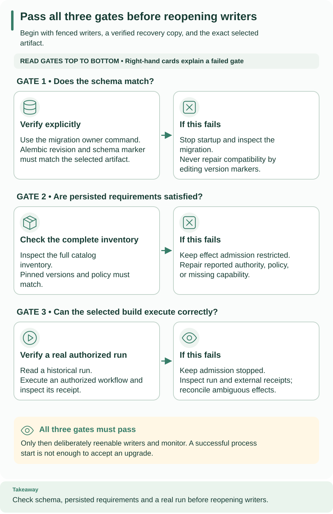

<!--
Copyright 2026 Firefly Software Foundation.

Licensed under the Apache License, Version 2.0 (the "License");
you may not use this file except in compliance with the License.
You may obtain a copy of the License at

    http://www.apache.org/licenses/LICENSE-2.0

Unless required by applicable law or agreed to in writing, software
distributed under the License is distributed on an "AS IS" BASIS,
WITHOUT WARRANTIES OR CONDITIONS OF ANY KIND, either express or implied.
See the License for the specific language governing permissions and
limitations under the License.
Author: Firefly Software Foundation
SPDX-License-Identifier: Apache-2.0
-->

# Upgrade a platform safely

Use this page to move a running Weave platform to a new server artifact: migrate
its database, check that retained work is still supported, and reopen traffic
only after a real run succeeds. It is written for operators. You need a
maintenance window, a verified recovery copy of the database, explicit migration
credentials, and the exact new artifact. Plan for the downtime of your slowest
step, usually the backup.

**Starting an API never migrates its database.** Weave uses explicit forward
migrations, and it checks persisted requirements before it admits
effect-producing work. Both Alembic's revision and Weave's own schema marker
must match the installed artifact. Installing or upgrading the CLI, Studio, or
the desktop app never migrates a platform.

| Version | Schema revision | What the upgrade involves |
| --- | --- | --- |
| alpha4 | `0021_operations` | Earlier baseline |
| alpha5 | `0025_run_lifecycle` | New migrations for human tasks, email, run filters, and execution lifecycle state |
| alpha6 | `0025_run_lifecycle` | macOS packaging correction; no new migration |
| alpha7 | `0025_run_lifecycle` | No new migration; adds optional server settings for [published sign-in](#after-the-upgrade-clients-and-sign-in) and the executor `build` field, whose default `image` keeps existing executor configuration valid |
| alpha8 | `0028_files` | Adds decision-table artifacts, separate Weave AI configuration, file metadata/chunks/retention, and new scoped file and assistant roles. Existing grants do not automatically gain these roles. |
| alpha9 | `0028_files` | No new schema migration. Adds guided AI configuration and renewable worker OAuth2 authentication. |
| alpha10 | `0028_files` | No new schema migration. Restores Weave AI access through the Studio host; explicit selection supersedes pending canvas fitting, and initial empty fields no longer steal focus. |
| alpha11 | `0028_files` | Studio AI setup wizards and explicit same-execution shared AI context; no server behavior or schema change. Updating the local Studio host and assets does not require redeploying an alpha10 server. |
| alpha12 | `0030_worker_presence` | Adds scoped deployment Operations persistence, runner fencing and reconciliation, and worker presence/drain state. Explicitly migrate the server before using Operations; new roles are never granted automatically. Provider credentials stay on separately operated runners. |
| alpha13 | `0030_worker_presence` | No new schema migration. Workers retry explicit capacity rejections while they read task context or credentials, and an Agentic preparation timeout before provider execution counts as not started. Upgrade the Agentic and Files workers to 0.1.5 together with the server. |
| alpha14 | `0030_worker_presence` | No new schema migration. Adds the detached Docker development platform (`weave platform up`); existing foreground installations keep working and are never converted. The Agentic and Files workers 0.1.6 pin this server version. |
| alpha15 | `0030_worker_presence` | No new schema migration and no role change. Upgrade CLIs and SDKs together with the server, review native executor `capacity` and the legacy private-network settings before restarting, and finish runs that use text templates before any rollback to alpha14; see [what changes in alpha15](#what-changes-in-alpha15). The Agentic and Files workers 0.1.7 pin this server version. |
| alpha16 | `0033_language_workflow_calls` | Three new migrations, no role change. `0031_operations_key_collation` only replaces two internal accounting functions. `0032_operations_facts` adds [scoped operational fact storage](#operational-fact-storage) with a bounded historical backfill; it holds its locks until it commits (17 s for 10,000 retained runs and 32 s for 50,000 in a rehearsal), so stop every writer first. `0033_language_workflow_calls` adds two empty tables and takes well under a second whatever the number of retained runs (under 0.15 s in every measurement on 10,000 and 50,000 runs). Explicitly migrate the server before restarting it. Upgrade CLIs and SDKs together with the server, upgrade the server before its deployment runners, and finish or cancel runs that use loops or call other workflows before any rollback; see [what changes in alpha16](#what-changes-in-alpha16). `weave platform up --username` grants new local accounts the local owner roles (developer, deployer, operator, viewer, task_participant, tenant_admin, lumi_manager, execution_manager, worker_operator, deployment_reader, deployment_planner, deployment_approver, deployment_operator); existing accounts keep their roles until `weave platform user grant` adds more. `weave platform user` is now a command group; `weave platform user --username` works as before. The Agentic and Files workers 0.1.8 pin this server version. |
| Unreleased | `0037_language_transactions` | Four new migrations. `0034_operations_change_requests` adds the empty `deployment_change_requests` table and two nullable columns on `deployment_plans` (who made a plan, and the change request it was made for); `0035_principal_idempotency` adds the empty `principal_idempotency` table, so a repeated `Idempotency-Key` on principal creation answers the principal it created, in its current state, for seven days; the next keyed creation by the same administrator removes older keys. These two take constant time. Every existing target now needs a second approver: plans made before the upgrade must be planned again on such targets, and an environment manager can turn the rule off per target; see [change request compatibility](#change-request-compatibility). Upgrade the server first, then its deployment runners: an upgraded runner registers adapter version 2, which an earlier server refuses. `0036_editor_studio_documents` adds the empty `studio_documents` table (a platform draft's canvas and test data, the latest two revisions of each), its tenant policy and its usage accounting; it takes well under a second. Explicitly migrate the server before restarting it, and upgrade Studio together with the server: Studio saves a platform draft's canvas and test data through the new `studio_documents` operations. `0037_language_transactions` adds the empty `run_transactions` and `worker_release_awareness` tables, a `settlement` column on task and call rows, an `effect` column on call rows, a `transaction_aware` column on task leases and a `transaction_state` column on run facts; every new column has a constant default or none, so adding them changes only the catalog; two new partial indexes read the task table once. The upgrade took 0.08 s with 10,000 and 0.28 s with 50,000 retained runs. Purge refuses a run whose transaction is not settled. It adds the `transaction_reconciler` role, which no existing account gains. Workers that send `worker` on their claims must send the release they registered with. |



Read the three gates from top to bottom. Each left card says what to verify; the
card on its right says what to do when it fails. A completed migration passes
only the first gate: retained requirements and a real authorized run still need
evidence before you reopen writers.

[Open diagram at full size](../diagrams/operations-upgrade.svg)

### A local platform has no in-place upgrade

**A local platform from `weave platform` has no in-place upgrade.** It records
the CLI version and the checkout that created it. Every `weave platform`
command refuses another version with `Use this installation's original
directory and matching CLI version.`, and a modified checkout with `The source
checkout has changed. Restore its original content before resuming this
installation.` Keep using the CLI and checkout that created it, or clone the new
release into a new directory and run `weave platform setup` there. That creates
a separate installation with its own data. The rest of this page applies to the
[manual local installation](../guides/standalone.md) and to deployments.

## Understand the upgrade boundary

An upgrade has three independent checks:

1. **Schema.** The new artifact can read the database schema.
2. **Retained requirements.** Its installed capabilities satisfy every retained
   execution requirement. Workflows may still reference an older admitted worker
   release or connector version that the new deployment must keep supporting.
3. **Execution.** Real work runs successfully after the restart.

A completed migration proves only the first. Use a maintenance window for the
whole procedure. The local walkthrough can rehearse these steps, but its guarded
restore helper is not a production backup system. For production, use a verified
environment-specific backup and restore procedure, and account for external
effects that happened after the backup.

## Prepare the upgrade

1. **Record what runs today.** Note the running wheel hash, dependency lock,
   image identities, schema revision, and private configuration locations. Keep
   the previous artifact.
2. **Stop every writer.** Inventory APIs with schedulers, native executors,
   remote workers, provider dispatchers, broker consumers, and outbox
   dispatchers. Stop admission and fence them before database maintenance. For
   the manual local installation, follow
   [step 1 of backup and restore](backup-restore.md#1-stop-and-fence-all-source-writers);
   on Kubernetes, [maintain the deployment deliberately](kubernetes.md#8-maintain-the-deployment-deliberately).
3. **Make a recoverable copy.** For the owned standalone installation, follow
   [backup and restore](backup-restore.md). For other deployments, use the
   environment-specific verified recovery procedure. Preserve the source database
   and external effect receipts.
4. **Rehearse.** Install the exact new artifact in a separate environment and
   rehearse the migration against a restored copy, with the same connector
   packages and operational policy as the target deployment.
5. **Provide explicit migration authority.** Runtime application and scheduler
   credentials are separate nonowner identities and cannot replace it. The
   operations migration provisions narrowly privileged function ownership and
   rejects an unrecognized or privileged existing owner role.

Never run mixed schema versions against the same mutable database. The server
performs exact schema checks, not rolling schema negotiation.

## Apply packaged migrations

Run this stage in the operator terminal while writers are stopped. Select the new
installed interpreter, not whichever `python` or source checkout happens to be on
`PATH`. On a restored local rehearsal, the target URLs are in that attempt's
`target.env`; the original `runtime.env` still refers to the fenced source.
Confirm which database you selected before you migrate.

Load `WEAVE_MIGRATION_DATABASE_URL` from protected deployment configuration;
never print it or pass it to runtime containers. Then run:

```sh
# Apply the packaged migrations with the new artifact's own interpreter.
"$WEAVE_PYTHON" -I -m firefly_weave.persistence.migrations
```

Expected: `Weave schema is current`, printed only after both schema markers were
checked. `WEAVE_PYTHON` is the Python executable of the new installed
environment; `"$WEAVE_PYTHON" -I -m firefly_weave.cli.main admin migrate` runs
the same migration. Without `WEAVE_MIGRATION_DATABASE_URL`, or on any failure,
the command stops with `Migration failed; verify PostgreSQL connectivity and
schema compatibility`.

If you lower operational quotas at the initial migration, supply the same
`WEAVE_OPERATIONS_POLICY` JSON to the migration and to every runtime process.

**Migrations are transactional and serialized.** Investigate a failure against
the retained database and protected logs; never change version rows to bypass
it. Destructive downgrades are unsupported. Returning to an older runtime needs a
compatible, separately restored database and reconciliation of any external
effects since its backup.

**The operational policy has a persisted fingerprint.** Every replica must use
the same policy as the database. Rerunning an already-current migration is not a
policy update, and this release has no in-place policy-change operation: a
mismatch leaves the runtime restricted. Never rewrite the fingerprint or counters
by hand to force readiness.

## Run list and timeline compatibility

The server now serves run summaries and step timelines. `runs.list` changes its
default to `started_desc`, with `started_asc` and `updated_desc` also available.
Clients that continue a legacy v1 cursor must send `order=id` and retain its
original filters. New filters bind ID cursors to the normalized query; time
orders use v2 cursors. Restart pagination after changing filters or order.
The `weave runs list` command does not send `order=id` yet, so it cannot
continue a cursor saved before the upgrade; start such a listing again.

`runs.list` also changes how it reads requests:

- It accepts the run summary filters and leaves out test runs unless the
  request sends `include_test=true`.
- It rejects unknown query parameters with `422 WV-VALIDATION`; the earlier
  route ignored them.
- A `limit` outside 1 to 100 answers `422 WV-VALIDATION` instead of
  `422 WV-PAGE`.
- An older server reads only `limit`, `cursor`, `business_key`,
  `correlation_key`, a single `status` and `include_archived`. It ignores the
  other filters, and it keeps only the last of several `status` values. Upgrade
  servers before relying on the new filters.

The Python SDK's `list_runs` takes either a `query` or the keyword filters;
passing both raises `ValueError` instead of silently dropping the keywords.

Request telemetry records an authorized `501 WV-UNAVAILABLE` answer, such as
`runs.logs`, with the status `unavailable` instead of `failed`. Alerts that
count `weave.requests` with `status=failed` no longer include these answers.

The update-time order is a live view: a later update can move an item between
pages. Refresh from the first page to see the latest ordering. Unknown historical
times sort last and are never replaced by the fact projection's creation date.
Restored runs reappear even though their archive lifecycle record is retained.

Old runs may have incomplete timelines. The server reads their missing author
step metadata in batches of 500, retaining only the requested page candidates.
A request stops after 100,000 keys or two seconds with `429 WV-RUNTIME-LIMIT`;
the time budget can be reached first. Synthetic control instances do not count
toward completeness or the key cap. Step outputs remain optional and classified.
`runs.logs` still answers authorized requests with `501 WV-UNAVAILABLE`.

## Incident list compatibility

`incidents.list` and the paged `incidents.run_list` now read incident facts
instead of loading each incident's run. Their default order changes to
`opened_desc`, newest opened first, with `opened_asc` also available; incidents
whose opening time is unknown come last. Clients that continue a cursor saved
before the upgrade must send `order=id` without filters. The
`weave runs incidents list` and `run-list` commands do not send `order=id` yet,
so they cannot continue such a cursor; start the listing again.

The incident lists also change how they read requests:

- They accept `status` (repeatable), `code`, `workflow`, `node_id`, an opening
  time range, and `include_test`. Without `status` they still list every
  status.
- Incidents of test runs are left out unless the request sends
  `include_test=true`.
- They reject unknown query parameters with `422 WV-VALIDATION`; the earlier
  routes ignored them. A `limit` outside 1 to 100 answers `422 WV-VALIDATION`
  instead of `422 WV-PAGE`.
- An older server ignores the filters and the order and lists every incident in
  ID order. Upgrade servers before relying on them.

Incident views gain optional fields that are left out while unknown, false, or
empty. **Upgrade CLIs and SDKs with the server.** Earlier releases reject the
new fields: `weave runs incidents list` and `run-list`, and the Python SDK's
`list_incidents` and `run_incidents`, fail with `502 WV-WIRE` on the first page
that lists an available incident. Stored resolution receipts and
`incidents.resolve` answers keep their bytes, and so does the earlier plain
array of a run's incidents. A resolve answer is the incident as stored, so read
it again with `incidents.read` to show it as the lists do.

For an incident of a repeated step instance, `node_id` becomes the static step
ID and `instance_key` carries the full key; other incidents, including those on
a switch or parallel branch output or a join, keep the same `node_id`. Whether
an incident is withheld now comes from its run's metadata, its policy blocks,
and whether its step matches its incident facts, so a list never loads runs.
The new `incidents.read` operation serves direct links and sends the revision
as `ETag`. The Python SDK adds `read_incident`, and `list_incidents` and
`run_incidents` take either a `query` or the keyword arguments; passing both
raises `ValueError`.

Historical opening times come from each incident's opening event. When that
event was not retained, the upgrade used the run's last recorded event and
marks the time `opened_at_estimated`; without either, the opening time stays
unknown.

## Worker identity compatibility

Workers can now report where they run when they register, and worker reads
return it. Deployment observations can also list the containers or pods of a
worker component. Both changes cross versions:

- **New workers, older server.** The Agentic and Files workers and the Python
  SDK's `register_worker` send an `identity`. A server without it refuses the
  field with `422 WV-VALIDATION`; the worker then registers exactly once more
  without it, on the same connection and credentials. Other failures are not
  retried. Upgrade servers first to keep the identity. Native executors register
  inside the API process, so they always use a server of their own version.
- **Older clients, new server.** Worker reads, lists, and drain or resume
  answers add `identity` and `registered_at` when they are known. **Upgrade
  CLIs and SDKs with the server.** Earlier releases reject the new fields:
  `weave workers list`, `read`, `drain`, and `resume`, and the Python SDK's
  `read_worker`, `list_workers`, `drain_worker`, and `resume_worker`, fail with
  `502 WV-WIRE` for a worker registered after the upgrade. A drain or resume is
  still applied; read the worker again with an upgraded client. Workers
  registered before the upgrade, the registration answer, and stored worker
  records keep their earlier shape.
- **Labels.** `WEAVE_WORKER_LABELS` is read only from the worker's own
  environment. An invalid label stops the worker before it registers, so check
  the setting before rolling out new worker images. With native executors
  configured, an invalid label on the API's own environment stops the API from
  starting.

**Upgrade the server before its runners.** An upgraded runner reports
`members` for worker components, and an older server refuses them: the runner's
observe jobs fail, and an apply that touches a worker component ends
`reconciliation_required` with an ambiguous receipt, even though the change
was applied. Upgrade the API first, then each runner.

- **Older clients, observations with members.** Observations that an upgraded
  runner recorded with `members` fail with `502 WV-WIRE` in earlier releases:
  `weave operations observations read` and `list`, and the Python SDK's
  `invoke("deployment_observations.read")` and
  `invoke("deployment_observations.list")`. Upgrade CLIs and SDKs with the
  server before upgrading runners.
- **Unchanged.** Observations without members, their digests, plans reviewed
  against them, and Compose and Kubernetes resource versions keep their bytes.
- **Members are placement only.** They list live containers or pods: stopped,
  terminating, finished, failed, and evicted ones are left out. When a worker
  component has more than 100 live members, or the runner cannot list them all,
  `members` is left out and placement is unknown; the observation itself still
  succeeds.
- **Kubernetes.** After upgrading the server, and before upgrading a Kubernetes
  runner, grant it `list` on `pods` in the namespace. Without that permission
  the runner leaves `members` out. See
  [the runner guide](operations-runner.md#kubernetes).

## Worker fleet compatibility

`workers.list` now reads each page with one query and changes what it lists by
default:

- **Current workers only.** Without `state=all`, it leaves out revoked workers
  and workers neither seen nor registered in the last hour. Workers registered
  before the upgrade that were never seen are listed only with `state=all`.
- **Newest contact first.** The default order is `last_seen_desc`;
  `registered_desc` is also available, and unknown times come last.
- **Cursors.** Cursors issued before the upgrade are refused with
  `422 WV-VALIDATION`; start the listing again. `weave workers list` sends only
  `limit` and `cursor`, so it lists current workers.
- **Requests.** Unknown query parameters are refused with `422 WV-VALIDATION`
  instead of being ignored, and a `limit` outside 1 to 100 answers
  `422 WV-VALIDATION` instead of `422 WV-PAGE`. An older server ignores the new
  filters and lists every worker in ID order, so upgrade servers before relying
  on them.
- **Earlier Studio hosts and desktop apps.** The Studio bridge forwards answers
  unchanged, so an earlier Studio host or desktop app gets this reduced default
  list from an upgraded server. Its Workers page lists only current workers,
  **Show revoked workers** shows none, and rows reorder as workers check in.
  Upgrade Studio and the desktop app with the server. Until then, the Python
  SDK's `list_workers(query=WorkerListQuery(state="all"))` lists every worker.
  The upgraded Studio asks the platform for current workers and turns on
  `state=all` with **Show retired workers**; against an older server its filters
  are ignored and it lists every worker.

Worker reads and lists add optional `placement` and `drained_at`, and drain and
resume answers add `drained_at`. **Upgrade CLIs and SDKs with the server.**
Earlier releases reject these fields: `weave workers list`, `read`, `drain`, and
`resume`, and the Python SDK's `read_worker`, `list_workers`, `drain_worker`,
and `resume_worker`, fail with `502 WV-WIRE` for a worker that is placed, or
drained since the upgrade. A drain or resume is still applied. Stored worker records and the registration
answer keep their bytes, and workers drained before the upgrade show no drain
time.

Two operations are new: `workers.retire_stale` (`weave workers retire-stale`,
SDK `retire_stale_workers`) revokes up to 100 offline workers without active
leases per command, and `releases.usage` (`weave workers releases usage`, SDK
`release_usage`) reports where a release runs. Neither changes an existing
answer. Earlier servers do not serve them and answer `404` or `405`.

## Environment summary and telemetry settings

Two reads are new, and neither changes an existing answer:

- `operations_summary.read` (`weave operations summary`) answers an
  environment's health, load, workers, targets, incidents and the items that
  need attention. It needs `status.read`; each section beyond health, load and
  workers needs its own capability, and a section you may not read answers
  `{"state": "forbidden"}` instead of zeros. Run figures leave out test runs.
- `operations_telemetry.read` (`weave operations telemetry`) answers whether
  telemetry export is on and which collector hosts it uses. It needs
  `status.read` granted for the project, not only for an environment, and
  never returns endpoint paths, credentials or headers.

Earlier servers do not serve them and answer `404` or `405`. For the first 24
hours after the upgrade, `opened_24h` leaves out incidents whose opening time
the upgrade could only estimate. A `WEAVE_TELEMETRY` collector URL whose host
name is longer than 253 characters, which no DNS name is, now stops startup with
`Invalid WEAVE_TELEMETRY configuration`. Loop health is
measured in each API process and starts again when the process restarts, so a
freshly started process reads `degraded` until each loop completes a cycle. An
answer from an API-only replica reports every scheduler loop as `disabled`; the
summary's `instance` ID tells you which process answered. The reference explains
how each state is decided; see
[Discovery, debugging, and history](../reference/api.md#discovery-debugging-and-history).

The Studio host bridge now forwards both reads and `releases.usage`. An earlier
Studio host or desktop app refuses them with `404`, so upgrade Studio and the
desktop app with the server before relying on the pages that use them.

## Operational fact storage

The `0032_operations_facts` migration adds five scoped operational projections
and the operations loop's bounded traversal cursors: one for tenants, one per
tenant for environments, and one per environment for re-checking stored listing
decisions. The scheduler login reaches tenants through the new execute-only
`weave_operations_tenants(integer)`, granted to `weave_scheduler`, so it never
moves the recovery traversal's cursors. The migration does not add columns to
stored runs or events. Apply it explicitly with all writers stopped, using the procedure above.

The migration runs in one transaction and reads retained runs in UUID order, at
most 10,000 IDs per batch. It validates each run's state, activation and request,
classifies each distinct stored artifact once, and aggregates event timestamps per
batch. The indexes it adds to existing tables (`run_deadlines`, `event_deliveries`
and `incidents`) are built inside that transaction, so their locks last until the
whole migration commits: the maintenance window is the migration's duration, which
is one more reason to stop every writer first. The foreign keys of the new fact
tables likewise lock `runs`, `task_intents`, `incidents`, `worker_instances`,
`environments` and `tenants` against writes until the migration commits. Allow temporary disk space for all
five projections, their indexes, and transaction/WAL overhead.

Rehearse against a restored copy to measure your maintenance window. On a
development machine (PostgreSQL 17 in a 4-CPU, 8 GiB virtual machine with default
memory settings, upgrading from `0031_operations_key_collation`), the migration
took 17 seconds for 10,000 retained runs and 32 seconds for 50,000, and the
database grew by 1.4 to 1.6 KB per retained run (16 MB and 70 MB). Usage counters
equaled an independent recomputation afterwards in both. Larger sizes were not
measured: if the time keeps growing linearly, 1,000,000 runs would take roughly 10
to 15 minutes on similar hardware, but treat that as an estimate, not a
measurement.

Historical run times come from accepted events. Missing, malformed or oversized
evidence remains unavailable, and malformed lifecycle values remain unknown
instead of being labeled as queued. A run requiring an unsupported IR version or
language feature keeps that separate classification. Historical origins remain
unknown unless an explicit start, retry or matching start receipt proves them.
Signal delivery receipts do not establish how a run started. Historical step
and task times are not invented, and worker instances registered before the
upgrade keep an unknown registration time and no identity; a worker reports its
identity when it next registers. Each run projection records when its coverage
began.

The new facts count toward ordinary storage usage. Near a quota ceiling, this
means a claim or completion that an earlier server accepted can be refused with
the usual capacity answer, and it changes nothing when it is refused. Active executions reserve
additional capacity for bounded terminal fact updates, including allocation
provenance. Backfill inventories retained data without granting extra admission
capacity: a platform already above a quota can still migrate, but new work must
satisfy the unchanged quotas. Purging an authorized archived run also removes
its run, step, task and incident facts; deleting a worker removes its facts.
The cursor tables hold a single row for tenants, one row per tenant for
environments, and one row per environment for re-checks. They have no business
payload or retained history.

## Start and inspect compatibility

Remove the migration credentials from the runtime environment, then start the
new artifact with its application and execute-only catalog and scheduler
identities. The startup inventory needs catalog authority even when
`WEAVE_SCHEDULER_ENABLED=false`.

**The application and catalog URLs must name the same database.** They need the
same driver, host, port, database, and query options; only their credentials
differ. Use the same host spelling in both, even when several DNS aliases reach
the same server. The catalog login keeps its execute-only scheduler authority,
without business-table or column grants.

Compatibility checks examine retained runs, activations, worker releases,
connector requirements, provider requirements, and the operational policy. Exact
persisted versions and pins matter: an online worker is not a substitute for a
compatible admitted release. Missing authority or an incomplete inventory never
counts as a successful check.

**Read the report from the CLI.** Compatibility is a project-level operation, so
it uses the tenant and project of your [saved platform's](../guides/connect-to-api.md)
workspace and ignores the environment. Reading needs `status.read` (the `viewer`
role) and a fresh scan needs `compatibility.check` (the `operator` role), granted
on the project or tenant; an environment-level grant does not cover them. The
`viewer` and `operator` grants that `weave platform user` and the first-run
helper create are on the environment, so ask a
[tenant administrator](../guides/people-and-access.md) for a project grant
first.

```sh
# Read the current report for the project of your saved workspace.
weave compatibility read --output json
# Ask the server for a fresh scan of the same project.
weave compatibility check --output json
```

Expected: one JSON report with `policy`, `mode`, `complete`, `inspected`,
`checked_at`, `findings`, and `findings_truncated`. A healthy upgrade reports
`"mode": "ready"`, `"complete": true`, and no findings. In a script, use
[explicit mode](../guides/connect-to-api.md#scripts-and-ci-explicit-mode)
instead: `--base-url` with the restarted API origin, `--tenant` and `--project`,
and a current `WEAVE_ACCESS_TOKEN`. For a standalone rehearsal, take the scope
IDs from `first-run.json`; never invent IDs or reuse an expired token.

Findings are filtered to the authorized project, with safe global inventory
conditions retained; no other project's resource identifiers appear. A
truncated or incomplete report is not evidence of full compatibility.

**The server also rescans by itself.** Each process requests a compatibility
rescan every 60 seconds. Automatic and explicit scans share one reservation, so
an automatic scan that would overlap is skipped instead of queued. A scan
classifies retained items in its own reserved execution slot, so a burst of API
requests cannot make it fail. A failed scan leaves the process restricted until
a later scan succeeds, and catalog cleanup must succeed before readiness
returns. A rescan that confirms a ready process keeps it ready while it releases
its catalog connection; if that cleanup fails, readiness is withdrawn. While the
process is restricted, refused changes answer HTTP 503 `WV-COMPATIBILITY` with
`Retry-After` set to the seconds until the next automatic rescan.

When a rescan withdraws readiness, the server logs the warning `Compatibility
rescan withdrew readiness` with the finding kinds and codes and the class of
any error the scan caught, such as `CatalogError WV-OPERATION-CAPACITY`. The
warning never includes error messages or connection details.

The capabilities response also reports the effective policy, fixed server
ceilings, the supported worker convention, and a small readiness projection. An
older server may omit this declaration; omission does not imply readiness.

| Finding | What to do |
| --- | --- |
| `authority_missing`, `inventory_incomplete` | Repair catalog connectivity or authority and rerun the scan |
| `policy_mismatch` | Restore the policy matching the database; never edit counters or fingerprints |
| `ir_unsupported`, `artifact_invalid` | Inspect the pinned definition and select a compatible artifact; preserve historical bytes. `ir_unsupported` also covers language features the server does not list in `language_features`, for example `text.concat` after a rollback: upgrade the server instead of editing the artifact. Runs in progress that use such a feature [wait for a server that runs it](#runs-that-need-a-newer-server), unless the server predates language features. |
| `action_unavailable`, `connector_unsupported`, `provider_requirement_unsupported` | Restore the exact required release or package, or use an explicit supported migration |
| `worker_protocol_unsupported` | Use a compatible worker and server convention; never relabel an existing release |
| `legacy_policy_blocked` | Inspect historical classification limits; preserve withheld evidence instead of bypassing policy |
| `operational_capacity_blocked`, `capacity_absent` | Inspect retained usage and admission requirements; use authorized maintenance where supported |

**Restricted mode keeps the platform inspectable.** Health and authorized
inspection stay available while new effect-producing work is blocked. Issued
terminal controls remain available within their reserved authority and capacity.
Restricted mode never permits arbitrary execution, and you must not rewrite
retained definitions to silence findings. See
[incident operations](../reference/incident-operations.md) and
[retention](retention.md) for the supported controls.

### Runs that need a newer server

A server that lists `language_features` in its capabilities, but not a feature
that a run in progress uses, cannot run that run. This happens, for example,
after you roll back from a release that added `flow.forEach` to one that did
not. The server leaves the run waiting and records nothing about it:

- It never offers the run's tasks to workers, applies its deadlines, or retries
  its attempts, and it never blocks the run. The run does not hold back the
  deadlines of other runs.
- Compatibility reports the run as `ir_unsupported`, so the server stays
  restricted while the run is in progress. Other runs then advance only through
  cancellation and terminal deadlines, such as overall timeouts, and workers
  cannot claim tasks, renew leases, or report results.
- Reading the run, sending it a signal, or reporting a task result for it
  answers HTTP 422 `WV-IR-UNSUPPORTED` with `result.missing_features`, and run
  lists show it, and incident lists its incidents, as unavailable. Reading its
  pinned definition version answers the same way, and catalog lists show that
  version as an unavailable item with `reason: ir_unsupported` and the same
  `missing_features`. Runs with unavailable legacy evidence still answer HTTP
  409 `WV-LEGACY-UNAVAILABLE`.

Upgrade the server again to resume the run. Deadlines that passed in the
meantime apply then, and an expired lease is recovered like any lost attempt:
an action that is safe to repeat is retried while it has attempts and time
left, and otherwise an incident opens for you to reconcile. Cancelling the run
on the older server records only the cancellation, as for
[runs with unavailable legacy evidence](../reference/incident-operations.md#runs-with-unavailable-legacy-evidence),
and its state stays withheld after you upgrade. To keep a run's full record,
let it finish or cancel it before you roll back.

After the upgrade, `runs.read` serves the run at once, but run summaries, step
timelines and incident lists keep withholding it until the scheduler re-checks
its stored listing decision; its timeline answers `422 WV-IR-UNSUPPORTED`
meanwhile. The scheduler does this in the background: each minute it visits up
to 16 tenants, gives each one's next environment up to one second of database
work, and re-checks at most 100 runs there, fewer when the second runs out
first. A tenant's environments take turns, one per minute. So in an installation
with one tenant and one environment, 10,000 waiting runs take at least 100
minutes, and a million about a week. More environments in a tenant, or more
than 16 tenants, make each environment wait longer.

Runs recorded under an earlier classification policy are re-checked the same
way, and their timelines answer `409 WV-LEGACY-UNAVAILABLE` meanwhile. A policy
change re-checks available and unsupported decisions only: unavailable ones,
such as runs whose history the upgrade could not trust, stay unavailable. API
replicas that disable the scheduler rely on the scheduler replica for this. A
run whose re-check fails, for example because its record cannot be locked in
time or ordinary storage is full, stays withheld, is logged by error class, and
is tried again on a later pass while the others continue.

**A server whose capabilities do not list `language_features` predates
language features.** It cannot recognize such a run, treats it as legacy
evidence, and can block it permanently; a blocked run's tasks are never offered
to workers again, even after you upgrade. Before you roll back to such a
server, let every run that uses a language feature finish, or cancel it.

## Language manifest compatibility

The language manifest (`language.read`, `weave remote language`, and the
Python SDK's `language()`) gains a `step_fields` list and the feature names
`flow.transaction` and `flow.eventTrigger`. Clients read the manifest strictly,
so **upgrade CLIs and SDKs together with the server**:

- **Older clients, new server.** An earlier CLI or SDK refuses this server's
  manifest because of the new list and feature names.
- **New clients, older server.** This CLI or SDK reads an earlier server's
  manifest; a server without the list reports no step fields.

Studio reads `step_fields` as optional and works with both. Worker payloads
are unaffected: a failure's `effect` and a claim's `worker` are left out unless
a worker sends them, so existing workers keep working unchanged.

## Change request compatibility

Servers with change requests (migration `0034_operations_change_requests`) keep
what runners, CLIs and SDKs of the previous release read:

- **Plans read as before.** A plan does not carry who made it or which workers a
  scale-down removes. The server keeps the planner beside the plan, and the
  members a scale-down removes follow from the plan's own observation by a fixed
  rule (Compose: exited containers first, then the highest container numbers),
  which the server and an upgraded runner both apply. Plan digests are
  unchanged.
- **Leases carry only what the runner registered.** A lease's target lists the
  capabilities the claiming runner registered and no approval policy, so a runner
  of the previous release keeps claiming observe, deploy, update and scale jobs.
- **A second approver is required.** Every target registered before the upgrade
  needs a second person to approve its plans. A plan made before the upgrade does
  not record its planner, so on such a target it must be planned again before it
  can be approved or applied (409 `WV-PLAN-STALE`). The rule compares accounts:
  see [Who counts as a second approver](cluster-management.md#who-counts-as-a-second-approver).

Upgrade runners soon after the server anyway: a runner of the previous release
cannot run restart jobs (it never registers `restart_workers`, so it never claims
them), and it is never offered a scale-down that removes workers, because it would
let Compose choose the containers instead of removing the reviewed members.
**Scale-downs wait until the target's runner is upgraded**: an upgraded Compose
runner registers adapter version 2, which promises to remove exactly the reviewed
members, and only such a runner claims a scale-down's apply job. Any plan that
lowers a worker component's replicas is a scale-down, whether it scales, updates
or deploys. Kubernetes and Container Apps runners register version 1 until their
adapters remove the reviewed members too, so they do not take scale-downs yet. A
job nobody claims is cancelled at its deadline, the workers its change drained go
back to work, and the change request can be planned again. CLIs and SDKs of the previous release cannot read
a restart plan, a target that offers `restart_workers`, or a target whose
environment manager turned off the second approver; upgrade them with the server.

## Verify before admitting traffic

Perform these checks in order for each project and execution path:

1. **Readiness.** `/health/ready` answers HTTP 200 on the replica that receives
   traffic. If it fails, keep effect-producing admission stopped and read the
   compatibility findings.
2. **Compatibility.** A complete report with `"mode": "ready"`, and a policy in
   the capabilities response that matches the intended deployment. A report
   truncated for response size cannot prove that every requirement was reviewed.
3. **History.** A known historical run and its durable output can still be read.
4. **Execution.** Start the required admitted executor or worker and run a small
   authorized workflow. The [deployment exercises](deployment.md) show concrete
   remote and native checks for the local installation.
5. **External effects.** Verify receiver or provider receipts and telemetry
   through their own interfaces, then reenable the remaining writers deliberately
   and watch recovery.

Do not infer provider delivery from API readiness alone. Keep the prior artifact,
the source database, the backup, and protected migration evidence until the
upgraded deployment and its recovery procedure have been verified.

## What changes in alpha15

Alpha15 adds no schema migration: the head stays `0030_worker_presence`, as in
alpha12 to alpha14, and no role is added or changed. Follow the procedure above
as usual; the migration command reports the schema as current. Then check these
changes before you reopen traffic:

- **Upgrade CLIs and SDKs with the server.** Connection test answers carry a new
  `encrypted` field, `false` for an `http://` connection. CLIs and SDKs from
  alpha14 or earlier cannot read `weave connections test` answers for HTTP
  connections from an alpha15 server. Catalog list pages can also contain a new
  item for a version the server does not run (`unavailable: true`,
  `reason: ir_unsupported`, `missing_features`), and older SDKs and CLIs reject
  such a page.
- **Reads of versions and runs the server cannot run answer 422.** Reading a
  definition version that needs a language feature the server does not list, or
  repeating the publish request that created it, answers HTTP 422
  `WV-IR-UNSUPPORTED` with `result.missing_features` instead of HTTP 409
  `WV-LEGACY-UNAVAILABLE`. Reading a run that waits for an upgrade, sending it a
  signal, or reporting a task result for it answers the same way. Runs with
  unavailable legacy evidence still answer HTTP 409 `WV-LEGACY-UNAVAILABLE`.
  Treat the 422 as "this server is too old", not as lost data.
- **`email_receipts.dispatch` can answer 429.** When Weave refuses the dispatch
  for capacity, the operation answers HTTP 429 (`WV-OPERATION-CAPACITY` or
  `WV-REQUEST-CAPACITY`) with `Retry-After`, where it used to answer HTTP 200
  with state `blocked`. The receipt keeps its state, and the next pending scan
  dispatches it. A script that read `blocked` from that answer should retry the
  429 instead.
- **Native executors run up to their configured capacity.** In-process native
  connector calls no longer share the two execution work slots of API requests.
  Each `WEAVE_NATIVE_EXECUTORS` entry now runs up to its `capacity` at once,
  where before a third concurrent call failed. Before you restart, check that
  each entry's `capacity` is what the connector's destinations can take.
- **Runs wait after a rollback instead of being blocked.** An alpha15 server that
  does not list a language feature that a run in progress uses leaves the run
  waiting until a server that runs it takes over; see
  [runs that need a newer server](#runs-that-need-a-newer-server). Alpha14 and
  earlier predate language features and block such runs permanently. Before you
  roll back from alpha15 to alpha14, let every run that uses `concat` or `join`
  finish, or cancel it.
- **Legacy private-network settings map into the private-origin policy.**
  `WEAVE_HTTP_PRIVATE_NETWORKS`, `WEAVE_MAIL_PRIVATE_NETWORKS`, and
  `WEAVE_POSTGRES_PRIVATE_NETWORKS` (with `WEAVE_POSTGRES_PLAINTEXT_NETWORKS`)
  keep their reach. At startup the API maps each one that is set to "Legacy
  setting" entries of the same policy that a `WEAVE_PRIVATE_ORIGINS_FILE` feeds,
  and logs a `private_origins.legacy` warning that names the setting. Keep using
  these settings in deployments; the private-origin file is what
  `weave platform up --allow-private-origin` writes for the Docker development
  platform. All four are now parsed strictly: a CIDR with host bits set, such as
  `10.0.0.1/8` instead of `10.0.0.0/8`, or more than 128 networks stops the API
  at startup, so check their values before you restart.
- **IR `weave/ir-v1alpha4` appears only with text operators.** A workflow that
  uses `concat` or `join` compiles to `weave/ir-v1alpha4` with a `features`
  list. Every other workflow keeps its IR version and digest, so existing
  activations and pinned artifacts are unaffected. Alpha14 and earlier servers
  refuse v1alpha4 artifacts: publish and activate such workflows only once every
  server that runs them is on alpha15. The capabilities response lists
  `weave/ir-v1alpha4` in `ir_versions` and the features in `language_features`.
- **Compatibility refusals say when to retry.** `503 WV-COMPATIBILITY` answers
  now carry `Retry-After` with the seconds until the next automatic rescan.
- **Workers and local platforms.** The Agentic and Files workers 0.1.7 pin core
  0.1.0a15. A local platform still has [no in-place upgrade](#a-local-platform-has-no-in-place-upgrade):
  set up alpha15 from its own checkout in a new directory.

## What changes in alpha16

Alpha16 adds three schema migrations (the head becomes
`0033_language_workflow_calls`), no role, and no change to definition schemas or
the stored digests of the built-in AI Connector, Action and task. Follow the
procedure above and migrate explicitly before you restart the server; a server
that includes them refuses to start on the previous schema.

- **Allow for the migration time.** `0031_operations_key_collation` replaces two
  internal accounting functions in place and changes no table, data or role.
  `0032_operations_facts` backfills [operational facts](#operational-fact-storage)
  from every retained run in one transaction and holds its locks until it
  commits: in a rehearsal on PostgreSQL 17 (4 CPUs, 8 GiB), it took 17 seconds
  for 10,000 retained runs and 32 seconds for 50,000, and the database grew by
  1.4 to 1.6 KB per retained run. Rehearse it on a restored copy to measure your
  window. `0033_language_workflow_calls` adds the empty `run_calls` and
  `run_call_links` tables, their indexes and scope policies, the call rules for
  run purging, and room in each run's reserved control capacity for the call
  rows its cancellation or timeout changes. It changes no existing row and took
  under 0.15 seconds in every measurement, on 10,000 and on 50,000 retained runs.
- **Upgrade CLIs and SDKs together with the server.** Workflow calls add the
  `call_completed` history event and the `caller` field of runs, loops add the
  human task `instance_key` and `iteration` fields and new capability fields,
  and incident, worker and observation answers gain optional fields. Alpha15 and
  earlier CLIs and SDKs check every answer against the fields and event types
  they know, so they fail with `WV-WIRE` on these answers. The items below and
  the compatibility sections above name each case.
- **Upgrade the server before its deployment runners**, as described in
  [worker identity compatibility](#worker-identity-compatibility).
- **Finish or cancel runs that use calls or loops before any rollback.** Alpha15
  lists neither `flow.callWorkflow` nor `flow.forEach`, so such runs wait until a
  server that runs them takes over; see
  [runs that need a newer server](#runs-that-need-a-newer-server). Rolling back
  the database also means restoring the backup taken before the migration, as
  [if the upgrade fails](#if-the-upgrade-fails) explains.
- **Workers and local platforms.** The Agentic and Files workers 0.1.8 pin core
  0.1.0a16. A local platform still has [no in-place upgrade](#a-local-platform-has-no-in-place-upgrade):
  set up alpha16 from its own checkout in a new directory.
- **Contributors.** The `Acceptance` workflow now runs Studio and security
  journeys against a real platform on every pull request. Run the same `pr`
  profile locally before you open one, as `tests/acceptance/README.md` in the
  repository explains. Operators need no change for it.

Check these changes before you reopen traffic:

- **New AI operations are additive.** `ai_endpoints.list`, `ai_models.list`,
  `ai_readiness.read`, `ai_setup.publish`, `ai_setup.grant` and
  `bindable_connections.list` are new; see
  [AI discovery, readiness and setup](../reference/api.md#ai-discovery-readiness-and-setup).
  Omitted optional fields keep their defaults (`refresh=false`, `limit=50`,
  `probe_tools=true`). Studio reaches them through its host bridge; the server
  still checks each caller's grants. Existing operations also change in the four
  ways described next, so clients that never call the new operations can still
  see different answers.
- **Saving an AI connection runs discovery before it answers.** After an AI
  connection is saved, `connections.create` refreshes its model list and answers
  only then, so the 201 can take up to about 20 seconds. When the policy approves
  the connection's endpoint and the AI gateway is configured, the refresh uses the
  connection's credential, if it has one, contacts the provider through the
  gateway and spends one of the six AI test admissions per person per minute.
  Replaying the save with its `Idempotency-Key` spends another, and a refresh
  that cannot call the gateway spends none. A script that saves several AI
  connections and then tests them within a minute can get 429
  `WV-AI-RATE-LIMITED`. A failed refresh never undoes the save.
- **AI connection tests run discovery afterwards.** `ai_connections.test` and
  `connections.test` of an AI connection refresh the model list after the test,
  within the test's admission. Both answer later and send one more request
  through the AI gateway, still within their bounds of 130 seconds for
  `ai_connections.test` and 30 seconds for `connections.test`.
- **`connections.test` stops when the client disconnects.** For every connector
  type, a test whose client disconnects is cancelled. Its
  `connection.test.requested` audit remains, but no result is stored and no
  `connection.test.completed` audit is written. Before, the test always ran to
  completion.
- **Activation bindings check `connection.bind` for each revision.** A new
  activation requires `connection.bind` for each bound connection revision, on
  both the request's token and the caller's stored grants. A token whose stored
  grant was removed gets 403, and a `connection.bind` grant limited to specific
  revisions now binds exactly those revisions, where before it bound none.
- **Mount the AI policy on the API to check AI activations.** With
  `WEAVE_AI_POLICY_FILE` set, a new activation of a workflow with AI task (`llm`)
  steps answers 422 `WV-ACTIVATION-AI-PROVIDER` or `WV-ACTIVATION-AI-MODEL`
  instead of creating an activation whose runs would fail with `LLM_CONNECTION`
  or `LLM_POLICY`. While the mounted file cannot be read, activations with AI task
  steps answer 503 `WV-AI-POLICY`; other activations are not affected. Without the
  setting, activation behaves as before. Activations that already exist are not
  checked again.
- **Activation replays need current authority.** Replaying an activation
  `Idempotency-Key` now requires the caller's current `release.activate` grant.
  A caller whose grant was revoked gets 403 (or 401) instead of the stored 201
  answer. Scripts that retry activations with a token whose grant was removed
  must get the grant back first.
- **Starting a run no longer slows down as executions accumulate.** Migration
  `0031_operations_key_collation` fixes the usage accounting that runs on
  every run start and every change to quota-counted records: it now finds its
  reservation and allocation entries by primary key instead of reading every
  reservation in the database, which grew with each run ever started. Usage
  figures and limits are unchanged. Apply the migration before you restart the
  server; a server that includes it refuses to start on the previous schema.
- **Loops run; upgrade CLIs and SDKs with the server.** The server lists
  `flow.forEach` in its language manifest and capabilities and runs workflows
  with **Loop over items** (`forEach`) steps. The capabilities response gains
  `operations.runtime.loop_units_per_turn`, and human tasks inside a loop
  answer with `instance_key` and `iteration`. CLIs and SDKs check every answer
  against the fields they know, so alpha15 and earlier clients fail
  `capabilities.read` (`weave remote capabilities`, `capabilities()` in the SDK)
  with `WV-WIRE` against such a server. Upgrade them together with the server. Before
  you roll back to alpha15, let every run that uses a loop finish, or cancel it:
  alpha15 does not list `flow.forEach`, so such runs wait until a server that
  runs loops takes over, as described in
  [runs that need a newer server](#runs-that-need-a-newer-server).
- **Workflows call workflows; upgrade CLIs and SDKs with the server.** The
  server lists `flow.callWorkflow` and runs **Call a workflow** steps (see
  [Call another workflow](../guides/call-workflows.md)). A child run answers
  with a `caller` field, and a caller's history holds `call_completed` events.
  Alpha15 and earlier CLIs and SDKs check every answer against the fields and
  event types they know, so they fail with `WV-WIRE` when they read such a run
  or its history; `weave runs calls`, `run_calls()` and
  `--pin-current-calls` need the new CLI or SDK. Upgrade them together with the
  server. Before you roll back to alpha15, let every run that calls another
  workflow finish, or cancel it: alpha15 does not list `flow.callWorkflow`, so
  a calling run waits until a server that runs calls takes over, as described
  in [runs that need a newer server](#runs-that-need-a-newer-server). Its child
  runs are ordinary runs and keep going, and a detached call that has not
  started its child yet waits too.
- **AI test times use the database clock.** A recorded AI connection test is
  dated with the database's clock, the same clock readiness uses to measure its
  age. Tests recorded by an earlier server keep their API-host timestamps.

## After the upgrade: clients and sign-in

Saved platforms, `weave auth setup`, and published sign-in settings arrived in
0.1.0a7. Upgrading a server from alpha5 or alpha6 to 0.1.0a7 adds no migration:
the schema stays at `0025_run_lifecycle`. After the upgrade, check these points:

- **Publish sign-in settings** with `WEAVE_CLIENT_SIGN_IN` and, optionally,
  `WEAVE_DISPLAY_NAME`, so people can connect by typing the server address; see
  [publish sign-in settings](identity-and-secrets.md#3-publish-sign-in-settings-for-people).
  Without them, clients report `WV-CONNECT-NO-SIGN-IN`.
- **Older connection files keep working.** `--auth-config FILE` still works for
  sign-in and remote commands, and `weave auth setup --auth-config FILE` turns a
  file into a saved platform; see
  [older connection files](configuration.md#older-connection-files).
- **A server that predates published sign-in settings** is reported to current
  clients as `WV-CONNECT-INCOMPATIBLE` when someone connects by address; people
  can still use a connection file until you upgrade it.
- **Saved platforms keep what each person reviewed.** If you change the issuer
  or login client, people review the platform again, as described in
  [What clients read from the server](identity-and-secrets.md#what-clients-read-from-the-server).
- **Signing keys without `alg` are now accepted by key type.** The built-in
  verifier uses a JWKS key that omits `alg`, as Microsoft Entra ID publishes
  them, only for the allowed algorithm of its key type: an RSA key for `RS256`,
  a P-256 key for `ES256`. Keys that declare `alg` are checked as before. Unit
  tests cover Entra-shaped keys, and Azure preproduction checks have verified
  real Entra application tokens. Human sign-in remains unverified, as
  [Microsoft Entra ID](identity-and-secrets.md#microsoft-entra-id-human-sign-in-not-verified)
  explains.
- **Local Keycloak realms accept any loopback port.** A local platform still has
  [no in-place upgrade](#a-local-platform-has-no-in-place-upgrade), so set up
  alpha7 from its own checkout. Its realm registers the port-free loopback
  callbacks, and `weave platform start` adds them to a retained realm that lacks
  them, printing `Updated the local Keycloak login client so browser sign-in
  accepts any loopback port.`; see
  [Browser sign-in is refused](../guides/local-platform.md#browser-sign-in-is-refused).

Upgrading the CLI or Studio never rewrites saved platforms it cannot read; such a
file is reported as `WV-PROFILE-STORE`.

## If the upgrade fails

Keep the failed deployment's evidence and stop its writers before you choose a
recovery path. A schema failure belongs to migration diagnosis; a compatibility
finding belongs to the missing authority, policy, or pinned capability that the
report names. Neither is repaired by editing version rows or weakening grants.

**Starting the old wheel against a newly migrated database is not a supported
rollback.** Recover the old artifact with a separately restored compatible
database, choose one active deployment, and reconcile effects that occurred after
that backup before you resume work. See
[incident operations](../reference/incident-operations.md) for ambiguous effects
and [backup and restore](backup-restore.md) for the local source fencing
behavior.

## Next steps

- Make the recovery copy first with [backup and restore](backup-restore.md).
- Check the server variables in [configuration](configuration.md).
- Watch the upgraded platform with [observability](observability.md).
