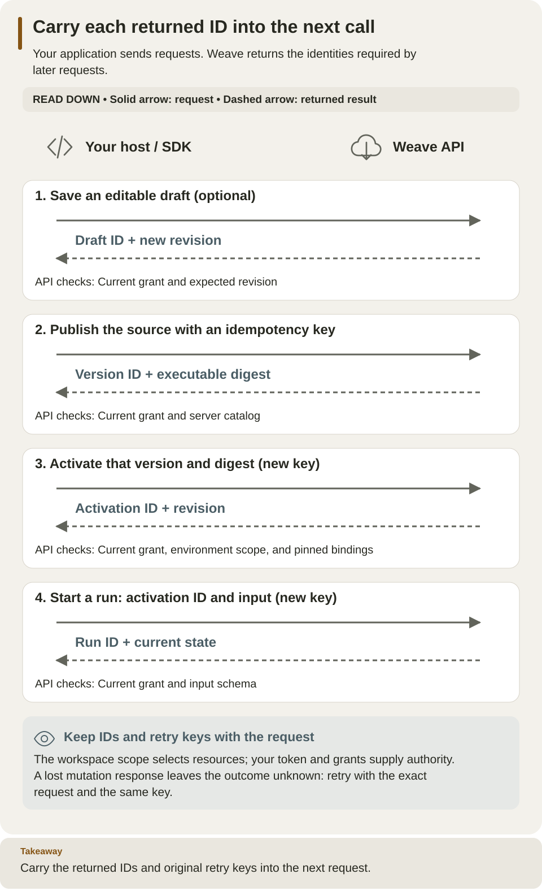

<!--
Copyright 2026 Firefly Software Foundation.

Licensed under the Apache License, Version 2.0 (the "License");
you may not use this file except in compliance with the License.
You may obtain a copy of the License at

    http://www.apache.org/licenses/LICENSE-2.0

Unless required by applicable law or agreed to in writing, software
distributed under the License is distributed on an "AS IS" BASIS,
WITHOUT WARRANTIES OR CONDITIONS OF ANY KIND, either express or implied.
See the License for the specific language governing permissions and
limitations under the License.
Author: Firefly Software Foundation
SPDX-License-Identifier: Apache-2.0
-->

# Use the HTTP API

The HTTP API is how every client talks to a Weave platform: your application
publishes workflows, starts runs, reads their progress, and answers waiting work
through it. The CLI, Studio's local host, and the Python SDK use this same API,
so an application written in any language can do what they do.

This page is for integration developers. In about 15 minutes you make two
read-only requests and one compile request with `curl`, and you learn the rules
every request follows: scope IDs, errors, revisions, and retry keys. You need:

- a running platform: one your team operates, or the
  [local platform](../guides/local-platform.md) on your computer;
- a current access token for that platform and a person or application that
  holds grants in a workspace (see [Get an access token](#get-an-access-token));
- `curl` and Python 3 in a terminal.

## Choose how to learn the API

| You want to… | Open | What you will get |
| --- | --- | --- |
| Make a first request from a terminal | [Make a read-only request first](#make-a-read-only-request-first) | Two `curl` requests that check your identity and project access |
| Look up one operation's exact contract | [Full API reference](api-explorer.md) | Every operation and schema, with a downloadable OpenAPI document |
| Send requests from your browser | [API playground](../guides/api-playground.md) | Your server's Swagger UI, how to authorize it, and a compiler request |
| Call the API from Python | [Python SDK tutorial](../guides/sdk-tutorial.md) | A script that publishes, activates, starts, and reads a run |
| Add workflows to your own product | [Host integration](../guides/host-integration.md) | Which responsibilities belong to your application and which to Weave |

**The published API reference is documentation only.** The interactive
Swagger UI lives at `/docs` on your own platform when its operator sets
`WEAVE_DOCS_ENABLED=true`. Its **Try it out** buttons send real requests to that
platform.

## Understand the three IDs in a request

Every workspace has three levels, and each one is a UUID in the request path:

- A **tenant** is an organization or team.
- A **project** inside it groups definitions: workflows, Actions, and Connectors.
- An **environment** inside the project, such as development or production, is
  where versions are activated and runs execute.

Display names cannot replace the UUIDs. The first request below lists the ones
you can use.

| Resource | Path after the API origin | Why it lives there |
| --- | --- | --- |
| Catalog, definitions, drafts, compiler | `/api/v1/tenants/{tenant}/projects/{project}` | Definitions belong to a project and can be used in all its environments |
| Activations, connections, runs, human tasks | The project path plus `/environments/{environment}` | Execution uses one environment's bindings and permissions |
| Your identity and the workspaces you can use | `/api/v1/identity` | Discover your own scopes without knowing any ID in advance |
| Published sign-in settings | `/api/v1/client-configuration` | Public, new in 0.1.0a7: how people sign in; `weave auth setup` and Studio read it |
| Health | `/health/live` and `/health/ready` | Public: operators check that the API runs and is ready |

For example, append `/catalog` to the project path to read the definitions you
can use, or `/runs/{run_id}` to the environment path to read one run. The
[full reference](api-explorer.md) gives each operation's exact path, body,
headers, and required capability.

**A token proves who you are; grants decide what you may do.** Every request
except the public ones needs a verified bearer access token from your
platform's identity provider. The platform then looks up the Weave person or
application linked to that sign-in and checks its current grants for the
requested scope. A successful sign-in alone grants nothing. See
[Give people the right access](../guides/people-and-access.md) and
[roles and lifecycle](../guides/roles-and-lifecycle.md).

## Get an access token

The CLI, Studio, and the desktop app never print the tokens they keep, so a
`curl` session needs a token from another source:

| Your platform | Where the token comes from |
| --- | --- |
| Operated by your team | Your operator's approved method, such as a CI secret or your identity provider's tooling. Follow [Use a supplied access token](../guides/connect-to-api.md#use-a-supplied-access-token) |
| The [local platform](../guides/local-platform.md) | `weave platform token` refreshes the local host token in the private file `.local/platform/host-token.json` (it prints the path, never the token) |
| A Python application | The [Python SDK](sdk.md#start-with-an-existing-api) can reuse your saved platform's sign-in (new in 0.1.0a7) or call your own token logic; no copying needed |

Keep the values in the same terminal. The API origin has no `/api/v1` suffix; on
the local platform, `weave platform status` shows it as `Api url`:

```sh
# Ask for the API origin without a path, such as https://weave.example.com.
printf 'Weave API origin: '; read -r WEAVE_BASE_URL
export WEAVE_BASE_URL
# Prompt for the token without echoing it or keeping it in shell history.
export WEAVE_ACCESS_TOKEN="$(python3 -c 'import getpass; print(getpass.getpass("Access token: "))')"
```

On the local platform, read the token file instead of typing the token:

```sh
# Refresh the local host token; the command prints only the file's path.
weave platform token
# Read the token from that private file without printing it.
export WEAVE_ACCESS_TOKEN="$(python3 -c 'import json; print(json.load(open(".local/platform/host-token.json"))["access_token"])')"
```

Expected: `Token file: …/host-token.json` from the first command and no output
from the second. Run both from the folder that holds `.local/platform`; with
`weave platform --directory PATH`, read `PATH/host-token.json` instead. Tokens
expire: when a request returns HTTP 401, get a new one the same way.

## Make a read-only request first

Start with requests that change nothing, so that a failure can only mean an
identity, scope, or network problem.

1. **Ask who you are.** This request needs no IDs, and its answer lists the
    workspaces you can use:

    ```sh
    # Read your identity, your grants, and the tenants, projects, and environments you can use.
    curl --fail-with-body --silent --show-error \
      "$WEAVE_BASE_URL/api/v1/identity" \
      -H "Authorization: Bearer $WEAVE_ACCESS_TOKEN"
    ```

    Expected: HTTP 200 and a JSON object with `principal_id`, `kind` (`human`,
    `application`, or `worker`), `grants`, and `workspaces`. Each workspace is a
    tenant with its `projects`, and each project lists its `environments`, all
    with `id` and `name`. HTTP 401 means the token is invalid or expired, or the
    platform does not know this sign-in yet; see
    [When a request fails](#when-a-request-fails).

2. **Keep the IDs of one workspace.** Copy the tenant, project, and
    environment `id` values from that answer:

    ```sh
    # Paste the UUIDs from the identity answer; display names do not work in paths.
    printf 'Tenant UUID: '; read -r WEAVE_TENANT_ID
    printf 'Project UUID: '; read -r WEAVE_PROJECT_ID
    printf 'Environment UUID: '; read -r WEAVE_ENVIRONMENT_ID
    export WEAVE_TENANT_ID WEAVE_PROJECT_ID WEAVE_ENVIRONMENT_ID
    ```

3. **Read the project catalog.** Your identity needs the `catalog.read`
    capability in that project:

    ```sh
    # Read the definitions this project can use before changing or running anything.
    curl --fail-with-body --silent --show-error \
      "$WEAVE_BASE_URL/api/v1/tenants/$WEAVE_TENANT_ID/projects/$WEAVE_PROJECT_ID/catalog" \
      -H "Authorization: Bearer $WEAVE_ACCESS_TOKEN"
    ```

    Expected: HTTP 200 and the catalog as JSON with `definitions`, `tasks`,
    `adapters`, and `schemas`; a new project's lists can be empty. HTTP 403 with
    `WV-FORBIDDEN` means you are known but hold no grant for this project.

<a id="make-one-request-before-reading-the-inventory"></a>

## Compile a workflow without publishing it

Compiling checks a workflow against the project's catalog and returns the
compiled artifact. It saves nothing, publishes nothing, and starts no run. Your
identity needs the `compile` capability in the project.

1. **Create a workflow file.** Write `.local/tutorial/echo.workflow.yaml` as in
    the [quickstart's definition step](../quickstart.md#create-the-definition),
    then return to the folder that contains `.local`.

2. **Wrap the YAML in a JSON request.** The API takes the source as a string,
    so encode it rather than pasting it:

    ```sh
    # JSON-encode the YAML so its quotes and newlines survive the HTTP request intact.
    python3 - <<'PYTHON'
    import json
    from pathlib import Path
    request = {
        "source": Path(".local/tutorial/echo.workflow.yaml").read_text(),
        "format": "yaml",
        "filename": "echo.workflow.yaml",
        "strict": True,
    }
    Path(".local/tutorial/compiler-request.json").write_text(json.dumps(request))
    PYTHON
    ```

3. **Send it to the compiler.** Leaving out `catalog` makes the server use the
    project's current authorized catalog:

    ```sh
    # Compile against the project's catalog; nothing is saved or executed.
    curl --fail-with-body --silent --show-error \
      "$WEAVE_BASE_URL/api/v1/tenants/$WEAVE_TENANT_ID/projects/$WEAVE_PROJECT_ID/compiler/compile" \
      -H "Authorization: Bearer $WEAVE_ACCESS_TOKEN" \
      -H 'Content-Type: application/json' \
      --data-binary @.local/tutorial/compiler-request.json
    ```

    Expected: a compiler result with `ok: true`, `partial: false`, and an
    `artifact`. `filename` is only a label for diagnostics; the server never
    opens a file with that name.

**HTTP success and compiler success are separate checks.** A 200 response can
still carry `ok: false` with diagnostics: read `ok` and `diagnostics` as well as
the status.

**To publish instead,** send `{"source": "<the YAML text>", "format": "yaml"}`
to the project's `/workflows` collection with an `Idempotency-Key` header. The
[SDK lifecycle example](sdk.md#extend-the-host-to-publish-activate-and-run)
shows how the returned version ID and digest feed activation and the first run.

## When a request fails

Errors arrive as `application/problem+json` with `status`, a stable `code`, a
safe `message`, a `request_id`, and `diagnostics`. Quote the `request_id`
(also in the `X-Weave-Request-ID` header) when you ask an operator for help.

| What you see | Why | What to do |
| --- | --- | --- |
| HTTP 401, `WV-UNAUTHENTICATED` | The token is missing, malformed, or expired, was issued for another API, or its sign-in is not linked to a Weave person or application | Get a new token. If it still fails, ask an administrator to link your identity ([People and access](../guides/people-and-access.md)) |
| HTTP 403, `WV-FORBIDDEN` | You are known but hold no current grant with the required capability in that scope | Check the IDs in the path, then ask for the role you need |
| HTTP 404, `WV-NOT-FOUND` | No resource with that ID exists in the scope of the path | Check every ID in the path, including the environment |
| HTTP 409, `WV-IDEMPOTENCY-CONFLICT` | You reused an `Idempotency-Key` with a different request body | Use a new key for a new request; reuse a key only for an exact retry |
| HTTP 412, `WV-ETAG` | Your `If-Match` revision is no longer the current one | Read the resource again, merge your change, and resend with the new revision |
| HTTP 422, `WV-VALIDATION`, `WV-IDEMPOTENCY`, or `WV-ETAG` | The body does not match the contract, a required `Idempotency-Key` is missing, or `If-Match` is not a positive revision | Compare field names and types with the [full reference](api-explorer.md); send the revision as `"2"` or `2` |
| HTTP 422, `WV-FILTER` | A list query combines filters that contradict each other, or has an invalid time range (empty, or longer than 400 days); the `message` names the rule that failed | Change or remove the filters the message names, then send the request again |
| HTTP 501, `WV-UNAVAILABLE` | This server does not serve the operation yet | Use an operation this server serves, or ask your operator for a release that serves it |
| A timeout or lost connection during a change | The outcome is unknown: the change may or may not have happened | Keep the original body and key; read the resource, and retry only with the same key |

## Request rules: paths, errors, revisions, and retries

These rules hold for every operation. Read them before you send your first
change.

### Paths

- New code uses the versioned `/api/v1/tenants/...` paths. The older
  `/tenants/...` paths remain as compatibility routes to the same handlers,
  authorization, and data; they do not redirect.
- `/admin/tenants` and `/admin/grants` keep their own, separately authorized
  paths.
- Health probes, signed webhooks (`POST /webhooks/{identifier}`), and provider
  ingress (`/provider-ingress/{identifier}`) stay at the root. A webhook is
  checked against its trigger's signature over the exact timestamp and raw
  bytes; a bearer token never replaces that signature.
- Nothing in a request can raise your authority: identity-provider roles, a
  catalog lock you send, or a compiled artifact grant no execution or
  publication right. Each operation checks your identity and scope again.

### Headers and errors

- Canonical responses carry `X-Weave-Wire-Version: weave/api-v1` and
  `X-Weave-Request-ID`, even when authentication fails early.
- Errors use `application/problem+json` with `status`, `code`, `message`,
  `request_id`, and `diagnostics`. When an operation has a safe compiler result
  or an "unavailable" result, `result` keeps it.
- Errors never contain a framework traceback, a token, or a resolved
  connection credential.
- Worker credential leasing is the one deliberate secret boundary: it answers
  with `Cache-Control: no-store` and `Pragma: no-cache`, and its schema declares
  the secret `value` field. See the [worker protocol](worker-protocol.md).

### Revisions (ETags)

Resources that change, such as drafts, carry a **revision**: a positive number
that grows with each change.

- Responses send it as a quoted ETag, such as `"2"`.
- Send it back in `If-Match` to say "change this only if it is still revision
  2". Both `"2"` and the bare `2` are accepted. Weak (`W/"2"`), wildcard,
  multiple, zero, signed, and zero-padded values are invalid.
- A stale draft write answers HTTP 412 (`WV-ETAG`). Debug sessions and
  incidents keep their own conflict codes.
- The SDK reports the real status and code instead of converting every
  revision conflict to one error.

### Idempotency keys

An **idempotency key** is a name you choose for one intended change, so that a
retry cannot apply it twice. These changes require an `Idempotency-Key` header
of 1 to 200 characters:

- publishing and retiring definitions, and creating and retiring activations;
- starting, retrying, pausing, resuming, archiving, restoring, and purging
  runs;
- claiming, releasing, reassigning, and completing human tasks, and saving
  human assignments and groups.

The [full reference](api-explorer.md) shows the header on every operation that
accepts it. The rules for using a key:

- Sending the same key, from the same principal and scope, with the exact same
  body returns the result that was already committed. The same key with a
  different body fails with HTTP 409.
- Replaying an activation key also needs your current `release.activate` grant.
  A caller whose grant was revoked gets HTTP 403 (or 401 once the token stops
  working) instead of the activation that was already created.
- Clients never retry a change on their own after a timeout or another
  outcome they cannot know. If you retry, send the exact same body and key. The
  exceptions are rejections that mean the platform did not admit the request:
  HTTP 429 with `WV-OPERATION-CAPACITY` or `WV-REQUEST-CAPACITY`, and HTTP 503
  with `WV-COMPATIBILITY`. For these, Studio sends a read, or a change that
  carries a key, again with the same key, honoring `Retry-After`, for at most
  four attempts in all. Studio sends a `WV-COMPATIBILITY` refusal again only
  when its `Retry-After` is 5 seconds or less.
- A `WV-COMPATIBILITY` refusal carries `Retry-After` with the whole seconds
  until the server's next automatic compatibility rescan. An explicit
  compatibility check can lift a restricted verdict sooner.
- Creating a connection revision accepts an optional key since 0.1.0a7: with
  one, a retry returns the revision already created; without one, every request
  creates a new revision. Debug commands
  have no idempotency guarantee.

### AI discovery, readiness and setup

Six operations, all in one environment, let a client choose and set up an AI
connection. They are additive: no role, migration, definition schema or stored
digest changes, and none of them sends a prompt or a model credential to a
client.

```text
GET  .../ai/endpoints
GET  .../ai/models?connection=<revision UUID>
GET  .../ai/models?connection=<revision UUID>&refresh=true
GET  .../ai/readiness
POST .../ai/setup/publish  {}
POST .../ai/setup/grant    {"connection_revision_id":"<revision UUID>"}
GET  .../bindable-connections?connector=weave-agentic-provider%401.0.0&limit=50
```

Each `...` stands for `/api/v1/tenants/{tenant}/projects/{project}/environments/{environment}`.
`ai_models.list` and `bindable_connections.list` parse their query strictly: an
unknown or repeated parameter, a malformed UUID, a `refresh` other than `true`
or `false`, or a `limit` outside 1 to 100 answers 422 `WV-VALIDATION` before any
record is read. The other four operations take no query parameters. Request
bodies are limited to 64 KiB (413 `WV-AI-LIMIT`).

| Who | Can do |
| --- | --- |
| `catalog.read` (viewer, developer) | Read endpoints, cached model metadata and readiness |
| `connection.manage` (tenant administrator) | Refresh discovery, test AI connections, authorize workers with `ai_setup.grant` |
| `definition.publish` at project scope (developer) | Publish the built-in AI Connector and Action with `ai_setup.publish` |
| `connection.bind` (deployer) | List connection choices with `bindable_connections.list` |

#### Endpoints and models

`ai_endpoints.list` returns the operator-approved endpoint presets, without network
rules or credential locations. `ai_models.list` requires a `connection` revision
ID and returns approved cached metadata with `catalog.read`; it does not require
connection binding or management permission. Both operations recheck current
permissions in the selected environment and return `Cache-Control: no-store`.

Set `refresh=true` to discover models through the AI gateway. This also requires
`connection.manage`. Refreshes and AI connection tests share six admissions per
minute per person. A test and its automatic refresh use one admission. A saved AI
connection refreshes after the save commits, using its own admission, and the save
answers after that refresh, within about 20 seconds; a refresh failure preserves
the successful save or test result. A refresh spends an admission only when it
calls the AI gateway: without a policy, for an endpoint or provider outside it, or
without a gateway, it answers without resolving the credential or spending one.

The cache retains metadata only, for up to five minutes, with at most 128 records,
8 MiB in total and 256 KiB per record. Entries are isolated by environment,
revision and policy content. A restart, another API process or an expired entry
can return `discovery: "unknown"`; a passive read never calls a provider. An absent
policy returns unknown approval and no models. A failed refresh replaces prior
health with its safe discovery code and an empty model list. Discovery traffic
always runs through the configured AI gateway.

Discovery reports what the endpoint serves; it never pulls a model, never grants
network access and never changes the approval. For an Ollama endpoint, the gateway
reads Ollama's own model list and each model's details, so `tools` is `yes` only
when Ollama reports tool support for that model, never a guess from its name.
Ollama discovery reads at most 50 models, in name order, within 10 seconds; a
model whose details do not arrive in time is listed with unknown facts. Other
providers' model lists are read up to 50 names.

Approval and availability are separate. When the policy lists an endpoint's
approved models, each listed model the endpoint does not report appears with
`available: false`: for Ollama the API adds these rows, and for other providers
the AI gateway does. Because provider lists stop at 50 names and Azure endpoints
list no deployments, outside Ollama `available: false` means that the endpoint
did not report the model, not that it is not installed. Either way the worker
answers `LLM_MODEL_NOT_FOUND` if a step uses a model the endpoint does not serve.

Without a mounted policy (`WEAVE_AI_POLICY_FILE` on the API), `approval` is
`unknown` and the list is empty. A client then lets people type the model name,
with a warning that the platform does not publish its approved models and that
the worker refuses models it has not approved. A configured policy that cannot be
read answers 503 `WV-AI-POLICY`; a policy that changes during a refresh answers
409 `WV-AI-POLICY-CHANGED`, and a new refresh reads the current one.

Model credentials never travel over plain HTTP. A keyless connection uses the
reserved secret handle `no-credential`, which is never resolved, leased, logged
or sent; discovery and tests of such a connection send no credential.

#### Readiness

`ai_readiness.read` returns eight ordered checks for installed worker releases,
published AI definitions, worker presence, current connections, secret grants,
worker credential authorization, recent AI tests and Weave AI configuration.
It reads one consistent snapshot and never calls the gateway, resolves a secret
value or changes platform state. The key check confirms an operator grant;
it does not confirm that the secret provider currently holds a value.

The checklist requires `catalog.read` and rechecks current permissions. Restricted
items are `unknown` with a required role, without identifiers, configuration or
hidden counts. Connections use the latest revision per name across all connector
types. A successful dedicated AI test must be less than 24 hours old; generic
tests and missing, malformed or future timestamps cannot establish health.

Each collection is limited to 1,000 matching records, with an 8 MiB cumulative
read budget. A complete observation that exceeds either bound is `unknown`,
never a healthy partial result. Responses, including errors, disable storage
with `Cache-Control: no-store`. Fixes contain server-owned guidance or currently
available operations; execution still requires the operation's own authority.

The age of the last AI test is measured with the database clock, which also
dates each test, so a test that just passed reads as `done` on every API
process.

#### Setup actions

`ai_setup.publish` accepts an empty body or `{}` and publishes the server's
built-in AI Connector and Action in one project transaction. It requires
`definition.publish` at project scope on both the request and current principal;
an environment-only grant is insufficient. Digest-derived keys make retries return
the same version IDs. A conflicting immutable version answers 409
`WV-VERSION-CONFLICT` and a retired built-in answers 409 `WV-AI-CATALOG-RETIRED`;
setup never overwrites or reactivates them. Publication rejects more than 1,000
project-wide worker releases or 8 MiB of release payloads with 429 `WV-PAGE-LIMIT`
before compilation. The built-in Action compiles against the exact built-in
generate task, so publication also requires an admitted worker release in the
project that provides it; without one it returns 422 `WV-AI-WORKER-MISSING` before
publishing anything.

`ai_setup.grant` accepts only `{connection_revision_id}` and requires
`connection.manage` in the selected environment. It revalidates the stored AI
revision, then authorizes every exact built-in credential capability actually
present in each admitted release in that environment. Active pairs are skipped;
revoked pairs are reenabled. An approved keyless connection returns
`{granted: false, not_needed: true}` without reading worker grants. Credentialed
connections with no relevant admitted release return 422 `WV-AI-WORKER-MISSING`.
Release and existing-grant reads share an 8 MiB budget and each allow at most 1,000
records; exceeding a bound returns 429 `WV-PAGE-LIMIT` before any grant is written.

Both setup operations return 200 on success, audit accepted requests, roll back
on failure or cancellation, and return `Cache-Control: no-store`, including on
errors. Neither operation resolves credential values or calls a provider. The
readiness checklist offers **Publish** or **Authorize** only when both permission
snapshots allow the operation and the operation can repair the observed missing
state: **Publish** appears only once `worker_installed` is `done`, and
**Authorize** only once `key_available` is `done`.

#### Connection choices

`bindable_connections.list` is the one list every connection dropdown uses. It
returns only the revisions the caller may bind now: `connection.bind` is checked
for each revision, on both the token and the current grants, so a grant limited
to some revisions lists exactly those. Each item carries `connection_id`,
`revision_id`, `name`, `label`, `connector` and `enabled`; AI connections add
`provider` and the endpoint's origin (`endpoint_origin`), never its path,
configuration, destinations or secret handles. `connection_id` is the same
UUID as `revision_id`: a connection is identified by its immutable revision.
`enabled` is `false` when the revision fails the checks a binding runs now, for
example because its Connector version was retired or its secret handle is no
longer granted in the environment.

Filter with `connector` (an exact `name@version`). `limit` defaults to 50 and
accepts 1 to 100. `next_cursor` continues the same list: it is bound to the
environment, the caller and the filter, and a cursor from another list answers
422. Reading this list needs `connection.bind`; a caller without it gets 403.

#### Activations with AI steps

When the API has a policy mounted, a new activation of a workflow with AI task
(`llm`) steps checks each of those steps against the connection bound to its slot,
after every binding passed its own authorization and before anything is written:

| Problem code | Status | Meaning |
| --- | --- | --- |
| `WV-ACTIVATION-AI-PROVIDER` | 422 | The step's `provider` differs from the connection's provider |
| `WV-ACTIVATION-AI-MODEL` | 422 | The policy does not approve the step's model for the connection's exact endpoint |
| `WV-AI-POLICY` | 503 | The configured policy cannot be read; only activations with AI steps are refused |

The check reads the policy file again for each activation, so a policy edit
applies without a restart. Approval is the policy's answer: a `served` endpoint
admits any well-formed model name, whether or not it is installed yet. Without a
policy, activation behaves as before and the worker remains the only judge.
Replaying a committed activation key returns that activation without a new
check (it still needs current `release.activate`). Runs of earlier activations
are unchanged: the worker keeps refusing a model that is no longer approved with
`LLM_POLICY`, and a missing model with `LLM_MODEL_NOT_FOUND`.

### Health probes

`GET /health/live` answers `{"status":"up"}` while the process runs, and
`GET /health/ready` answers `{"status":"ready"}` when it can serve requests.
When the API is not ready, `/health/ready` answers HTTP 503 with the same safe
problem envelope as other errors, so check the HTTP status or the `status`
field. Failure details, database URLs, and credentials are never included, and
the request ID is generated by the server. Only these exact paths are public.

## Authoring and lifecycle



Read down: solid arrows are your requests and dashed arrows return the IDs that
the next request needs. The API checks your grant at every step; revisions
protect edits, and idempotency keys make retries safe.
[Open diagram at full size](../diagrams/authoring-host-sequence.svg).

**Compile and validate.** `compiler/compile` and `compiler/validate` accept
`source`, `format`, an optional `filename`, an optional canonical `catalog`, and
`strict`.

- With an explicit catalog lock, the diagnostics, source locations, source map,
  and artifact digest are the same as in [local compilation](cli.md#local-workflow-commands).
- Without `catalog`, **compile** uses the project's current authorized catalog.
- Without `catalog`, **validate** performs partial validation: `partial`,
  `validationOk`, `ok`, `artifact`, and the diagnostics keep their separate
  meanings. `strict=true` then has no effect, exactly like
  `weave workflow validate --strict` without a catalog: it neither promotes
  warnings, rejects the request, nor substitutes an empty catalog.
- Partial validation does not prove a workflow can be deployed. Publication
  always repeats the server's authority and catalog checks.

**Drafts.** Saving a draft appends a new document revision.
`DELETE drafts/{identifier}` retires a draft; it needs `definition.write`, the
current grants, and the latest revision.

- The answer carries a new lifecycle revision and the retained document
  revision.
- A missing draft answers HTTP 404, a stale revision HTTP 412, and repeating a
  retirement that already happened is a conflict rather than new work.
- Reads and exports keep every revision with its retirement metadata. Lists
  leave retired drafts out by default, and a later save cannot bring the ID
  back.

**Published versions and connections never change.** A change publishes a new
version; retiring a version keeps its history. Updating a connection creates a
new connection revision with a new ID.

**Triggers.** Each trigger ID is one immutable configuration revision with its
own signed webhook URL and receipts. Replacing a trigger creates a new ID and
disables the previous route. The switch is not atomic: there can be an overlap
or a gap, and one event sent to both revisions can start two runs. Coordinate
the switch with the sender, or deduplicate upstream.

**Installed connectors.** Since 0.1.0a7,
`GET …/projects/{project}/connector-descriptors` lists the connectors installed
on the platform, and `…/connector-descriptors/{adapter}` reads one. Each
descriptor holds the exact Connector manifest to publish (`source`), its
capabilities, bindings, Actions, and connection settings, plus
`published_version_id` once it is published in the project. Both need
`catalog.read`. `weave connector descriptor ADAPTER` prints the same view.

## Discovery, debugging, and history

**Lists.** Canonical lists return `{ "items": [...], "next_cursor": null | "opaque" }`.

- `limit` is 1 to 100 (50 by default). Items come in stable ID order unless a
  list documents another order: `runs.list` and run summaries are newest
  started first, and incident lists newest opened first, by default (see below).
- Pass `next_cursor` back as `cursor` for the next page. A cursor is bound to
  its tenant, project, environment, collection, and any run or schedule filter;
  a cursor from another scope or filter is rejected.
- A cursor describes a position, not a snapshot: items created or retired
  meanwhile can change later pages.
- Compatibility endpoints that return plain arrays keep that shape.

**Who may list what.** Listing a whole collection needs the scope-wide
capability: connections `connection.manage`, runs and schedules `run.read`,
workers `status.read`, releases and the catalog `catalog.read`, triggers
`trigger.manage`, incidents `incident.read`. Grants are reloaded in the same
transaction. A resource whose classification cannot be checked appears as an
explicit safe placeholder; a list never widens access.

**Debug sessions** belong to a project and to the person who created them.
They expire in real time, use revisions, run Actions only against mocks, and
support breakpoints and virtual time. The response is a `DebugSession` envelope
that contains a `view`. Source-map file names are labels only. No connector or
secret provider runs during a simulation.

**History and replay.** Run history pages use a bounded high-water cursor and
keep the pinned source, receipt, and version facts, with explicit omissions.
Replay reports `consistent`, `inconsistent`, or `incomplete`: a history prefix,
or a history with unavailable or redacted parts, is never reported as success.
See [history and replay](history-and-replay.md).

**Run summaries, steps, and logs.** `run_summaries.list` and `runs.steps` serve
scoped operational metadata after checking both token and current permissions.
`runs.logs` remains a published contract: an authorized request answers `501`
with `WV-UNAVAILABLE`.

- Run summaries and `runs.list` default to `order=started_desc`. They also accept
  `started_asc` and `updated_desc`; `runs.list` additionally accepts `order=id`.
  Use explicit `order=id` with legacy v1 cursors. The original business-key,
  correlation-key, single-status and archive filters retain their v1 collection;
  additional filters bind the cursor to the normalized query.
- Chronological lists use v2 cursors with UUID tie breakers and unknown times
  last. `updated_desc` is a live view: updates can move a run between pages,
  so refresh from the first page to see its latest position. Steps sort by
  scheduled time, static step ID and full instance key; unknown times sort last.
- `runs.steps` and `runs.logs` accept a `limit` of 1 to 500 (200 by default).
- Each cursor is bound to every filter and to the order. After you change a
  filter, start again from the first page.
- Test runs are left out unless you send `include_test=true`, and archived runs
  unless you send `include_archived=true`. This applies to `runs.list` too.
- `runs.list` and run summaries reject unknown query parameters, and a `limit`
  outside 1 to 100 answers `422` with `WV-VALIDATION`.
- A `runs.list` page is limited to 8 MiB of retained run data. A larger page
  answers `429` with `WV-PAGE-LIMIT`; request a smaller `limit`.
- A contradictory filter, such as `version` without `workflow`, answers `422`
  with `WV-FILTER`; the message names the rule that failed.
- Send times as RFC 3339 with an offset. Use `Z`, or encode `+` as `%2B` in the
  query string.

Step timelines do not read payloads unless `include=output` is requested. Only
the displayed outputs are fetched, after checking the bounded run artifact and
classifying each output. The outputs on one page are limited to 8 MiB in total;
a larger page answers `429 WV-PAGE-LIMIT`, so request a smaller `limit`. An
omitted output carries an omission reason; a returned JSON `null` is distinct
from an omitted output. The output of an instance key with an activation
segment (`#`) or a yield count (`~`) is omitted as `classification_unavailable`,
because its step's schema does not describe it. Synthetic control
instances do not appear. `complete=false` means the run has author step
instances without facts, even when they fall outside the current page or filter.
Their unknown timestamps remain null. Legacy metadata is streamed in batches
of 500, up to 100,000 keys and two seconds per request; exceeding either budget
answers `429 WV-RUNTIME-LIMIT`. A run this platform cannot run yet answers
`422 WV-IR-UNSUPPORTED`, as `runs.read` does; a run with unavailable legacy
evidence answers `409 WV-LEGACY-UNAVAILABLE`. Timelines, summaries and incident
lists follow the run's stored listing decision. After an upgrade lets the
platform run such a run again, `runs.read` serves it at once, but its timeline
keeps answering `422 WV-IR-UNSUPPORTED` until the scheduler re-checks the
decision in the background. Each minute the scheduler visits up to 16 tenants
and re-checks at most 100 runs in one environment of each, so a large backlog
takes a long time; see [Upgrades](../operations/upgrades.md#runs-that-need-a-newer-server).
In `runs.list`, only a recorded policy block withholds a run before its own read
classifies it.

**Incidents.** `incidents.list` and the paged `incidents.run_list` read
incident facts after checking both token and current permissions; they never
load run payloads. `incidents.read` (`GET …/incidents/{identifier}`) reads one
incident for a direct link and sends its revision as the `ETag`, ready for
`incidents.resolve`.

- Filters: `status` (repeatable: `active`, `closed`, `resolved`; every status
  when omitted), `code`, `workflow`, `node_id`, `opened_after`,
  `opened_before`, and `include_test`. `node_id` is a static step ID and
  matches every instance of that step. Opening times follow the run summary
  rules: RFC 3339 with an offset, `opened_after` earlier than `opened_before`,
  and a range of at most 400 days.
- Incident lists default to `order=opened_desc` and also accept `opened_asc`
  and `order=id`. Incidents whose opening time is unknown come last. ID order
  without filters keeps the earlier cursors, so send explicit `order=id` to
  continue one; every other cursor is bound to the run, each filter, and the
  order.
- Incidents of test runs are left out unless you send `include_test=true`.
  Incidents of archived runs stay listed.
- Incident views add `opened_at`, `updated_at`, `workflow` (`name` and
  `version`), `run_status`, `test`, and, for an incident of a repeated step
  instance, `instance_key`; `node_id` is then the static step ID. Each is left
  out while unknown, false, or empty. `opened_at_estimated: true` marks an
  opening time taken from the run's last recorded event because the incident's
  own opening event was not retained; an unknown opening time is never
  estimated.
- An incident on a control step, a switch or parallel branch output
  (`@branch:…`) or a join (`@join:…`), keeps that control-step ID as `node_id`
  and has no `instance_key`. The `node_id` filter takes author step IDs, so it
  does not select these incidents.
- An incident whose run metadata cannot be classified, whose run has a recorded
  policy block, or whose step does not match its incident facts is an
  unavailable placeholder. `incidents.read` then sends no `ETag`.
- `incidents.resolve` answers with the incident as stored, without the added
  fields; for a repeated step instance, its `node_id` is the full instance key.
  Read the incident again with `incidents.read` after resolving to show it as
  the lists do.
- A page is limited to 8 MiB of retained incident data; a larger page answers
  `429` with `WV-PAGE-LIMIT`. Unknown query parameters are rejected, and a
  `limit` outside 1 to 100 answers `422` with `WV-VALIDATION`.

**Worker identity.** `workers.create` accepts an optional `identity` describing
where the worker runs: `host`, `runtime` (`embedded`, `container`, or
`process`), `sdk_version`, `language_version`, `os`, `arch`, `platform_hint`
(`kubernetes`, `docker`, or `none`), `namespace`, `node`, and up to 8
`labels`. It is display metadata and never grants authority or placement.

- `host`, `namespace`, and `node` are host or DNS names of at most 253
  characters. Versions, `os`, and `arch` have at most 64 letters, digits, `.`,
  `_`, `+`, or `-`.
- Label keys have at most 64 characters and must not name a token, password,
  secret, or authorization; values have at most 256 characters without control
  characters. The whole identity is at most 4 KiB as stored JSON.
- Unknown fields, a `placement` among them, are refused with `422`
  `WV-VALIDATION`; placement is derived by the server, never reported.
- The registration answer keeps its earlier shape and does not repeat the
  identity. `workers.read`, `workers.list`, `workers.drain`, and
  `workers.resume` return `identity` and `registered_at` (the database time of
  registration) when they are known. Workers registered before the server
  recorded them have neither.

An older server refuses `identity` with `422` `WV-VALIDATION`. Current packaged
workers and the Python SDK then register exactly once more without it, using the
same client and credentials; any other failure is not retried. Native executors
register inside the API process and always use a server of their own version.
The registration answer's schema (`WorkerInstance`) has no `identity` field.

**Worker fleet.** `workers.list` reads every page with one database query,
including each worker's active leases, and checks `status.read` on both the
token and the current principal.

- By default it lists current workers: not revoked, and seen in the last hour
  or, never seen, registered in the last hour. `state=all` lists every worker,
  including revoked ones and workers registered before registration times were
  recorded.
- Filters: `presence` (`recent`, `stale`, or `unknown`, with the 60-second
  presence window), `draining`, `release_id`, `task_type` (a capability as
  workers register it, such as `echo@1.2.0`), `target_id`, and `host_prefix`, a
  literal, case-sensitive prefix of the reported host in which `%` and `_`
  match only themselves. `target_id` needs `deployment.read` on that target.
- Orders: `last_seen_desc` (default) and `registered_desc`; unknown times come
  last, and equal times are ordered by ID. Cursors are bound to every filter and
  the order. A `limit` outside 1 to 100 or an unknown query parameter answers
  `422 WV-VALIDATION`, and a page is limited to 8 MiB of worker data
  (`429 WV-PAGE-LIMIT`).
- `placement` names the deployment component a worker runs in:
  `target_id`, `target_name`, `deployment_id`, and `component`. The server
  matches the worker's reported `host` against the members of the latest
  complete observation of each target, taken at the target's current revision
  and not yet expired. Only targets that both the token and the current
  principal may read with `deployment.read` are considered, so other targets'
  names never appear. A host listed by more than one readable target or
  component, a native executor (`runtime: embedded`), and a worker without a
  reported host have no placement. Because uniqueness is decided among readable
  targets, a reader restricted to some targets can see a placement for a host
  that a reader of every target sees as ambiguous, and so without placement.
- `drained_at` is the time the worker started draining. A repeated drain keeps
  it and resuming clears it; workers drained before the time was recorded show
  none. `workers.read` returns the same fields as the list, and `workers.drain`
  and `workers.resume` answers include `drained_at` but no placement.

`workers.retire_stale` (`POST …/workers/retire-stale`, `release.retire`,
Idempotency-Key) revokes workers that hold no active lease and whose last
contact (or registration, if never seen) is older than `older_than_seconds`,
from one hour to 30 days. A worker without either time is never retired. Each
command revokes at most 100 workers, oldest last contact first, and answers
`{matched, revoked, worker_ids}`: `matched` counts every eligible worker, and
`revoked` and `worker_ids` describe this batch. `dry_run: true` returns the same
batch without revoking it. Repeating an Idempotency-Key returns the saved
answer; send a new key for the next batch. Retirement never deletes or settles
leases, and a worker another command is holding is left for the next batch.

`releases.usage` (`GET …/worker-releases/{identifier}/usage`, `catalog.read`)
answers `{workers, deployments, activations, next_cursor}`:

- `workers` counts every instance of the release once: `revoked`, else
  `draining`, else `online` (seen in the last 60 seconds) or `offline`.
- `activations` counts the activation revisions that pin the release and can
  still start runs: neither they, the latest revision of their activation, nor
  their workflow version is retired.
- `deployments` lists, at most `limit` (1 to 100, default 100) at a time, the
  desired deployment components whose admitted release and image digest are
  this release: `target_id`, `target_name`, `deployment_id`, `deployment_name`,
  `component`, and `replicas`. Only targets that both the token and the current
  principal may read with `deployment.read` are listed; without that capability
  the list is empty. `next_cursor` continues the list for the same release and
  readable targets.
- A release of another environment answers `404 WV-NOT-FOUND`.

**Environment summary.** `operations_summary.read`
(`GET …/environments/{environment}/operations/summary`, `weave operations
summary`) answers one environment's platform health in a single read. It needs
`status.read` on both the token and the current principal, and reads every
section in the same transaction that reloads those grants.

- `observed_at` is the database time of the answer. `api` names the server
  `version`, its image `build` digest when the server knows it, the `instance`
  ID of the process that answered (new each time it starts), its
  `uptime_seconds`, and `compatibility` (`mode` and the number of this
  project's `findings`).
- `health` lists `database` (with `latency_ms` of a bounded probe), each
  background loop (`recovery_loop`, `schedules`, `outbox_loop`,
  `provider_loop`, `kafka_loop`, `operations_loop`, `alert_evaluator`),
  `native_executors`, and `telemetry`, each with a `state` of `ok`, `degraded`,
  `down`, or `disabled`. Loops add `last_started_at` and `last_ok_at` when
  known, `consecutive_failures`, and `recent_failures` (failed cycles among
  the last 20). `telemetry` is `disabled` while export is off, `degraded` when
  the process dropped telemetry within the last three metrics export intervals
  (90 seconds by default), and `ok` otherwise. Health is measured by the
  process that answered; no exception text is returned.
- `load`: `runs_active` (active by status, as the run usage counter counts
  them, with test runs left out), `tasks_ready` and
  `oldest_ready_seconds` (tasks due now; a retry joins when its next attempt is
  due), `tasks_leased`, `waits_active`, `waits_overdue` and
  `oldest_overdue_seconds`, `outbox_pending` and `outbox_oldest_seconds`,
  `provider_pending`, and `sources_enabled`. Task and worker figures count test
  runs' work too, because they measure shared capacity. An age is `null` when
  nothing waits.
- `workers` counts current workers as `workers.list` lists them by default:
  `online` (seen in the last 60 seconds), `offline`, `draining`, the `capacity`
  of online workers that are not draining, and the `active_leases` workers hold.
- `targets` needs `deployment.read` and counts only the targets both the token
  and the current principal may read: `total`, `runner_online`, `busy` (an
  active job), `reconciliation_required`, and `awaiting_approval` (plans that
  can still be approved: unexpired, on a fresh observation of the current
  target and deployment revisions, and neither approved nor applied).
- `incidents` needs `incident.read`: `active` and `opened_24h`, leaving out
  incidents of test runs. `opened_24h` counts only known opening times: an
  incident whose opening time the upgrade estimated is never counted.
- `attention` lists at most 20 items, `{kind, id, title}` plus `expires_at` for
  approvals, in this order: jobs that need reconciliation, plans you may
  approve (soonest expiry first), offline workers that still hold active
  leases, active incidents, targets whose runners are all offline, a restricted
  compatibility verdict (`id` is `compatibility`), and runs that failed in the
  last hour. Within a kind, items come oldest first, then by ID. Each kind
  needs the capability that reads its records: `deployment.read` on the target
  for jobs and runners, `deployment.read` and `deployment.approve` on the same
  target for approvals, `incident.read` for incidents, and `run.read` for
  failed runs. Items you may not read are left out; test runs never appear.
- A section you may not read is `{"state": "forbidden"}`; none of its queries
  run, and leaving it out records no authorization denial. Each section has two
  seconds of database time in all (or a stricter statement timeout already in
  force), shared by its queries: each runs under what is left. One that runs
  out, or meets a transient database failure, is `{"state": "unavailable"}`
  while the others are still served with `200`. Neither state is ever reported
  as zero. The answer has no 24-hour run figures yet.

Loop states follow these rules. A loop is `disabled` when its setting turns it
off (API-only replicas disable every scheduler loop) and `down` while its task
is not running. It is `degraded` before its first successful cycle, after 3
failed cycles in a row or 3 failed cycles among its last 20, and when its last
success is older than three poll intervals. A cycle still running within its
loop's budget is on time: 5 seconds for the outbox and broker traversals, 30
seconds for recovery and schedules, and 60 seconds for provider and mailbox
polling. A cycle that starts no work, such as an outbox cycle while the platform
is not ready or while no delivery slot is free, is neither a success nor a
failure, so a loop that keeps waiting turns `degraded` without counting
failures. Ages use the process's monotonic clock; the times shown come from
its wall clock.

**Telemetry settings.** `operations_telemetry.read`
(`GET …/projects/{project}/operations/telemetry`, `weave operations
telemetry`) needs `status.read` for the project, on both the token and the
current principal; an environment grant is not enough. It answers whether
telemetry export is `enabled`, whether `traces` and `metrics` have a collector
`configured` and its `host` name, the metrics `interval_seconds`, and how many
telemetry items this process has `dropped`. It never returns endpoint paths,
ports, queries, credentials, or headers.

**Answers that say "unavailable".** Cancellation and task completion can return
an unavailable acknowledgment when the platform cannot classify the historical
data or compare payloads; task completion then includes
`payload_match: unavailable`.

**Large runs.** Cancelling a supported historical run whose state is larger than
the current processing budget can return `CapacityRunAcknowledgment` instead of
a full `RunView`. It holds `id`, the terminal `status`, `accepted_sequence`,
`capacity_limited: true`, an explicit omission of `/state` with reason
`resource_limit`, and `external_effects_may_continue`. The cancellation and its
complete history are committed; only the large state is left out of the
answer. Handle both shapes. Cancellation stops further orchestration, but it
cannot undo an external call that is already in progress.

## Operation inventory

The table lists every operation with its canonical path and the capability it
requires. "Public probe" marks the endpoints that need no token. The contract
test in `tests/contracts/test_api_documentation.py` checks every row against the
platform's operation registry, so the table matches the code. GET routes also
answer HEAD, without a body. For request and response schemas, open the
operation in the [full API reference](api-explorer.md); to generate a client,
[export the OpenAPI document](native-openapi.md).

| Operation | Method and canonical path | Required authority |
| --- | --- | --- |
| `human_files.create` | `POST /api/v1/tenants/{tenant}/projects/{project}/environments/{environment}/human-tasks/{identifier}/files/create` | human_task.complete |
| `human_files.chunk` | `POST /api/v1/tenants/{tenant}/projects/{project}/environments/{environment}/human-tasks/{identifier}/files/chunk` | human_task.complete |
| `human_files.finish` | `POST /api/v1/tenants/{tenant}/projects/{project}/environments/{environment}/human-tasks/{identifier}/files/finish` | human_task.complete |
| `human_files.read` | `POST /api/v1/tenants/{tenant}/projects/{project}/environments/{environment}/human-tasks/{identifier}/files/read` | human_task.read |
| `human_files.download` | `POST /api/v1/tenants/{tenant}/projects/{project}/environments/{environment}/human-tasks/{identifier}/files/download` | human_task.read |
| `files.create` | `POST /api/v1/tenants/{tenant}/projects/{project}/environments/{environment}/files` | file.manage |
| `files.list` | `GET /api/v1/tenants/{tenant}/projects/{project}/environments/{environment}/files` | file.read |
| `files.read` | `GET /api/v1/tenants/{tenant}/projects/{project}/environments/{environment}/files/{identifier}` | file.read |
| `files.chunk` | `POST /api/v1/tenants/{tenant}/projects/{project}/environments/{environment}/files/{identifier}/chunks` | file.manage |
| `files.finish` | `POST /api/v1/tenants/{tenant}/projects/{project}/environments/{environment}/files/{identifier}/finish` | file.manage |
| `files.download` | `POST /api/v1/tenants/{tenant}/projects/{project}/environments/{environment}/files/{identifier}/download` | file.read |
| `files.delete` | `DELETE /api/v1/tenants/{tenant}/projects/{project}/environments/{environment}/files/{identifier}` | file.manage |
| `task_files.create` | `POST /api/v1/tenants/{tenant}/projects/{project}/environments/{environment}/tasks/files/create` | task.claim |
| `task_files.chunk` | `POST /api/v1/tenants/{tenant}/projects/{project}/environments/{environment}/tasks/files/chunk` | task.claim |
| `task_files.finish` | `POST /api/v1/tenants/{tenant}/projects/{project}/environments/{environment}/tasks/files/finish` | task.claim |
| `task_files.read` | `POST /api/v1/tenants/{tenant}/projects/{project}/environments/{environment}/tasks/files/read` | task.claim |
| `task_files.download` | `POST /api/v1/tenants/{tenant}/projects/{project}/environments/{environment}/tasks/files/download` | task.claim |
| `lumi.configuration.read` | `GET /api/v1/tenants/{tenant}/projects/{project}/environments/{environment}/lumi/configuration` | lumi.manage |
| `lumi.configuration.write` | `PUT /api/v1/tenants/{tenant}/projects/{project}/environments/{environment}/lumi/configuration` | lumi.manage |
| `lumi.status` | `GET /api/v1/tenants/{tenant}/projects/{project}/environments/{environment}/lumi/status` | lumi.use |
| `lumi.ask` | `POST /api/v1/tenants/{tenant}/projects/{project}/environments/{environment}/lumi/ask` | lumi.use |
| `compatibility.read` | `GET /api/v1/tenants/{tenant}/projects/{project}/operations/compatibility` | status.read |
| `operations_summary.read` | `GET /api/v1/tenants/{tenant}/projects/{project}/environments/{environment}/operations/summary` | status.read |
| `operations_telemetry.read` | `GET /api/v1/tenants/{tenant}/projects/{project}/operations/telemetry` | status.read |
| `compatibility.check` | `POST /api/v1/tenants/{tenant}/projects/{project}/operations/compatibility/check` | compatibility.check |
| `retention.plan` | `POST /api/v1/tenants/{tenant}/projects/{project}/operations/retention/plans` | retention.plan |
| `retention.read` | `GET /api/v1/tenants/{tenant}/projects/{project}/operations/retention/plans/{identifier}` | retention.plan |
| `retention.apply` | `POST /api/v1/tenants/{tenant}/projects/{project}/operations/retention/plans/{identifier}/apply` | retention.apply |
| `teams_references.read` | `GET /api/v1/tenants/{tenant}/projects/{project}/environments/{environment}/teams-references/{identifier}` | trigger.manage |
| `teams_references.list` | `GET /api/v1/tenants/{tenant}/projects/{project}/environments/{environment}/teams-references` | trigger.manage |
| `teams_references.revoke` | `POST /api/v1/tenants/{tenant}/projects/{project}/environments/{environment}/teams-references/{identifier}/revoke` | trigger.manage + connection.manage + connection.bind |
| `teams_references.reactivate` | `POST /api/v1/tenants/{tenant}/projects/{project}/environments/{environment}/teams-references/{identifier}/reactivate` | trigger.manage + connection.manage + connection.bind |
| `whatsapp_statuses.read` | `GET /api/v1/tenants/{tenant}/projects/{project}/environments/{environment}/provider-sources/{identifier}/whatsapp-statuses` | run.read |
| `whatsapp_statuses.facts` | `GET /api/v1/tenants/{tenant}/projects/{project}/environments/{environment}/provider-sources/{identifier}/whatsapp-statuses/{state_id}/facts` | run.read |
| `provider_sources.create` | `POST /api/v1/tenants/{tenant}/projects/{project}/environments/{environment}/provider-sources` | trigger.manage + connection.manage + connection.bind + target authority |
| `provider_sources.read` | `GET /api/v1/tenants/{tenant}/projects/{project}/environments/{environment}/provider-sources/{identifier}` | run.read |
| `provider_sources.list` | `GET /api/v1/tenants/{tenant}/projects/{project}/environments/{environment}/provider-sources` | run.read |
| `provider_sources.disable` | `POST /api/v1/tenants/{tenant}/projects/{project}/environments/{environment}/provider-sources/{identifier}/disable` | trigger.manage + connection.bind + target authority |
| `provider_receipts.read` | `GET /api/v1/tenants/{tenant}/projects/{project}/environments/{environment}/provider-receipts/{identifier}` | run.read |
| `provider_receipts.list` | `GET /api/v1/tenants/{tenant}/projects/{project}/environments/{environment}/provider-receipts` | run.read |
| `provider_receipts.retry` | `POST /api/v1/tenants/{tenant}/projects/{project}/environments/{environment}/provider-receipts/{identifier}/retry` | run.retry + current source/target authority |
| `provider_ingress.receive` | `POST /provider-ingress/{identifier}` | provider verification |
| `provider_ingress.challenge` | `GET /provider-ingress/{identifier}` | provider challenge verification |
| `human_tasks.list` | `GET /api/v1/tenants/{tenant}/projects/{project}/environments/{environment}/human-tasks` | human_task.read |
| `human_tasks.read` | `GET /api/v1/tenants/{tenant}/projects/{project}/environments/{environment}/human-tasks/{identifier}` | human_task.read |
| `human_tasks.claim` | `POST /api/v1/tenants/{tenant}/projects/{project}/environments/{environment}/human-tasks/{identifier}/claim` | human_task.claim |
| `human_tasks.release` | `POST /api/v1/tenants/{tenant}/projects/{project}/environments/{environment}/human-tasks/{identifier}/release` | human_task.release |
| `human_tasks.reassign` | `POST /api/v1/tenants/{tenant}/projects/{project}/environments/{environment}/human-tasks/{identifier}/reassign` | human_task.manage |
| `human_tasks.complete` | `POST /api/v1/tenants/{tenant}/projects/{project}/environments/{environment}/human-tasks/{identifier}/complete` | human_task.complete |
| `human_assignments.list` | `GET /api/v1/tenants/{tenant}/projects/{project}/environments/{environment}/human-assignments` | assignment.read |
| `human_assignments.put` | `POST /api/v1/tenants/{tenant}/projects/{project}/environments/{environment}/human-assignments` | assignment.manage |
| `human_groups.put` | `POST /api/v1/tenants/{tenant}/projects/{project}/environments/{environment}/human-groups` | assignment.manage |
| `runs.lifecycle` | `GET /api/v1/tenants/{tenant}/projects/{project}/environments/{environment}/runs/{identifier}/lifecycle` | run.read |
| `runs.archive` | `POST /api/v1/tenants/{tenant}/projects/{project}/environments/{environment}/runs/{identifier}/archive` | run.archive |
| `runs.restore` | `POST /api/v1/tenants/{tenant}/projects/{project}/environments/{environment}/runs/{identifier}/restore` | run.archive |
| `runs.purge` | `POST /api/v1/tenants/{tenant}/projects/{project}/environments/{environment}/runs/{identifier}/purge` | run.purge |
| `runs.pause` | `POST /api/v1/tenants/{tenant}/projects/{project}/environments/{environment}/runs/{identifier}/pause` | run.pause |
| `runs.resume` | `POST /api/v1/tenants/{tenant}/projects/{project}/environments/{environment}/runs/{identifier}/resume` | run.resume |
| `email_conversations.list` | `GET /api/v1/tenants/{tenant}/projects/{project}/environments/{environment}/email/conversations` | email.read |
| `email_conversations.read` | `GET /api/v1/tenants/{tenant}/projects/{project}/environments/{environment}/email/conversations/{identifier}` | email.read |
| `email_submissions.send` | `POST /api/v1/tenants/{tenant}/projects/{project}/environments/{environment}/email/submissions` | email.send |
| `email_submissions.reply` | `POST /api/v1/tenants/{tenant}/projects/{project}/environments/{environment}/email/conversations/{identifier}/reply` | email.send |
| `email_submissions.read` | `GET /api/v1/tenants/{tenant}/projects/{project}/environments/{environment}/email/submissions/{identifier}` | email.read |
| `email_submissions.execute` | `POST /api/v1/tenants/{tenant}/projects/{project}/environments/{environment}/email/submissions/{identifier}/execute` | email.send |
| `email_receipts.list` | `GET /api/v1/tenants/{tenant}/projects/{project}/environments/{environment}/email/receipts` | email.read |
| `email_sources.create` | `POST /api/v1/tenants/{tenant}/projects/{project}/environments/{environment}/email/sources` | email.manage |
| `email_sources.poll` | `POST /api/v1/tenants/{tenant}/projects/{project}/environments/{environment}/email/sources/{identifier}/poll` | email.manage |
| `email_sources.rebaseline` | `POST /api/v1/tenants/{tenant}/projects/{project}/environments/{environment}/email/sources/{identifier}/rebaseline` | email.manage |
| `email_receipts.correlate` | `POST /api/v1/tenants/{tenant}/projects/{project}/environments/{environment}/email/receipts/{identifier}/correlate` | email.manage |
| `email_receipts.dispatch` | `POST /api/v1/tenants/{tenant}/projects/{project}/environments/{environment}/email/receipts/{identifier}/dispatch` | email.manage |
| `email_tokens.create` | `POST /api/v1/tenants/{tenant}/projects/{project}/environments/{environment}/email/correlation-tokens` | email.manage |
| `email_tokens.revoke` | `POST /api/v1/tenants/{tenant}/projects/{project}/environments/{environment}/email/correlation-tokens/{identifier}/revoke` | email.manage |
| `principals.list` | `GET /api/v1/admin/principals` | grant.admin |
| `principals.create` | `POST /api/v1/admin/principals` | grant.admin |
| `principals.link` | `POST /api/v1/admin/principals/{identifier}/identity-links` | grant.admin |
| `principals.status` | `POST /api/v1/admin/principals/{identifier}/status` | grant.admin |
| `members.list` | `GET /api/v1/tenants/{tenant}/members` | grant.manage or grant.admin |
| `members.grant` | `POST /api/v1/tenants/{tenant}/members` | grant.manage or grant.admin |
| `members.revoke` | `POST /api/v1/tenants/{tenant}/members/{identifier}/revoke` | grant.manage or grant.admin |
| `identity.read` | `GET /api/v1/identity` | authenticated identity |
| `client_configuration.read` | `GET /api/v1/client-configuration` | Public probe |
| `health.live` | `GET /health/live` | Public probe |
| `health.ready` | `GET /health/ready` | Public probe |
| `admin.tenant` | `POST /admin/tenants` | tenant.create |
| `admin.grant` | `POST /admin/grants` | grant.admin or grant.manage |
| `projects.create` | `POST /api/v1/tenants/{tenant}/projects` | project.manage |
| `environments.create` | `POST /api/v1/tenants/{tenant}/projects/{project}/environments` | environment.manage |
| `environments.read` | `GET /api/v1/tenants/{tenant}/projects/{project}/environments/{environment}` | status.read |
| `compiler.compile` | `POST /api/v1/tenants/{tenant}/projects/{project}/compiler/compile` | compile |
| `compiler.validate` | `POST /api/v1/tenants/{tenant}/projects/{project}/compiler/validate` | compile |
| `compiler.evaluate_decision` | `POST /api/v1/tenants/{tenant}/projects/{project}/compiler/evaluate-decision` | compile |
| `catalog.read` | `GET /api/v1/tenants/{tenant}/projects/{project}/catalog` | catalog.read |
| `capabilities.read` | `GET /api/v1/tenants/{tenant}/projects/{project}/capabilities` | catalog.read |
| `language.read` | `GET /api/v1/tenants/{tenant}/projects/{project}/language` | catalog.read |
| `schemas.read` | `GET /api/v1/tenants/{tenant}/projects/{project}/schemas` | catalog.read |
| `connector_descriptors.list` | `GET /api/v1/tenants/{tenant}/projects/{project}/connector-descriptors` | catalog.read |
| `connector_descriptors.read` | `GET /api/v1/tenants/{tenant}/projects/{project}/connector-descriptors/{adapter}` | catalog.read |
| `definitions.publish` | `POST /api/v1/tenants/{tenant}/projects/{project}/{collection}` | definition.publish |
| `definitions.list` | `GET /api/v1/tenants/{tenant}/projects/{project}/{collection}` | catalog.read |
| `definitions.read` | `GET /api/v1/tenants/{tenant}/projects/{project}/{collection}/{identifier}` | catalog.read |
| `definitions.export` | `GET /api/v1/tenants/{tenant}/projects/{project}/{collection}/{identifier}/export` | catalog.read |
| `definitions.retire` | `POST /api/v1/tenants/{tenant}/projects/{project}/{collection}/{identifier}/retire` | release.retire |
| `drafts.save` | `PUT /api/v1/tenants/{tenant}/projects/{project}/drafts/{identifier}` | definition.write |
| `drafts.retire` | `DELETE /api/v1/tenants/{tenant}/projects/{project}/drafts/{identifier}` | definition.write |
| `activations.create` | `POST /api/v1/tenants/{tenant}/projects/{project}/environments/{environment}/activations` | release.activate |
| `activations.list` | `GET /api/v1/tenants/{tenant}/projects/{project}/environments/{environment}/activations` | catalog.read |
| `activations.read` | `GET /api/v1/tenants/{tenant}/projects/{project}/environments/{environment}/activations/{identifier}` | catalog.read |
| `activations.export` | `GET /api/v1/tenants/{tenant}/projects/{project}/environments/{environment}/activations/{identifier}/export` | catalog.read |
| `activations.retire` | `POST /api/v1/tenants/{tenant}/projects/{project}/environments/{environment}/activations/{identifier}/retire` | release.retire |
| `connections.create` | `POST /api/v1/tenants/{tenant}/projects/{project}/environments/{environment}/connections` | connection.manage |
| `bindable_connections.list` | `GET /api/v1/tenants/{tenant}/projects/{project}/environments/{environment}/bindable-connections` | connection.bind |
| `connections.list` | `GET /api/v1/tenants/{tenant}/projects/{project}/environments/{environment}/connections` | connection.manage |
| `connections.read` | `GET /api/v1/tenants/{tenant}/projects/{project}/environments/{environment}/connections/{identifier}` | connection.manage |
| `connections.test` | `POST /api/v1/tenants/{tenant}/projects/{project}/environments/{environment}/connections/{identifier}/test` | connection.manage |
| `ai_endpoints.list` | `GET /api/v1/tenants/{tenant}/projects/{project}/environments/{environment}/ai/endpoints` | catalog.read |
| `ai_models.list` | `GET /api/v1/tenants/{tenant}/projects/{project}/environments/{environment}/ai/models` | catalog.read |
| `ai_readiness.read` | `GET /api/v1/tenants/{tenant}/projects/{project}/environments/{environment}/ai/readiness` | catalog.read |
| `ai_setup.publish` | `POST /api/v1/tenants/{tenant}/projects/{project}/environments/{environment}/ai/setup/publish` | definition.publish |
| `ai_setup.grant` | `POST /api/v1/tenants/{tenant}/projects/{project}/environments/{environment}/ai/setup/grant` | connection.manage |
| `ai_connections.test` | `POST /api/v1/tenants/{tenant}/projects/{project}/environments/{environment}/ai/connections/{identifier}/test` | connection.manage |
| `runs.start` | `POST /api/v1/tenants/{tenant}/projects/{project}/environments/{environment}/runs` | run.start |
| `runs.list` | `GET /api/v1/tenants/{tenant}/projects/{project}/environments/{environment}/runs` | run.read |
| `runs.read` | `GET /api/v1/tenants/{tenant}/projects/{project}/environments/{environment}/runs/{identifier}` | run.read |
| `runs.signal` | `POST /api/v1/tenants/{tenant}/projects/{project}/environments/{environment}/runs/{identifier}/signals` | run.signal |
| `runs.cancel` | `POST /api/v1/tenants/{tenant}/projects/{project}/environments/{environment}/runs/{identifier}/cancel` | run.cancel |
| `runs.retry` | `POST /api/v1/tenants/{tenant}/projects/{project}/environments/{environment}/runs/{identifier}/retry` | run.retry |
| `runs.history` | `GET /api/v1/tenants/{tenant}/projects/{project}/environments/{environment}/runs/{identifier}/history` | run.read |
| `runs.export` | `GET /api/v1/tenants/{tenant}/projects/{project}/environments/{environment}/runs/{identifier}/export` | run.read |
| `runs.replay` | `GET /api/v1/tenants/{tenant}/projects/{project}/environments/{environment}/runs/{identifier}/replay` | run.read |
| `run_summaries.list` | `GET /api/v1/tenants/{tenant}/projects/{project}/environments/{environment}/run-summaries` | run.read |
| `runs.steps` | `GET /api/v1/tenants/{tenant}/projects/{project}/environments/{environment}/runs/{identifier}/steps` | run.read |
| `runs.logs` | `GET /api/v1/tenants/{tenant}/projects/{project}/environments/{environment}/runs/{identifier}/logs` | run.read |
| `incidents.run_list` | `GET /api/v1/tenants/{tenant}/projects/{project}/environments/{environment}/runs/{identifier}/incidents` | incident.read |
| `incidents.list` | `GET /api/v1/tenants/{tenant}/projects/{project}/environments/{environment}/incidents` | incident.read |
| `incidents.read` | `GET /api/v1/tenants/{tenant}/projects/{project}/environments/{environment}/incidents/{identifier}` | incident.read |
| `incidents.resolve` | `POST /api/v1/tenants/{tenant}/projects/{project}/environments/{environment}/incidents/{identifier}/resolve` | incident.resolve |
| `releases.create` | `POST /api/v1/tenants/{tenant}/projects/{project}/environments/{environment}/worker-releases` | release.activate |
| `releases.list` | `GET /api/v1/tenants/{tenant}/projects/{project}/environments/{environment}/worker-releases` | catalog.read |
| `releases.read` | `GET /api/v1/tenants/{tenant}/projects/{project}/environments/{environment}/worker-releases/{identifier}` | catalog.read |
| `releases.usage` | `GET /api/v1/tenants/{tenant}/projects/{project}/environments/{environment}/worker-releases/{identifier}/usage` | catalog.read |
| `workers.create` | `POST /api/v1/tenants/{tenant}/projects/{project}/environments/{environment}/workers` | worker.register |
| `workers.list` | `GET /api/v1/tenants/{tenant}/projects/{project}/environments/{environment}/workers` | status.read |
| `workers.read` | `GET /api/v1/tenants/{tenant}/projects/{project}/environments/{environment}/workers/{identifier}` | status.read |
| `workers.revoke` | `POST /api/v1/tenants/{tenant}/projects/{project}/environments/{environment}/workers/{identifier}/revoke` | release.retire |
| `workers.retire_stale` | `POST /api/v1/tenants/{tenant}/projects/{project}/environments/{environment}/workers/retire-stale` | release.retire |
| `workers.grant` | `POST /api/v1/tenants/{tenant}/projects/{project}/environments/{environment}/worker-connection-grants` | connection.manage |
| `tasks.claim` | `POST /api/v1/tenants/{tenant}/projects/{project}/environments/{environment}/tasks/claim` | task.claim |
| `tasks.context` | `POST /api/v1/tenants/{tenant}/projects/{project}/environments/{environment}/tasks/context` | task.claim |
| `tasks.heartbeat` | `POST /api/v1/tenants/{tenant}/projects/{project}/environments/{environment}/tasks/heartbeat` | task.heartbeat |
| `tasks.complete` | `POST /api/v1/tenants/{tenant}/projects/{project}/environments/{environment}/tasks/complete` | task.complete |
| `tasks.fail` | `POST /api/v1/tenants/{tenant}/projects/{project}/environments/{environment}/tasks/fail` | task.complete |
| `tasks.credentials` | `POST /api/v1/tenants/{tenant}/projects/{project}/environments/{environment}/tasks/credentials` | credential.lease |
| `subscriptions.save` | `POST /api/v1/tenants/{tenant}/projects/{project}/environments/{environment}/subscriptions` | subscription.manage and connection.manage and connection.bind and source authority |
| `subscriptions.list` | `GET /api/v1/tenants/{tenant}/projects/{project}/environments/{environment}/subscriptions` | delivery.read |
| `subscriptions.read` | `GET /api/v1/tenants/{tenant}/projects/{project}/environments/{environment}/subscriptions/{identifier}` | delivery.read |
| `subscriptions.disable` | `POST /api/v1/tenants/{tenant}/projects/{project}/environments/{environment}/subscriptions/{identifier}/disable` | subscription.manage and source authority |
| `deliveries.list` | `GET /api/v1/tenants/{tenant}/projects/{project}/environments/{environment}/deliveries` | delivery.read |
| `deliveries.read` | `GET /api/v1/tenants/{tenant}/projects/{project}/environments/{environment}/deliveries/{identifier}` | delivery.read |
| `deliveries.retry` | `POST /api/v1/tenants/{tenant}/projects/{project}/environments/{environment}/deliveries/{identifier}/retry` | delivery.retry and current source authority |
| `deliveries.history` | `GET /api/v1/tenants/{tenant}/projects/{project}/environments/{environment}/deliveries/{identifier}/attempts` | delivery.read |
| `source_bindings.list` | `GET /api/v1/tenants/{tenant}/projects/{project}/environments/{environment}/connection-source-bindings` | connection.manage |
| `source_bindings.read` | `GET /api/v1/tenants/{tenant}/projects/{project}/environments/{environment}/connection-source-bindings/{identifier}` | connection.manage |
| `source_bindings.revoke` | `POST /api/v1/tenants/{tenant}/projects/{project}/environments/{environment}/connection-source-bindings/{identifier}/revoke` | connection.manage |
| `broker_triggers.create` | `POST /api/v1/tenants/{tenant}/projects/{project}/environments/{environment}/broker-triggers` | trigger.manage and connection.manage and connection.bind and target authority |
| `broker_triggers.list` | `GET /api/v1/tenants/{tenant}/projects/{project}/environments/{environment}/broker-triggers` | trigger.manage |
| `broker_triggers.read` | `GET /api/v1/tenants/{tenant}/projects/{project}/environments/{environment}/broker-triggers/{identifier}` | trigger.manage |
| `broker_triggers.disable` | `POST /api/v1/tenants/{tenant}/projects/{project}/environments/{environment}/broker-triggers/{identifier}/disable` | trigger.manage |
| `broker_triggers.retry` | `POST /api/v1/tenants/{tenant}/projects/{project}/environments/{environment}/broker-triggers/{identifier}/retry` | trigger.manage and current source authority |
| `broker_triggers.incidents` | `GET /api/v1/tenants/{tenant}/projects/{project}/environments/{environment}/broker-incidents` | trigger.manage |
| `triggers.create` | `POST /api/v1/tenants/{tenant}/projects/{project}/environments/{environment}/triggers` | trigger.manage |
| `triggers.list` | `GET /api/v1/tenants/{tenant}/projects/{project}/environments/{environment}/triggers` | trigger.manage |
| `triggers.read` | `GET /api/v1/tenants/{tenant}/projects/{project}/environments/{environment}/triggers/{identifier}` | trigger.manage |
| `triggers.disable` | `POST /api/v1/tenants/{tenant}/projects/{project}/environments/{environment}/triggers/{identifier}/disable` | trigger.manage |
| `webhooks.receive` | `POST /webhooks/{identifier}` | signed webhook and pinned principal authority |
| `schedules.save` | `POST /api/v1/tenants/{tenant}/projects/{project}/environments/{environment}/schedules` | trigger.manage and run.start |
| `schedules.list` | `GET /api/v1/tenants/{tenant}/projects/{project}/environments/{environment}/schedules` | run.read |
| `schedules.read` | `GET /api/v1/tenants/{tenant}/projects/{project}/environments/{environment}/schedules/{identifier}` | run.read |
| `schedules.history` | `GET /api/v1/tenants/{tenant}/projects/{project}/environments/{environment}/schedules/{identifier}/occurrences` | run.read |
| `schedules.enable` | `POST /api/v1/tenants/{tenant}/projects/{project}/environments/{environment}/schedules/{identifier}/enable` | trigger.manage |
| `schedules.disable` | `POST /api/v1/tenants/{tenant}/projects/{project}/environments/{environment}/schedules/{identifier}/disable` | trigger.manage |
| `schedules.delete` | `POST /api/v1/tenants/{tenant}/projects/{project}/environments/{environment}/schedules/{identifier}/delete` | trigger.manage |
| `debug.create` | `POST /api/v1/tenants/{tenant}/projects/{project}/debug/sessions` | simulate |
| `debug.read` | `GET /api/v1/tenants/{tenant}/projects/{project}/debug/sessions/{identifier}` | simulate |
| `debug.command` | `POST /api/v1/tenants/{tenant}/projects/{project}/debug/sessions/{identifier}/commands` | simulate |

| `deployment_plans.approval` | `GET /api/v1/tenants/{tenant}/projects/{project}/environments/{environment}/deployment-plans/{identifier}/approval` | deployment.read |
| `deployment_jobs.reconcile` | `POST /api/v1/tenants/{tenant}/projects/{project}/environments/{environment}/deployment-jobs/{identifier}/reconcile` | deployment.apply and deployment.approve |
| `deployment_targets.list` | `GET /api/v1/tenants/{tenant}/projects/{project}/environments/{environment}/deployment-targets` | deployment.read |
| `deployment_targets.read` | `GET /api/v1/tenants/{tenant}/projects/{project}/environments/{environment}/deployment-targets/{identifier}` | deployment.read |
| `deployments.list` | `GET /api/v1/tenants/{tenant}/projects/{project}/environments/{environment}/deployments` | deployment.read |
| `deployments.read` | `GET /api/v1/tenants/{tenant}/projects/{project}/environments/{environment}/deployments/{identifier}` | deployment.read |
| `deployment_observations.list` | `GET /api/v1/tenants/{tenant}/projects/{project}/environments/{environment}/deployment-observations` | deployment.read |
| `deployment_observations.read` | `GET /api/v1/tenants/{tenant}/projects/{project}/environments/{environment}/deployment-observations/{identifier}` | deployment.read |
| `deployment_plans.list` | `GET /api/v1/tenants/{tenant}/projects/{project}/environments/{environment}/deployment-plans` | deployment.read |
| `deployment_plans.read` | `GET /api/v1/tenants/{tenant}/projects/{project}/environments/{environment}/deployment-plans/{identifier}` | deployment.read |
| `deployment_jobs.list` | `GET /api/v1/tenants/{tenant}/projects/{project}/environments/{environment}/deployment-jobs` | deployment.read |
| `deployment_jobs.read` | `GET /api/v1/tenants/{tenant}/projects/{project}/environments/{environment}/deployment-jobs/{identifier}` | deployment.read |
| `deployment_runners.list` | `GET /api/v1/tenants/{tenant}/projects/{project}/environments/{environment}/deployment-runners` | deployment.read |
| `deployment_runners.read` | `GET /api/v1/tenants/{tenant}/projects/{project}/environments/{environment}/deployment-runners/{identifier}` | deployment.read |
| `deployment_targets.create` | `POST /api/v1/tenants/{tenant}/projects/{project}/environments/{environment}/deployment-targets` | target.manage |
| `deployments.create` | `POST /api/v1/tenants/{tenant}/projects/{project}/environments/{environment}/deployments` | target.manage |
| `deployment_observations.create` | `POST /api/v1/tenants/{tenant}/projects/{project}/environments/{environment}/deployment-observations` | deployment.plan |
| `deployment_plans.create` | `POST /api/v1/tenants/{tenant}/projects/{project}/environments/{environment}/deployment-plans` | deployment.plan |
| `deployment_targets.update` | `PUT /api/v1/tenants/{tenant}/projects/{project}/environments/{environment}/deployment-targets/{identifier}` | target.manage |
| `deployments.update` | `PUT /api/v1/tenants/{tenant}/projects/{project}/environments/{environment}/deployments/{identifier}` | target.manage |
| `deployment_plans.approve` | `POST /api/v1/tenants/{tenant}/projects/{project}/environments/{environment}/deployment-plans/{identifier}/approve` | deployment.approve |
| `deployment_plans.apply` | `POST /api/v1/tenants/{tenant}/projects/{project}/environments/{environment}/deployment-plans/{identifier}/apply` | deployment.apply |
| `deployment_jobs.cancel` | `POST /api/v1/tenants/{tenant}/projects/{project}/environments/{environment}/deployment-jobs/{identifier}/cancel` | deployment.cancel |
| `deployment_runners.create` | `POST /api/v1/tenants/{tenant}/projects/{project}/environments/{environment}/deployment-runners` | runner.register |
| `deployment_runners.claim` | `POST /api/v1/tenants/{tenant}/projects/{project}/environments/{environment}/deployment-runners/claim` | runner.claim |
| `deployment_runners.renew` | `POST /api/v1/tenants/{tenant}/projects/{project}/environments/{environment}/deployment-runners/renew` | runner.renew |
| `deployment_runners.report` | `POST /api/v1/tenants/{tenant}/projects/{project}/environments/{environment}/deployment-runners/report` | runner.report |
| `deployment_runners.revoke` | `POST /api/v1/tenants/{tenant}/projects/{project}/environments/{environment}/deployment-runners/{identifier}/revoke` | target.manage |
| `workers.drain` | `POST /api/v1/tenants/{tenant}/projects/{project}/environments/{environment}/workers/{identifier}/drain` | worker.drain |
| `workers.resume` | `POST /api/v1/tenants/{tenant}/projects/{project}/environments/{environment}/workers/{identifier}/resume` | worker.drain |

## Deployment Operations authority

Follow [Manage container deployments](../operations/cluster-management.md)
for the complete Studio and CLI sequence.

Deployment targets, desired deployments, observations, plans, approvals, jobs,
and runner registrations belong to one environment. Child-resource reads check
the target grant. Lists filter authorized target IDs before pagination; use
`target_id` to select a target, and `deployment_id` to narrow plan history.
An observation is a dated snapshot, not a promise of current health.
A worker component's observed resource lists up to 100 live `members`, one per
running or starting container or pod: `host`, `ordinal`, `state`, `ready`,
`started_at`, `restarts`, and `node`. Compose reports the container ID prefix,
which is the container's default hostname, and its Compose number as
`ordinal`; Kubernetes reports the pod name and node. Stopped, terminating,
finished, failed, and evicted containers or pods are left out. Members are
placement only: with more than 100 live members, or when the runner cannot list
them all, the field is left out (placement unknown) rather than truncated, and
the observation still succeeds. A resource without the field therefore has no
members or unknown ones, and its observation keeps its digest. Upgrade the
server before its runners; an older server refuses a report with `members`.

The server creates an immutable plan from the desired revision and a fresh,
complete observation. Approval records its exact digest. Applying checks the
current target and desired revisions, freshness, and the approver's current
authority again. `deployment_plans.approval` returns the recorded approval or
`null`; a recorded approval does not bypass those final checks.

| Role | Responsibility |
| --- | --- |
| `deployment_reader` | Read authorized target inventory and evidence |
| `deployment_planner` | Register target metadata, edit desired deployment, observe, and plan |
| `deployment_approver` | Approve the exact immutable plan |
| `deployment_operator` | Apply or cancel work |
| `deployment_runner` | Dedicated application's registration, claims, renewals, and reports |
| `worker_operator` | Drain or resume a specific worker instance |

Provider credentials and configuration templates stay on the outbound runner.
The API accepts typed intent, immutable image digests, and local configuration
aliases; it does not accept commands or cloud credentials. API/scheduler
components require exactly one instance. Worker components require an admitted
release. Available actions are bounded by both the registered target and the
runner's local adapter policy.

Only one job may be active per target. Losing authority after external changes
begin requires reconciliation, never automatic re-execution. An operator with
both apply and approve capabilities must acknowledge that the external
operation stopped and select a new complete, settled observation to close the
ambiguous job. Closing it does not reverse changes or apply another plan.
Worker drain prevents new claims and lets existing leases settle; scaling a
provider replica count to zero is a different operation.

## Compatibility and retention authority

**Compatibility.** A project viewer with `status.read` can read the project's
compatibility report; starting a fresh check needs `compatibility.check`.
Reports leave out other projects' findings, and both operations reload your
current grants.

**Retention.** A retention plan is an immutable set of items chosen by the
server.

- Only the plan's creator, with the matching current project capability, can
  read or apply it. An environment-only or resource-limited grant is not enough.
- Another person's plan answers exactly like an unknown plan (not found).
- Applying a plan checks authorization and eligibility again; a client cannot
  replace the items in it.

The [CLI retention commands](cli.md#compatibility-and-retention) show the
complete plan-then-apply sequence.

## Next steps

- Look up any operation's full contract in the [full API reference](api-explorer.md).
- Publish, activate, and start a run from Python with the
  [SDK tutorial](../guides/sdk-tutorial.md) and the [SDK reference](sdk.md).
- Run the same requests from a terminal with the [CLI](cli.md#remote-authoring-and-operations),
  which signs in for you and remembers your workspace.
- Generate a client in another language from the
  [native OpenAPI export](native-openapi.md).
