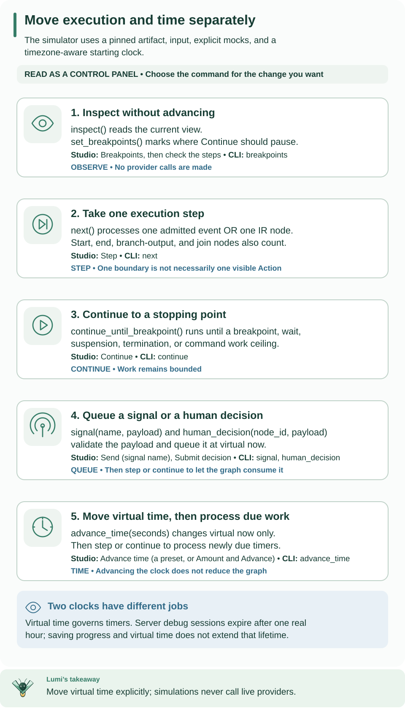

<!--
Copyright 2026 Firefly Software Foundation.

Licensed under the Apache License, Version 2.0 (the "License");
you may not use this file except in compliance with the License.
You may obtain a copy of the License at

    http://www.apache.org/licenses/LICENSE-2.0

Unless required by applicable law or agreed to in writing, software
distributed under the License is distributed on an "AS IS" BASIS,
WITHOUT WARRANTIES OR CONDITIONS OF ANY KIND, either express or implied.
See the License for the specific language governing permissions and
limitations under the License.
Author: Firefly Software Foundation
SPDX-License-Identifier: Apache-2.0
-->

# Simulate a workflow run without side effects

**Simulation** runs a compiled workflow step by step with fixed inputs, mocked
action results, and a virtual clock. It uses the same runtime reducer as real
runs, but it never calls a connector, worker, secret provider, or network. Use it
to see which path a run takes, what each step produces, and how waits, signals,
and human decisions behave, before you publish anything.

**Who it is for.** Process designers simulating in Studio, and authors and
integrators who script simulations from the CLI or Python. **What you need.** A
compiled artifact: follow [workflow authoring](../guides/workflow-authoring.md),
which creates `.local/tutorial/compiled/compiled-artifact.json` and
`.local/tutorial/simulation-request.json`. The CLI needs only the base
installation. Allow 15 minutes.

**What simulation does not prove.** A successful simulation does not show that
workers are running, connections are ready, or external systems behave as your
mocks claim. For a durable run with a database and history, use the
[local platform](../guides/local-platform.md) or the
[standalone tutorial](../guides/standalone.md).



Read the diagram as a control panel, not a sequence. Choose what you want to
change: observe, take one step, continue, queue a signal, or move virtual time.
Queuing a signal and moving time do not advance the graph by themselves; follow
either with a step or continue. Virtual time and a server session's real-time
expiry are independent.
[Open diagram at full size](../diagrams/authoring-simulation-controls.svg)

## Execute in Studio's new editor

With **Try the new editor** on, Studio simulates on its own host, on this
computer, instead of on the platform: **Execute step**, **Execute previous
steps** and **Execute workflow** (see the
[Studio guide](../guides/studio.md#execute-steps-and-read-the-run-log)).

- **What it compiles against.** What ships with Weave (the HTTP, email and file
  connectors and the AI action), the actions this workflow uses that Studio has
  (the ones it owns, before they are published), and, when connected, the
  project's catalog, read once with your session and kept for 30 seconds.
  Actions none of them has run on read-only stubs; decision tables are never
  stubbed. A definition on this computer with the same name and version as a
  different one in the catalog is refused.
- **What it uses as data, in order.** For a step that calls something, its
  pinned output (for one iteration, then for the step), otherwise its last
  result. The test input, or a sample of the input fields. The test answers of
  signals and human tasks, and the saved turns of AI tasks. Executing one step
  sends only the test data of the steps it runs, and a later step never stops
  it.
- **When it stops.** A step with no data blocks with "Step *ID* needs test
  data."; a signal or a person without a test answer blocks with "Send signal
  *name*" or "Decide for *ID*"; a step the test data doesn't reach says which
  path was taken; a deadline that passes fails the run at that step. Waits
  advance by themselves.
- **Secrets.** Test input, step mocks (in this workflow and in called
  workflows), signal payloads and decisions are checked against their schemas
  before anything runs; a value marked secret is refused with its location
  only, and never appears in an answer.
- **Step-through sessions.** With breakpoints, the host keeps a session in
  memory that the run log steps through with **Next** and **Continue**. A
  session's answers are checked the same way.
- **Limits.** One execution at a time, 30 seconds each; at most 4 sessions,
  each up to 16 MiB and closed after 30 minutes without use. Sessions end when
  you sign in, switch or sign out.
- **What reaches the platform.** Only the catalog read. Executing never starts
  a run or an activation, never publishes, and needs no `simulate` permission.

## Simulate in Studio

With **Try the new editor** off, in Studio, select **Simulate** on a workflow. Studio needs a connected platform
and an account with permission to simulate (the `developer` role grants it),
because it creates a real debug session on the platform (see
[Server sessions](#server-sessions)).

1. In **Simulate this workflow**, enter the run input under **Workflow input**.
   When the workflow calls actions, enter under **Action results** the result
   each action should return (its mock). Select **Skip this action** to leave an
   action without a result; the simulation stops when it reaches it.
2. Select **Start simulation**. The **Simulation** panel opens beside the
   canvas, in the inspector's place, and shows the status, the simulated time,
   and the current steps after **Now at**. The canvas highlights the current
   step, draws the path taken in color, marks finished steps with a check, and
   dims steps not reached. Editing is paused until you select **Stop
   simulation**.
3. Use **Step** and **Continue** to move on. To stop at chosen steps, open
   **Breakpoints** and check them; **Continue** pauses before each one. When the
   run waits, the panel's main button matches the wait: **Submit decision** for
   a human task, the send button under **Send a signal**, or a duration under
   **Advance time**.
4. Read **Step results**, **Workflow output**, and **Activity**. **Start over**
   returns to the setup.

**Simulate** is unavailable until Studio is connected to a platform and your
account may simulate in the workspace; select it and Studio says why under the
toolbar.

**This panel is new in 0.1.0a7;** an alpha6 or earlier Studio does not have it.
The [Studio guide](../guides/studio.md#simulate-a-run) describes the
panel; the rest of this page explains the commands it sends and how to run them
yourself.

## Run the echo artifact from the CLI

1. **Simulate to the end.** The request file holds the exact compiled artifact,
   the `mocks`, the `input`, and a timezone-aware starting time `now`:

    ```sh
    # Run the echo artifact until it finishes; nothing outside this process is called.
    weave workflow simulate .local/tutorial/simulation-request.json
    ```

    Expected: `Simulation succeeded; 1 accepted facts; 4 boundaries.` and exit
    code `0`. Without a command file, the CLI continues until a breakpoint, a
    wait, a suspension, or the end.

2. **Pause, step, and continue.** A **breakpoint** pauses before a named node so
   you can inspect its input and the current variables. Save this as
   `.local/tutorial/commands.json`:

    ```json
    [
      {"kind": "breakpoints", "node_ids": ["echo"]},
      {"kind": "continue"},
      {"kind": "next"},
      {"kind": "continue"}
    ]
    ```

    ```sh
    # Apply the commands in order within one invocation and print the final view as JSON.
    weave workflow simulate .local/tutorial/simulation-request.json \
      --commands .local/tutorial/commands.json --output json
    ```

    Expected: `"status": "succeeded"` and `"output": {"message": "Hello, Weave"}`
    inside `variables`. The first `continue` pauses before `echo`, `next`
    executes it, and the last `continue` runs to the end.

3. **Try a failure.** Change `input.message` in the request to a number and run
   step 1 again. Expected: exit code `1` and
   `WV-DEBUG-REQUEST: Invalid or over-budget simulation request.`, because the
   input violates `inputSchema`. Restore the string afterward.

With a command file, the CLI applies only your commands; it does not continue on
its own first. It exits `1` when the request is invalid or over budget, or when
the final status is `failed`, `suspended`, or `timed_out`.

## Mock actions, send signals, decide tasks, and move time

A **mock** is the fixed result an action returns instead of running. The
onboarding example from [workflow authoring](../guides/workflow-authoring.md#read-an-external-action-example-next)
calls an action, then waits for a `customer-approved` signal for up to one day.

1. **Compile it** from the repository root:

    ```sh
    # Compile the onboarding workflow against its teaching catalog and export the artifact.
    weave workflow compile examples/definitions/customer-onboarding.workflow.yaml \
      --catalog tests/fixtures/catalog/onboarding.lock.json --strict \
      --directory .local/onboarding --output json
    ```

    Expected: `ok: true` and `.local/onboarding/compiled-artifact.json`.

2. **Create the request** with Python 3.12 or later. Save this as
   `.local/make-onboarding-simulation.py` and run it with
   `python3 .local/make-onboarding-simulation.py`:

    ```python
    import json
    from pathlib import Path

    request = {
        "artifact": json.loads(Path(".local/onboarding/compiled-artifact.json").read_text()),
        "mocks": {"action:onboarding.check-customer@1.0.0": {"eligible": True}},
        "input": {"customerId": "demo"},
        "now": "2026-01-01T00:00:00Z",
    }
    Path(".local/onboarding-request.json").write_text(json.dumps(request))
    Path(".local/onboarding-approve.json").write_text(json.dumps([
        {"kind": "continue"},
        {"kind": "signal", "name": "customer-approved", "payload": {"approved": True}},
        {"kind": "continue"},
    ]))
    ```

3. **Stop at the wait.** Without commands, the simulation continues until the
   signal step waits:

    ```sh
    # Continue until the run waits for the customer-approved signal.
    weave workflow simulate .local/onboarding-request.json --output json
    ```

    Expected: `"status": "waiting"` with `"active_nodes": ["approval"]`. A wait
    is not a failure.

4. **Send the signal, then continue:**

    ```sh
    # Queue the approval at virtual now, then let the run consume it.
    weave workflow simulate .local/onboarding-request.json \
      --commands .local/onboarding-approve.json --output json
    ```

    Expected: `"status": "succeeded"` and `"output": {"accepted": true}`.

5. **See a timeout.** Replace the signal command with
   `{"kind": "advance_time", "seconds": 86400}` and run step 4 again. Expected:
   `"status": "timed_out"` and a `timed_out` event, because the signal did not
   arrive strictly before its one-day deadline.

You explored the declared contract without installing the action's
implementation.

### Command reference

| Command | Fields | Effect |
| --- | --- | --- |
| `breakpoints` | `node_ids`: complete node IDs or instance keys | Replace the breakpoint set; use IDs from `weave workflow explain`, including synthetic ones such as `@join:ID`. Inside a loop, a step ID stops every iteration and an instance key such as `send[2]` stops one. Inside a called workflow, prefix the call: `notify/record` (see [Simulate workflow calls](#simulate-workflow-calls)) |
| `next` | — | Process one boundary: one admitted event or one node, in the most deeply called workflow that has work |
| `continue` | — | Run until a breakpoint, a wait, a suspension, the end, or the command's work ceiling, through called workflows too |
| `step_out` | `frame` (optional) | Run until the called workflow returns its outcome to its caller; breakpoints still stop on the way. Without `frame`, the called workflow of the next boundary |
| `signal` | `name`, `payload`, `frame` (optional) | Validate the payload against the signal's schema and queue it at virtual now, in the called workflow `frame` names |
| `human_decision` | `name`: the human task step ID; `payload`: `{"decision": ..., "data": {...}}`; `frame` (optional) | Validate the decision and form data, then queue the completion |
| `advance_time` | `seconds`: whole number, zero or more | Move virtual time forward |

`signal`, `human_decision`, and `advance_time` return the current view without
advancing the graph. Follow them with `next` or `continue`. The CLI's `--help`
lists every command except `human_decision`, which works the same way.

**Mock keys.** Use `action:EXACT_REFERENCE`, such as
`action:onboarding.check-customer@1.0.0`, for every call to that action, or
`node:NODE_ID` for one action node. Inside a loop, `node:NODE_ID` answers every
iteration of the step, and `node:INSTANCE_KEY`, such as `node:send[2]`, answers
one iteration (see [Simulate loops](#simulate-loops)). The most specific key
wins: `node:INSTANCE_KEY`, then `node:NODE_ID`, then `action:EXACT_REFERENCE`.
Unknown keys and results that violate the pinned action or implementation output
schema are rejected before the simulation starts. A JSON list is one ordinary
result. There is no scripting of retry outcomes and no live fallback: an action
without a mock stops the simulation with `WV-DEBUG-MISSING_MOCK`, whose hint
lists the keys that would answer it.

**Calls to other workflows.** A simulation never starts a real run of another
workflow. A waiting **Call a workflow** step takes a `node:` mock for its whole
result, or runs the called workflow inside the simulation when the request
carries its artifact; see [Simulate workflow calls](#simulate-workflow-calls).

## Read the debugger view

Every command returns a view:

| Field | How to use it |
| --- | --- |
| `status` | `queued`, `running`, `paused` (at a breakpoint), `waiting`, `succeeded`, `failed`, `suspended`, `cancelled`, or `timed_out` |
| `selected_node` | The next ready node, or `null` when none is ready |
| `active_nodes` | Outstanding waits and tasks |
| `current_nodes` | `selected_node` and `active_nodes` together |
| `variables` | Current run data: `input`, step outputs under `steps`, and the final `output` |
| `diagnostics` | Debugger errors, such as a missing mock |
| `events` | Accepted facts, such as `started`, `task_completed`, or `signal_received` |
| `boundary`, `boundaries` | The last boundary processed, and all of them in order |
| `now` | Virtual time; waiting in your shell does not change it |
| `loops` | Workflows with loops only: one entry per loop instance (see [Simulate loops](#simulate-loops)) |
| `selected_scope` | Inside a loop body only: the `item`, `index` and `loops` values the selected step reads |
| `frames` | Workflows whose calls ran in the simulation only: one entry per call (see [Simulate workflow calls](#simulate-workflow-calls)) |
| `selected_frame` | Only while the next boundary belongs to a called workflow: that call's frame key |

Node IDs in `selected_node`, `active_nodes`, `current_nodes`, boundaries and
events are [instance keys](compiler.md#instance-keys): the step ID outside loops,
`send[2]` for iteration 2 of `send`. To continue from a wait, send the expected
signal or decision, or advance virtual time, then continue. An unknown breakpoint
ID is rejected.

## Simulate loops

A **Loop over items** (`forEach`) step runs its body once per element. A
simulation runs it exactly as a real run does: each iteration's steps have their
own instance keys (`send[0]`, `send[1]`), at most `concurrency` iterations run at
a time, and the results are collected in element order.

- **Mocks per iteration.** `node:send` answers every iteration of `send`;
  `node:send[1]` answers iteration 1 only and wins over `node:send` and over
  `action:` mocks. A key must give one position per enclosing loop, each below
  that loop's `maxItems`: `node:send[1][0]` for a step in one loop, or
  `node:send[10]` in a loop with `maxItems: 10`, is rejected with
  `WV-DEBUG-MOCK-KEY`.
- **Breakpoints per iteration.** A breakpoint on `send` stops before every
  iteration of `send`; a breakpoint on `send[1]` stops before iteration 1 only.
  The same position rules apply (`WV-DEBUG-BREAKPOINT`).
- **Loop progress.** `loops` lists every loop instance in definition order, an
  outer loop before the loops in its body:

    | Field | Meaning |
    | --- | --- |
    | `node_id` | The loop's step ID |
    | `instance_key` | The loop's instance key inside an outer loop (`cells[1]`), or `""` |
    | `count` | Elements in this run of the loop |
    | `completed` | Iterations whose results are collected |
    | `running` | Iterations started and not yet collected |
    | `next_index` | The position of the next iteration to start |
    | `status` | `running`, `joined` (all results collected), or `terminated` |

    An inner loop's entry disappears when its outer iteration finishes.
- **The item in scope.** When the selected step is inside a loop body,
  `selected_scope` holds what its expressions read: `item` and `index` of the
  innermost loop, and `loops` with `{item, index}` for every enclosing loop by its
  step ID.

For example, this request mocks every iteration of `send` with `7` and the second
one with `70`, and the commands stop before the second iteration:

```json
{"mocks": {"node:send": 7, "node:send[1]": 70},
 "commands": [{"kind": "breakpoints", "node_ids": ["send[1]"]}, {"kind": "continue"}]}
```

The view then shows `"selected_node": "send[1]"`,
`"selected_scope": {"item": 20, "index": 1, "loops": {"each": {"item": 20, "index": 1}}}`
for the input `[10, 20, 30]`, and a `loops` entry with `"completed": 1`. In
text output, the CLI prints one line per loop, such as
`Loop each: 1 of 3 items finished, 1 running.`

## Simulate workflow calls

A waiting **Call a workflow** step (`mode: wait`, the default) needs the called
workflow's result. A simulation gets it in one of two ways, and the first one
that applies wins:

1. **A mock for the whole call.** `node:CALL_ID` answers every run of the call,
   and `node:INSTANCE_KEY`, such as `node:notify[2]`, one iteration inside a
   loop. Under `onFailure: stop` (the default) the mock is the called workflow's
   output; under `onFailure: continue` it is the whole envelope the step returns,
   such as
   `{"status": "failed", "runId": "...", "error": {"code": "NO_CUSTOMER", "message": "Unknown customer."}}`.
   A success carries `output` and any other status carries `error`.
   `action:` keys never answer a call.
2. **The called workflow itself.** When the request's `workflows` gives the
   compiled artifact of the version the call names, the simulation runs that
   workflow in a **frame**: a simulated run with the call's input, its own
   mocks, signals and deadlines, and the session's virtual time. Its outcome
   reaches the caller as in a real run: the output, or the envelope; a failed
   run fails a caller that stops, and a cancelled or timed-out one opens
   `WV-CALL-INTERRUPTED` on it. A succeeded output is checked against the
   call's output schema first, as on a platform: a secret or unclassifiable
   value opens `WV-SCHEMA-SECRET_VALUE` or `WV-SCHEMA-CLASSIFICATION` on the
   caller instead. Sessions hold no files, so the platform's step of handing
   the child's files to its caller is skipped.

Without either, the simulation stops with `WV-DEBUG-MISSING_MOCK`, whose hint
names both. A detached call (`mode: detach`) never needs a mock: it continues at
once with `null`, and its frame runs when the artifact is given, even after the
caller finished; otherwise the call is listed with status `not_simulated`. A
caller that ends cancels the frames it waits for, and theirs.

**The request.** `workflows` maps each called version to its artifact and the
mocks used inside it. In this sketch, `send-receipt@1.0.0` stands for a called
workflow whose `send-mail` step runs an action:

```json
{"workflows": {"send-receipt@1.0.0": {"artifact": {"executable": "..."}, "mocks": {"node:send-mail": {"id": "m-9"}}}}}
```

Each artifact must be the version the call names, with the input and output
schemas the calling workflow was compiled against, and each entry must be a
version some call reaches (`WV-DEBUG-WORKFLOW`). Mocks inside a frame use the
same keys as top-level mocks, and apply to every run of that version. On a
platform, `"resolve_workflows": true` loads the published version of every
called workflow the request gives no artifact for, following the calls of
supplied and published versions alike; each must be the definition its caller
was compiled against. It needs the `catalog.read` capability as well as
`simulate`. From the CLI, pass each artifact with
`--workflow REF=ARTIFACT.json`.

**Stepping in and out.** Frames have keys: the call's instance key, joined with
`/` through nested calls (`notify`, `notify[2]`, `notify/audit`). `next` takes
one boundary in the most deeply called workflow that has work, so stepping past
a call steps into it. A breakpoint `notify/record` stops before `record` in
every run of the call `notify`, and `notify[2]/record` in one. `step_out`
continues until the called workflow's outcome reaches its caller, then stops
before the caller's next step.

For example, this compiles the two workflows under `examples/language/` and
simulates `order-intake`, whose `notify` call waits and whose `audit` call is
detached. Save it as `.local/make-call-simulation.py` and run it from a source
checkout with `uv run python .local/make-call-simulation.py`:

```python
import json
from pathlib import Path

import yaml

from firefly_weave.compiler.api import compile_source
from firefly_weave.compiler.catalog import CatalogSnapshot
from firefly_weave.contracts.definitions import load_definition

examples = Path("examples/language")
called = (examples / "notify-customer.workflow.yaml").read_text()
calling = (examples / "order-intake.workflow.yaml").read_text()
catalog = CatalogSnapshot.from_definitions([load_definition(yaml.safe_load(called))])
notify = compile_source(called, format="yaml", catalog=CatalogSnapshot.empty()).artifact
orders = compile_source(calling, format="yaml", catalog=catalog).artifact
folder = Path(".local/calls")
folder.mkdir(parents=True, exist_ok=True)
(folder / "notify-customer.json").write_bytes(notify.to_bytes())
request = {
    "artifact": json.loads(orders.to_bytes()),
    "input": {"customerId": "c-1", "orderId": "o-7", "tags": ["new", "web"]},
    "now": "2026-01-01T00:00:00Z",
}
(folder / "request.json").write_text(json.dumps(request))
(folder / "step-in.json").write_text(
    json.dumps([{"kind": "breakpoints", "node_ids": ["notify/record"]}, {"kind": "continue"}])
)
```

```sh
# Run both calls inside the simulation.
weave workflow simulate .local/calls/request.json \
  --workflow notify-customer@1.0.0=.local/calls/notify-customer.json
```

Expected: exit code `0` and

```text
Simulation succeeded; 2 accepted facts; 14 boundaries.
Called workflow notify (notify-customer@1.0.0): succeeded.
Called workflow audit (notify-customer@1.0.0): succeeded.
```

`boundaries` counts the boundaries of every frame; `accepted facts` counts the
calling workflow's own events. Without `--workflow`, the command exits `1` with
`WV-DEBUG-MISSING_MOCK` at `notify`. With
`--commands .local/calls/step-in.json`, it stops inside the called workflow and
prints `Ready: notify/record`; adding `{"kind": "step_out"}` to the commands
returns to `order-intake` with `steps.notify.output` set to
`{"status": "succeeded", "runId": "59475034-e4de-5a95-9d2e-23035f9fa906", "output": {"customerId": "c-1", "delivered": true}}`.
A frame's `runId` is fixed by its key, so it is the same in every simulation.

**The view.** Top-level fields keep describing the simulated workflow. The
caller's events include a `call_completed` event for each outcome a call
received, and `frames` lists each call that ran, in the order the calls
started:

| Field | Meaning |
| --- | --- |
| `key` | The frame key, such as `notify` or `notify[2]/audit` |
| `workflow` | The called version, such as `notify-customer@1.0.0` |
| `call_node` | The call's instance key in its caller |
| `mode` | `wait` or `detach` |
| `run_id` | The simulated run's ID, which the envelope's `runId` repeats; omitted when not simulated |
| `status` | The simulated run's status, or `not_simulated` |
| `selected_node` | The next node to reduce in this frame, or `null` |
| `active_nodes` | The frame's outstanding waits and tasks |
| `variables` | The frame's run data: its `input`, step outputs, and `output` |
| `loops` | The frame's loop instances, as for the simulated workflow |

Boundaries inside a called workflow carry `frame`. In text output, the CLI
prints one line per frame, such as
`Called workflow notify (notify-customer@1.0.0): succeeded.`, and exits `1`
when a called workflow its caller waits for is `suspended`, because that caller
would wait forever. A suspended detached call does not fail the command.

## Use the Python library

Embedders use the `Simulator` class. Run this from a source checkout with
`uv run python`, after creating the echo artifact:

```python
from datetime import UTC, datetime
from pathlib import Path
from firefly_weave.compiler.api import import_artifact
from firefly_weave.operations.debug.simulator import Simulator

artifact = import_artifact(
    Path(".local/tutorial/compiled/compiled-artifact.json").read_bytes()
)
sim = Simulator(artifact, mocks={}, input={"message": "Hello, Weave"},
                now=datetime(2026, 1, 1, tzinfo=UTC))
sim.set_breakpoints({"echo"})
paused = sim.continue_until_breakpoint()
assert paused.status == "paused" and paused.selected_node == "echo"
stepped = sim.next()
saved = sim.serialize()
sim = Simulator.restore(saved)
finished = sim.continue_until_breakpoint()
assert finished.status == "succeeded"
print(finished.variables["output"])
```

Expected: `{'message': 'Hello, Weave'}`. `serialize()` and `restore()` preserve
progress and virtual time; restoring starts no worker and changes no real run.

The methods are `inspect`, `set_breakpoints`, `next`,
`continue_until_breakpoint`, `signal`, `human_decision`, `advance_time`,
`command` (one command object), `serialize`, and `restore`. Creating a simulator
and inspecting it execute no nodes. Signal and decision data is validated before
it is queued.

## Server sessions

A **debug session** is a simulation stored on the platform, so Studio and other
clients can drive it across requests. Routes are project-scoped under
`/api/v1/tenants/{tenant}/projects/{project}`:

| Request | Body | Result |
| --- | --- | --- |
| `POST /debug/sessions` | The same `{artifact, mocks, input, now}` request, with optional `workflows` and `resolve_workflows` | `{id, revision, created_at, expires_at, view}`, starting at revision 1 |
| `GET /debug/sessions/{id}` | — | The current session |
| `POST /debug/sessions/{id}/commands` | One command from the table above | The next revision; requires `If-Match` with the current revision, for example `"1"` |

From the CLI, the typed commands are `weave runs debug create --request FILE`,
`weave runs debug read ID`, and
`weave runs debug command ID --revision N --request FILE`. They use your saved
platform and workspace; see
[how remote commands choose a platform](../guides/connect-to-api.md#how-remote-commands-choose-a-platform).
Saved platforms are new in 0.1.0a7; with an alpha6 or earlier CLI, these
commands use explicit mode only.

**Who may use a session.** Only its creator, with a current project `simulate`
capability (the `developer` role). No environment, activation, connection grant,
or worker release is needed. Each command locks the session, reloads current
grants, checks expiry by database time and the revision, then commits exactly one
new revision.

| Rule | Value |
| --- | --- |
| Lifetime | One hour from creation; virtual time and reads never extend it |
| Live sessions | At most 4 per creator and 16 per project; 1,000 retained per project |
| Stale revision | HTTP 409 `WV-DEBUG-REVISION` |
| Expired session | HTTP 410 `WV-DEBUG-EXPIRED` |
| Session size | 64 MiB serialized |

A new process restores the stored session; the server keeps no in-memory
simulator. The exact source envelope and source map are pinned, and filenames are
labels, never server file access. Expired sessions are retained until an operator
removes them with [retention](../operations/retention.md); nothing purges them
automatically.

## How execution advances

- **Boundaries.** Each `next` either admits one simulated event or reduces one
  node. Start, end, branch-output, and join nodes are visible boundaries too.
  Admitting an event increases the accepted sequence once; nodes never create
  extra receipts.
- **Actions.** Reducing an action node prepares an isolated task. The mocked
  completion is a later event, released only after that event's node queue has
  drained.
- **Breakpoints** use complete node IDs, including synthetic ones, or instance
  keys, and stop before effects. Continuing from a breakpoint consumes that stop
  once.
- **What is saved.** Ordered ready queues, event IDs, virtual timestamps, and
  boundary history survive serialization. Server IDs and wall-clock metadata are
  outside the comparable `view`.
- **Rollback.** If evaluation fails or an output is classified, every partial node
  change and command from that event is rolled back, while the prepared overall
  deadline is kept. Real runs drain this same reducer atomically; there is no
  second implementation of mapping or control flow.
- **Time order.** When several deadlines are due, the overall timeout wins, then
  signal timeouts, then duration waits ordered by due time and node ID. A signal
  must be accepted strictly before its deadline; at the deadline it is too late.
  Duration waits never wake early.
- **Suspension.** A suspension keeps the same deferred-event barrier as real runs.
  Kernel incidents leave the session `suspended`; a missing mock is a debugger
  failure and never creates a real worker incident.

## Limits

These operator-owned defaults (`DebugLimits`) apply to the CLI, the library, and
server sessions:

| Limit | Default |
| --- | ---: |
| Node reductions | 10,000 |
| Simulated events | 10,000 |
| Commands | 10,000 |
| Pending signals | 1,000 |
| Boundaries per `continue` | 10,000 |
| Total virtual time | 366 days |
| Depth of called workflows | 8 |
| Serialized session (artifact, mocks, state, queues, histories) | 64 MiB |

Source, compiler, and payload limits still apply. Authors cannot change these
limits through the workflow or a request; local embedding can pass its own
`DebugLimits`.

Frames share these limits with the simulated workflow: their boundaries,
events, signals and data count toward the same totals. A call deeper than the
depth limit refuses the command whole with `WV-DEBUG-LIMIT`.

Every command ends with a full check of these limits. While `continue` runs, the
serialized size is checked every 64 boundaries, or sooner once 1 MiB of new step
output and accepted facts has accumulated, so long loops simulate in time
proportional to their length. A command over a limit is refused as a whole and
keeps its starting state.

**Simulation can need more room than a real run.** A valid workflow can exceed
the session budget: in a measured case, 80 transforms copying a 900,002-byte
input reached 65,767,814 serialized bytes after 37 boundaries, and the next
command was rejected by the 67,108,864-byte ceiling. `WV-DEBUG-LIMIT` is a
debugger capacity error, not a sign that the workflow is invalid. A rejected
command keeps its starting state and server revision; `continue` that reaches its
work ceiling returns its progress so another command can resume.

**Secrets.** Secret-marked values are rejected at the same admission points as in
real runs; no masked value is executed. Unmarked data remains the author's to
classify and the operator's to protect. Errors never include rejected payloads or
fingerprints.

## Next steps

- [Studio: Simulate a run](../guides/studio.md#simulate-a-run): the same commands
  from the editor.
- [Compile workflows and read the results](compiler.md): produce the artifact and
  find node IDs.
- [Human tasks](../guides/human-tasks.md): assignments and decisions on a real
  platform.
- [Recorded history and offline replay](history-and-replay.md): check a real run
  after it happened.

## Troubleshooting

| What you see | Why | What to do |
| --- | --- | --- |
| `WV-DEBUG-REQUEST` from the CLI | The request file is not valid JSON, misses a field, or its input or mocks violate a schema | Check `artifact`, `mocks`, `input`, and a `now` with a time zone |
| `WV-DEBUG-COMMAND` | The command file is not a JSON array, or a command lacks the field its kind needs, such as a `signal` without `name` | Check each command against the [command reference](#command-reference) |
| `WV-DEBUG-MISSING_MOCK`, status `failed` | An action has no mock (in Studio, **Skip this action** was selected) | Add a mock under one of the keys in the diagnostic's hint |
| `WV-DEBUG-MISSING_MOCK` at a **Call a workflow** step | The step waits for another workflow, and the request has neither a mock for the call nor the called workflow's artifact | Add a `node:` mock for the call, or the artifact under `workflows` (`--workflow` in the CLI); see [Simulate workflow calls](#simulate-workflow-calls) |
| `WV-DEBUG-MOCK-KEY` | A mock key names no action node or waiting call in this artifact, or no iteration of it (detached calls and `action:` keys for calls take no mocks) | Use `action:EXACT_REFERENCE`, `node:NODE_ID` or `node:INSTANCE_KEY` with one position per enclosing loop, below its `maxItems` |
| `WV-DEBUG-WORKFLOW` | A `workflows` entry is not a version any call reaches, has no artifact, or its artifact is another version or has other input or output schemas; `resolve_workflows` reached a version this project never published, or one whose published definition differs from the one its caller was compiled against; `resolve_workflows` was set in a request to the CLI, which has no published versions; or a stored session has a frame of a version it does not carry | Compile the exact version the call names; on a platform, publish it or pass its artifact; from the CLI, pass `--workflow` |
| `WV-DEBUG-FRAME` | `step_out`, `signal` or `human_decision` named a frame that does not exist or is not simulated, or `step_out` had no called workflow to leave | Use a `key` from `frames` |
| `WV-IR-UNSUPPORTED` (HTTP 422 on a server) | The workflow uses a language feature this version does not run; a server names it in `result.missing_features`, and `weave workflow simulate` in its message (`Missing language features: flow.forEach.`) | Upgrade the platform or CLI, or simulate on one that runs the feature |
| `WV-DEBUG-MOCK-OUTPUT` | The mock does not match the action's output schema | Fix the mocked result |
| Status `waiting` | The run waits for time, a signal, or a person | Send the signal or decision, or advance time, then continue |
| `WV-DEBUG-SIGNAL` | No step waits for a signal with that name | Use the `name` declared on the **Wait for signal** step |
| `WV-DEBUG-HUMAN-TASK` | That human task is not waiting for a decision now | Continue until it is active, and use its step ID as `name` |
| `WV-DEBUG-STATE` | The simulated run already finished | Start a new simulation |
| `WV-DEBUG-BREAKPOINT` | A breakpoint names a node that does not exist, or no iteration of it, or a path through a step that is not a call or a call whose workflow the session does not have | Use complete IDs from `weave workflow explain`, or instance keys with one position per enclosing loop, prefixed with the frame keys of the calls |
| `WV-DEBUG-TIME` | `advance_time` was negative or not a whole number | Use whole seconds, zero or more |
| `WV-DEBUG-LIMIT` | A simulation limit was reached | Use a smaller input, or advance time in smaller amounts |
| HTTP 409 `WV-DEBUG-REVISION` | The session changed in another window or request | Read it again and send the current revision |
| HTTP 410 `WV-DEBUG-EXPIRED` | The session is older than one hour | Start a new session |
| HTTP 429 `WV-OPERATION-CAPACITY` when creating a session | You already have 4 live sessions, the project has 16, or the project retains 1,000 sessions, expired ones included | Wait until a live session expires, at most one hour after it was created; at the 1,000 limit, ask an operator to remove expired sessions with [retention](../operations/retention.md) |
